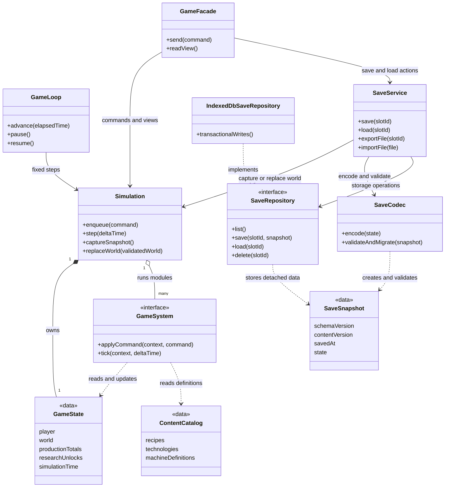
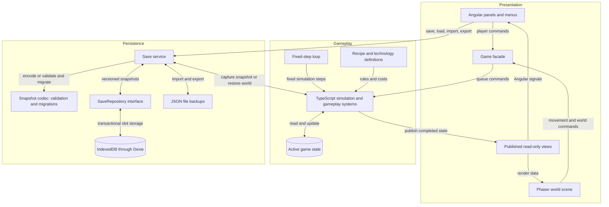
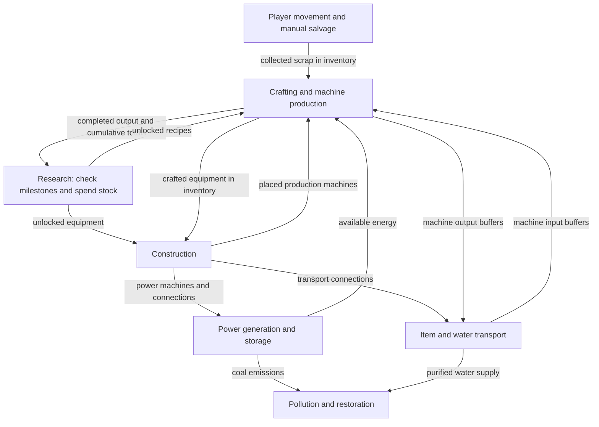

# Scrapworks Technical Design Document

Updated 4 October 2026.

This document describes the implemented integration and planned gameplay/persistence architecture for Scrapworks. Angular, Phaser, RxJS, Angular signals, and Dexie are installed. The renderer lifecycle is implemented; authoritative gameplay and complete world saves remain planned. Gameplay rules, progression, environmental mechanics, and prototype scope are covered in the [Game Design Document](GDD.md).

The [Implementation Plan](../plans/README.md) turns this design into milestones you can follow yourself, with additional diagrams for module dependencies, the fixed-step loop, save and load operations, and research validation.

## Agreed technical requirements

- Use Angular for the web application.
- Maintain player and world state so the player can save and load progress.
- Save and load locally in the browser for the prototype.
- Accommodate future accounts and cloud saves, with their implementation deferred.

## Technical stack and current implementation

| Responsibility            | Choice                  | Current implementation                                                                          |
| ------------------------- | ----------------------- | ----------------------------------------------------------------------------------------------- |
| Application and interface | Angular                 | Standalone shell, lazy game page, and CDK save/load dialog; gameplay panels are future work     |
| World presentation        | Phaser                  | Boot, loading, menu, and placeholder Game scenes; component-owned canvas and resizing           |
| Client subscriptions      | RxJS                    | BehaviorSubject replay and unsubscribe behind the plain GameClient interface                    |
| Gameplay simulation       | Plain TypeScript        | Independent queue scaffold and smoke test; world state and fixed-step rules are not implemented |
| Interface reactivity      | Angular signals         | Readonly lifecycle state and computed readiness, loading, scene, and error values               |
| Local persistence         | IndexedDB through Dexie | Test-data service only; gameplay snapshots and repository adapters are not implemented          |

Phaser is the installed rendering library for the sprite-based presentation specified in the [Art Document](../art/README.md). Camera, projection, style, and sprite specifications belong to that document. See the official [Phaser overview](https://docs.phaser.io/phaser/getting-started/what-is-phaser), [Phaser templates](https://docs.phaser.io/phaser/getting-started/project-templates), [Angular signals](https://angular.dev/guide/signals), [IndexedDB](https://developer.mozilla.org/en-US/docs/Web/API/IndexedDB_API), and [Dexie Angular](https://dexie.org/docs/Tutorial/Angular) documentation.

## Technical structure diagrams

These diagrams describe the proposed complete gameplay architecture, not a list of implemented classes. GameFacade, GameLoop, gameplay systems, SaveCodec, and SaveRepository remain future work. Data boxes represent plain TypeScript records, not Angular services or Phaser objects. The diagram's GameState is a proposed gameplay record; the implemented `src/contracts/game-state.ts` describes renderer lifecycle. Use a separate WorldState when implementing the authoritative world.

### Core class diagram

This diagram shows ownership and dependencies. `Simulation` owns the live world, `GameFacade` provides the presentation boundary, and `SaveService` handles persistence. `GameSystem` represents separate modules for movement and salvage, construction, crafting and machine production, transport, power, research, and pollution and restoration. It does not represent one class containing all those rules.

[SVG image](../diagrams/core-class-diagram.svg) / [PNG image](../diagrams/core-class-diagram.png) / [Mermaid source](../diagrams/src/core-class-diagram.mmd)

A filled diamond means ownership, a hollow diamond means a collection of modules, a dotted arrow means a dependency, and the hollow triangle means interface implementation. Presentation receives read-only views. Only the simulation and its gameplay modules change live gameplay state.

### Application system interaction diagram

This is a component and data flow diagram: it shows where commands, state, and saves travel. The fixed-step loop advances gameplay independently of the rendering frame rate. Signals hold the selected UI view of state rather than a second authoritative world.

[SVG image](../diagrams/system-interactions.svg) / [PNG image](../diagrams/system-interactions.png) / [Mermaid source](../diagrams/src/system-interactions.mmd)

Commands are checked and applied inside the simulation. At a completed step, it publishes views and can supply a detached save snapshot. Storage writes happen asynchronously; saving succeeds only after the repository commits the transaction. Loading validates and migrates data, constructs a candidate world, and replaces the active world at a safe step boundary only after all checks pass. An invalid load leaves the current session intact.

A future cloud repository can implement `SaveRepository`. Accounts, synchronization, and conflict handling remain later work; they are not needed by the prototype simulation.

### Gameplay system interactions

This closer view shows the dependencies between gameplay systems. Arrows describe resources and rules shared through `GameState`; they do not require the systems to call each other or maintain duplicate inventories. Construction establishes the machines and connections that power, transport, and production subsequently use.

[SVG image](../diagrams/gameplay-interactions.svg) / [PNG image](../diagrams/gameplay-interactions.png) / [Mermaid source](../diagrams/src/gameplay-interactions.mmd)

Production increases cumulative totals only when a craft or machine output completes. Transport and collection move existing items without increasing those totals. Research checks production milestones, current stock, and prerequisites, then consumes the stock and grants the unlock together. Production and construction both enforce the resulting unlocks. Pollution and restoration combine industrial emissions, supplied water, and simulation time to update pollution, vegetation, and greenhouse health.

The dependency arrows do not prescribe tick order. Commands are processed in a consistent order, then systems advance using an explicit schedule that resolves transport, power allocation, production, and environmental updates. Exact ordering and rules for newly produced items or power are implementation decisions to settle before the first playable prototype.

## State ownership and module boundaries

Keep the factory simulation and its rules separate from character input and visual presentation. The simulation owns the authoritative player and world state, with separate modules for crafting, research, transport, power, and restoration. Angular and Phaser send commands to the same game rules and display the resulting state. Future remote control can reuse those construction rules.

Angular owns the application shell and menus, and will own inventory, crafting, research, and status panels. Phaser owns rendering, cameras, visual effects, and input collection. Signals expose renderer lifecycle now and will expose selected simulation views without duplicating the authoritative factory state or forcing every world object through Angular components.

The source boundary is `src/app/features/` for Angular integration, `src/game/` for Phaser presentation, `src/contracts/` for plain bridge types, `src/simulation/` for authoritative rules, and `src/core/` for framework-independent utilities. Keep simulation, contracts, and core free of framework and storage imports. The present Player moves directly through Phaser frames and must hand authoritative movement to the simulation in Milestone 3.

GamePageComponent provides its runtime to itself and the renderer-neutral GameViewport child. The runtime owns a GameClient subscription, publishes readonly signals, guards stale callbacks across remounts, and cleans up through component unmounting and DestroyRef. The factory returns the interface; both concrete clients stay under `src/game/`. The regular route uses PhaserGameClient and `/3d` uses BabylonGameClient for the completed Phase 1 prototype. Phaser's per-game events report loading, ready, stopped, and error states, with listeners attached before application scenes start. Babylon publishes these plain states around asynchronous asset loading and the first rendered frame, disposes stale loads, and supports error retry through remounting. None of this lifecycle state is a saved gameplay world. See the [3D migration plan](../plans/3d-migration.md) for the remaining migration phases.

Production history and research unlocks belong to the simulation and saved world state. A research action must check eligibility, deduct the required materials, and grant the unlock together, without changing production history or charging again for completed research. Both crafting and placement must enforce technology unlocks. Research gameplay requirements are defined in the GDD.

## Simulation timing and save boundaries

Use fixed simulation steps with rendering handled separately. A completed step provides a consistent point to capture a save. Exact tick rates should follow prototype measurements.

Implement the proposed pause and resume behaviour described in the GDD: pause when the game is hidden or closed, then resume from the saved simulation time without offline production.

## Persistent game state

Keep active gameplay state in memory. Save a versioned data snapshot containing:

- Player position, inventory, and crafting queues.
- Remaining deposits, placed machines, and connections.
- Machine buffers, work progress, and items in transit.
- Stored energy and water.
- Cumulative production totals and research unlocks.
- Pollution, vegetation, and simulation time.

Store identifiers and data rather than Angular services or Phaser objects. Recipe and technology definitions belong to the game content; saves reference their identifiers and record a compatible content version.

## Local storage and save operations

Use the installed Dexie integration for IndexedDB persistence. The current service stores development test records; it has not yet proved a reload round trip or restored gameplay. Implement complete snapshots and a SaveRepository in Milestone 4, then periodic autosaves and retained revisions in Milestone 9.

Write each snapshot and its metadata together in a transaction. Report save success only after the write completes, and preserve the last successful revision if a later write fails. Avoid relying on a final save when the tab closes.

## Save format and loading

Give saves stable identifiers, a schema version, a game or content version, and a saved timestamp. Validate a loaded or imported snapshot, migrate supported older schemas, and construct the restored world before replacing the active session. Unsupported newer versions or invalid data should leave the active world and existing saves intact.

Database schema changes and game save migrations are separate concerns.

## File backups and browser storage limits

Provide JSON file export and import as a proposed backup and transfer option. Browser storage is local to the browser profile and website origin; clearing site data can remove saves, and best-effort storage can be evicted. Request persistent storage where supported, but retain file backups because that request may be denied and users can still clear stored data. These limits are documented in [MDN browser storage guidance](https://developer.mozilla.org/en-US/docs/Web/API/Storage_API/Storage_quotas_and_eviction_criteria).

## Future cloud persistence

Keep persistence behind a small save repository interface for listing, loading, saving, and deleting slots. Implement the local IndexedDB repository first. A future cloud repository can use the same versioned snapshot format, while accounts, synchronization, and conflicting revisions remain separate future work. This does not require a backend for the initial prototype.

## Initial verification requirements

The first implementation checks should cover:

- Saving and loading a running factory without changing inventory, research, production totals, or machine progress.
- Continuing the simulation with the same results after restoration.
- Migrating supported older save schemas.
- Invalid saves or failed writes preserving the last usable state.
- Research consuming the required materials exactly once while retaining cumulative production totals.
- Crafting and placement rejecting equipment whose technology has not been researched.
