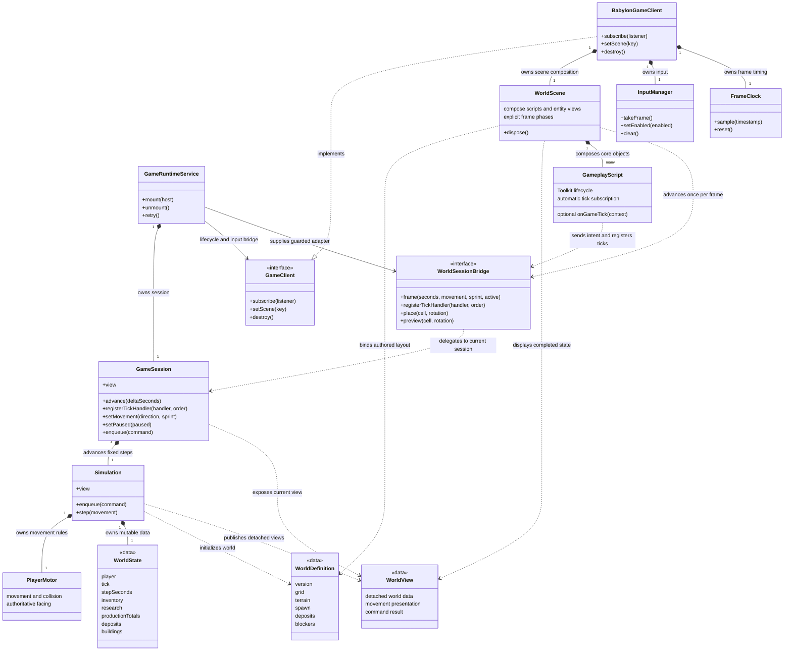
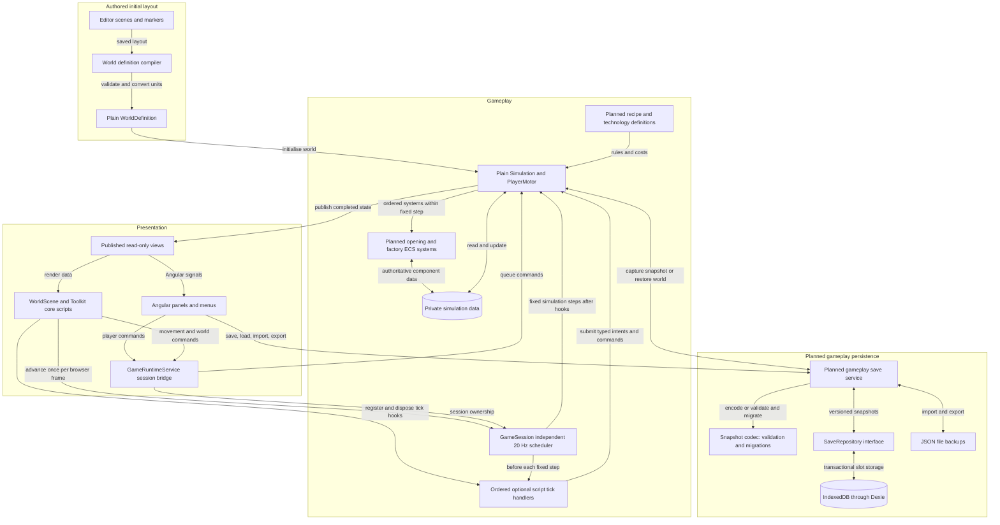

# Scrapworks Technical Design Document

Updated 28 October 2026 for the agreed UI-bound handcrafting cancellation/refund boundary. Core-object/session implementation is unchanged. Planned state, research, random recycling, renewable power and recovery requirements now follow the agreed progression design; migration evidence remains dated separately.

Scrapworks uses Angular for UI and Babylon.js with Babylon.js Editor for its 3D world. A plain authored-world definition and fixed-step movement session now connect scene presentation to authoritative state. Manual/factory rules and versioned world saves remain planned. The [GDD](GDD.md) and [player progression design](player-progression.md) own gameplay rules; the [roadmap](../plans/README.md) orders implementation.

## Agreed technical requirements

* Keep the game browser-first, with Angular UI and a fully 3D world/character.
* Author scenes and world layout in one Scrapworks Editor project; attached scripts handle presentation and scene bindings.
* Keep authoritative gameplay in plain TypeScript and save progress locally through versioned data snapshots.
* Defer accounts/cloud saves, remote control, physics, and navigation systems until a defined requirement needs them.

## Technical stack and current implementation

| Responsibility      | Choice                         | Current implementation                                                                                    |
| ------------------- | ------------------------------ | --------------------------------------------------------------------------------------------------------- |
| Application and UI  | Angular 22, signals, CDK       | Shell, shared page/viewport, dialogs, lifecycle views, errors and retry. Gameplay panels remain planned.  |
| 3D presentation     | Babylon.js 9.30.0              | Sole renderer at `/`, with `/3d` compatibility redirect; authored scene bindings and runtime character presentation. |
| Core object scripts | Babylon Toolkit 9.30.0        | TypeScript-attached scripts own player input/presentation, camera, selection and placement; no physics engine is enabled. |
| Authoring           | Babylon.js Editor 5.5.2        | Saved inputs export/reload automatically; validated marker metadata compiles into a plain world definition. |
| Client subscription | RxJS behind plain `GameClient` | Per-client replay, unsubscribe, mounting and asynchronous transition guards.                              |
| Gameplay            | Plain TypeScript               | Private plain WorldState, typed placement command, deterministic 20 Hz movement, collision and detached views. Manual/factory progression remains planned. |
| Persistence         | Dexie / IndexedDB              | Test-data service/dialog only; no playable-world snapshot or round trip.                                  |

The [cleanup record](../plans/3d-cleanup.md) defines current asset boundaries and retired-source recovery. The [Editor setup guide](../plans/babylon-editor-setup.md) owns export/MCP commands. The [Art Document](../art/README.md) owns camera and visual-production requirements.

## Technical structure diagrams

The class diagram describes the implemented migration boundary. The application diagram separates the current movement/session path from planned factory content and gameplay persistence; the final gameplay diagram remains the future design. Angular services, Babylon objects and Editor components stay outside plain state records. `GameState` describes renderer lifecycle and is separate from authoritative `WorldState`.

### Core class diagram

The application runtime owns one `GameSession`; its scheduler advances `Simulation` through the renderer's existing frame callback. `Simulation` exclusively owns `WorldState` and delegates authoritative player movement to plain [`PlayerMotor`](../../src/simulation/player-motor.ts). [`WorldScene`](../../src/game/views/world-scene.ts) composes Toolkit scripts and entity views that consume the initial definition and detached `WorldView` values. [`WorldSessionBridge`](../../src/contracts/game-client.ts) connects these scene objects to the application-owned session without exposing its mutable state.

[SVG image](../diagrams/core-class-diagram.svg) / [PNG image](../diagrams/core-class-diagram.png) / [Mermaid source](../diagrams/src/core-class-diagram.mmd)

A filled diamond means ownership, a dotted arrow means a dependency, and the hollow triangle means interface implementation. Presentation receives detached read-only views; simulation alone changes live world data.

### Application system interaction diagram

This is a component and data flow diagram: it shows where commands, state, and saves travel. The fixed-step loop advances gameplay independently of the rendering frame rate. Signals hold the selected UI view of state rather than a second authoritative world.

[SVG image](../diagrams/system-interactions.svg) / [PNG image](../diagrams/system-interactions.png) / [Mermaid source](../diagrams/src/system-interactions.mmd)

Commands are checked and applied inside the simulation and completed state is published as detached views. Gameplay snapshot capture/replacement and the persistence branch are planned. Their eventual implementation must await committed transactions, validate a separate candidate world and preserve the active session on failure. The existing test-data save dialog does not implement this branch.

A future cloud repository can implement `SaveRepository` . Accounts, synchronization, and conflict handling remain later work; they are not needed by the prototype simulation.

### Gameplay system interactions

This closer view shows the dependencies between gameplay systems. Arrows describe resources and rules shared through `WorldState` ; they do not require the systems to call each other or maintain duplicate inventories. Construction establishes the machines and connections that power, transport, and production subsequently use.

[SVG image](../diagrams/gameplay-interactions.svg) / [PNG image](../diagrams/gameplay-interactions.png) / [Mermaid source](../diagrams/src/gameplay-interactions.mmd)

```mermaid
flowchart TB
    Player[Player movement and manual salvage]
    Production[Power-free MiniFab and factory production]
    Research[Timed field and scalable lab research]
    Construction[Construction]
    Transport[Direct transport and output sorting]
    Power[Solar and wind first; optional coal and storage]
    Environment[Greenhouse terraforming and pollution]
    Extraction[Resource extraction and history]
    Recovery[Solid recovery to scrap or source ores]
    Winding[Optional winding and local MiniFab charge]

    Player -->|collected scrap in inventory| Production
    Player -->|inventory contributions and field work| Research
    Extraction -->|raw materials and extraction history| Production
    Extraction -->|raw-resource eligibility| Research
    Production -->|completed output and cumulative totals| Research
    Research -->|unlocked recipes| Production
    Research -->|unlocked equipment| Construction
    Production -->|crafted equipment in inventory| Construction
    Construction -->|placed production machines| Production
    Construction -->|extraction equipment| Extraction
    Construction -->|transport connections| Transport
    Construction -->|power machines and connections| Power
    Transport -->|machine input buffers| Production
    Production -->|machine output buffers| Transport
    Power -->|factory power and later MiniFab boosts| Production
    Winding -->|bonus speed with power-free baseline| Production
    Power -->|green contribution and optional emissions| Environment
    Research -->|greenhouse and mitigation unlocks| Environment
    Transport -->|purified water supply| Environment
    Construction -->|dismantled equipment and contents| Recovery
    Recovery -->|scrap or source ores without new history| Production
```

Production increases cumulative totals only when craft/machine output completes. Newly extracted resources have separate history; transfers, existing-output collection and refunds add neither history. Timed field and lab research validate prerequisites/eligibility and contribute materials exactly once, then grant the unlock when funded work completes. Enabled Field Research consumes uncommitted inventory gradually in the background, waits/resumes on shortages and preserves per-technology contributions/work on pause or switch. Consumed research materials are non-refundable; each paced cycle atomically consumes one of every still-required material, with all-input availability required and no overspending a completed material cost. Production, Mini Fabricator precursor planning and construction enforce unlocks. Greenhouses initiate restoration; green technology and optional pollution influence greening without a fail state or research lockout.

The dependency arrows do not prescribe tick order. For the Milestone 3 opening, manual commands/current handcraft input commitment have priority, followed by requested MiniFab input draws and then Field Research consumption of remaining uncommitted stock. Revalidate each atomic spend; paused/blocked work gains no hidden progress. The larger transport/power/environment schedule and freshly produced machine-output availability are later Milestone 6 integration work, not unresolved opening gameplay design.

### Planned opening-state expansion

The current simulation foundation exposes count-map inventory and string-array equipment/research with a placement-only command. Milestone 3 will introduce real bag slots, equipped-tool capacity, recoverable ground items, extraction history, per-technology consumed-material/work records and MiniFab buffers/jobs/charge through plain commands/state/detached views. Keep authored WorldDefinition, mutable WorldState and renderer GameState distinct. Author a versioned checked-in plain content catalogue from the agreed source IDs; Fibery/import receipts are design inputs, not runtime dependencies. This is implementation scope and does not imply those systems exist.

### Planned handcrafting cancellation boundary

Safe handcrafting runs only while its UI is visible; the adapter publishes intent/visibility and the plain simulation owns progress, input commitment, cancellation and refunds. Preflight checks output space after actual per-unit input consumption. The batch protects result/refund capacity across units and its exit warning; other additions/transfers and MiniFab deliveries wait. Enabled Field Research is a consume-only exception after player commands: take uncommitted stock only, never current craft inputs or protected capacity. Research may use finished outputs and affect later batch affordability, so revalidate each next unit. Idle crafting UI does not protect inventory. Warn/suspend before intentional exit; confirmed exit or forced teardown cancels unfinished work, refunds original inputs exactly once and releases protection afterward. Research withdrawals cannot occupy refund space, so refunds never spill. Load/world replacement resolves unseen handcraft cancellation before research draws/other writers. Supplied MiniFab work may finish and hold output. See [the progression rules](player-progression.md#handcrafting-and-interruption).

### Planned inventory capacity and salvage overflow

Inventory has 24 bag slots, a separate equipped-tool slot and no weight metric. Item definitions own stack caps (initially 100 for simple materials); player reach starts at a 2 m ground-plane radius and capacity/reach can grow later. Salvage atomically debits the deposit, inserts what fits and creates recoverable ground resources for the remainder, with an inventory-full notice. Count newly extracted quantity once across both destinations; pickup adds no history. Ground IDs, types, quantities and positions belong in plain world/snapshot state.

Handcrafting checks its inventory destination after actual per-unit input consumption. MiniFab instead starts against actual input/output buffer capacity: ingest one complete operation from uncommitted inventory just before work, directly reuse eligible precursor output and commit new production once into its output buffer. Delivery/direct reuse is only a transfer. Initial buffers hold one operation's ingredients/result (including a recipe's multi-output batch); capacities upgrade later toward item stacks. When output is full and bag delivery fails, retain output and pause/notify/resume. A validated next-input ingestion may precede held-output delivery if it genuinely frees sufficient bag capacity; buffered/partial-stack consumption cannot invent a freed bag slot. Player commands precede automatic intake/delivery; active handcraft capacity protection defers those bag transfers while already supplied MiniFab work may continue. Salvage overflow remains ground drops; MiniFab never spills. See [the capacity rules](player-progression.md#inventory-interaction-range-and-overflow).

## State ownership and module boundaries

The simulation owns authoritative player/world state, movement, collision and placement validation. Planned crafting, research, transport, power and restoration modules will join this boundary. Angular and Babylon send commands to the same session and display published views. Scene frames, animation callbacks, and UI handlers must not advance production or directly spend inventory.

Angular owns the shell, menus, dialogs, controls and future gameplay panels. Babylon owns rendering, cameras, picking, visual effects, animation, and input adaptation. Signals expose lifecycle, selection and detached world views without becoming an authoritative world owner.

Use `src/app/features/` for Angular/session integration, `src/game/` for 3D presentation, `src/contracts/` for plain boundaries, `src/simulation/` for authoritative rules, and `src/core/` for framework-independent utilities. Simulation/contracts/core remain free of framework, storage, DOM, and wall-clock dependencies. Phaser source and its package dependency have been removed.

The Editor owns saved cameras, lights, materials, static geometry, and world markers in `assets/`. The compiler in `tools/world/` extracts marker metadata into versioned `WorldDefinition` records without executing attached scripts, validates IDs, bounds, alignment, footprints and hierarchy transforms, and converts centimetres to metres on X/Z. Mutable `WorldState` belongs exclusively to the simulation; detached views cross into presentation. Scene serialization and attached components are not gameplay saves.

`GamePageComponent` provides a scoped runtime and directly owns the renderer host. The runtime owns its `GameClient` subscription, readonly signals, generation guards, mount/unmount, retry, and application session. Babylon owns one engine/frame callback, scene assets, resize observation, transition guards, first-frame readiness and late-load disposal. Its frame advances the application-owned scheduler; no independent simulation timer is started. See the [migration plan](../plans/3d-migration.md) for current lifecycle acceptance and the [dated Phase 2 walkthrough](../plans/3d-phase-2-walkthrough.md) for implementation history.

### Core object scripts

`@babylonjs-toolkit/next` is pinned to 9.30.0 alongside Babylon 9.30.0. Core scripts are constructed and attached in TypeScript; the Editor continues to own scenes, layout and visual bindings. Toolkit owns initialization, render updates, late updates and destruction. Physics callbacks are reserved for future physics features; Havok and physics-based scheduling are not part of this integration.

The adapter uses Toolkit's public `SceneManager.AttachScriptComponent` registration directly. It deliberately omits `InitializeRuntime`, which installs global glTF loader overrides that these code-attached scripts do not need. Native startup calls `awake` on the first render, `start` on the second and `update` from the third. The client waits for script initialization before reporting Game ready. No component lifecycle method is invoked manually.

| Responsibility | Owner |
| --- | --- |
| Shared movement and sprint input | `PlayerController` interprets the frame's shared `ActionFrame` and submits plain intent. |
| Authoritative position, collision and facing | Session-owned `PlayerMotor` in plain simulation code. |
| Character rig, interpolation, turning and animation | `PlayerView`. |
| Orbit, zoom, following and occlusion | `CameraController`. |
| Picking and interaction feedback | `SelectionController`. |
| Build mode, rotation, preview and confirmation | `PlacementController`. |
| Entity meshes and materials | Individual view objects, synchronized by entity ID. |

`WorldScene` is the composition root for those objects. `BabylonGameClient` retains browser/render lifecycle responsibilities rather than gameplay-feature branches. The integration defines frame phases explicitly, so incidental construction or array order does not determine behavior:

1. Sample one shared `ActionFrame`, dispatch application/UI actions, and validate ownership.
2. Run camera controls and player input interpretation.
3. Advance the session once, executing zero to five gameplay ticks.
4. Publish completed world state and update player/entity presentation.
5. Follow the player, update occlusion, pick the world and update placement feedback.
6. Draw the scene.

[`attachScriptsInOrder`](../../src/game/toolkit/attach-scripts-in-order.ts) sorts explicit numeric phases before native Toolkit registration. During one `scene.render()`, native `update` runs camera controls (10), player interpretation (20), `SessionDriver` advancement/publication (30), player presentation (40) and entity presentation (50). Native `late`, before render targets are drawn, runs camera follow/occlusion (10), selection (60) and placement feedback (70). The script ordering belongs to the composition root; optional gameplay tick ordering belongs separately to the session.

Generation, transition and input-revision checks invalidate remaining work when ownership changes during a frame. Scene destruction unregisters scripts before disposing their assets; asynchronous Inspector closure remains ahead of scene/engine disposal. Cancelled loads cannot attach scripts or publish into a newer scene. A healthy session survives viewport recreation and renderer-only Retry. A failed authoritative session exposes only its last completed state and is recreated on explicit Retry.

[`GameplayScript`](../../src/game/toolkit/gameplay-script.ts) guards callbacks against stale ownership and observes both node and scene disposal. Its idempotent teardown calls public `SceneManager.DestroyScriptComponent`: Toolkit 9.30.0's base `ScriptComponent.dispose()` is empty. Native destruction then removes the application's tick subscription and disposes the script's owned resources.

### ECS foundation from Milestone 3

Architecture revision, 28 October 2026: adopt ECS for the opening simulation before inventory, salvage, research and crafting are implemented. [Milestone 3 Step 0](../plans/milestone-03-character-and-manual-opening.md#step-0-establish-and-prove-the-ecs-foundation) selects/proves the library and establishes its actual runtime. [Milestone 6](../plans/milestone-06-first-working-machines.md) adds factory entities/power/processing to that same foundation. The [ECS laboratory](../../tools/ecs-bench/README.md) now pins four development-only candidates for synthetic Node/Chromium investigation; it does not implement an ECS in production Simulation or grant gameplay implementation credit.

The [29 October ECS investigation](../reports/ecs/2026-10-29/README.md) selects **Miniplex 2.0.0**. Miniplex and bitECS meet the 100,000-entity combined simulation/publication budget in both environments; Miniplex has the simpler verified integration. Only comparison and workload evidence are complete. Production runtime ownership, components/resources, commands and view integration remain Step 0 implementation work.

- **Single authority:** Simulation owns one ECS runtime, component stores and explicit world resources. Component values remain plain gameplay data; queries/indexes/library handles are private runtime machinery. The existing WorldState interface is the current scaffold, not a requirement to maintain a parallel mutable object graph. WorldView is a detached projection, not another writable world. WorldDefinition remains authored initialization; renderer GameState remains lifecycle state.
- **Opening composition:** meaningful entities include the player/inventory owner, deposits, ground piles and personal processing jobs/devices. Components hold position/owner links, bag/equipment, work/reservations, buffers/capabilities and charge as needed. Keep content immutable and shared time/ID allocation, research and histories as explicit world resources where appropriate; do not invent entities for every item unit or singleton field.
- **Shared domain logic:** slot capacity/transactions, recipe costs/eligibility, work progression, recovery/history rules and result accounting remain plain functions independent of the ECS library. Systems query relevant components and invoke those rules. Handcraft UI requirements, MiniFab charge/precursors and factory arity/power remain executor policies; later machines do not require replacing the opening's inventory or production engine.
- **Existing clock:** GameSession remains the sole 20 Hz scheduler. Simulation's fixed step invokes ordered ECS systems with explicit structural-mutation boundaries; manual/current-handcraft spending precedes requested MiniFab then Field Research. Do not derive priorities from incidental query iteration or run authoritative systems through Toolkit tick subscriptions. Reuse PlayerMotor's tested movement algorithms against ECS-owned data; camera and player Toolkit scripts continue as presentation/input adapters.
- **Stable boundaries:** game-owned stable IDs identify persisted entities/references; library-recycled IDs and object identity are runtime details. Angular/Babylon consume projections and submit commands without ECS query/component handles. Preserve the useful GameClient/WorldView interface while changing its internal state representation. Profile changed/selective projections and explicit snapshots so repeated full-world cloning does not erase the ECS benefit.
- **Snapshot groundwork:** capture plain versioned component/resource data and rebuild a fresh runtime/queries/ID mapping. Verify continued simulation is equivalent and restoring components never fabricates production/refunds/research contributions. Milestone 4 implements persistence around this boundary; never serialize the ECS world, observers, queries or renderer objects as the save schema.

Miniplex remains the first candidate because its entities are plain objects and it leaves scheduling to the application, which fits the existing clock. Its object-identity focus still requires explicit stable IDs. Compare it with bitECS, whose component storage can use objects, arrays or typed arrays, before selecting an exact version. These are documented capabilities, not a Scrapworks performance result: [Miniplex official documentation](https://github.com/hmans/miniplex), [bitECS official documentation](https://github.com/NateTheGreatt/bitECS).

The selection spike must measure representative active/idle/blocked processing, inventory/buffer access, structural churn, memory/allocations and capture/rebuild/view costs at increasing scales in the intended JavaScript environments. Record evidence and select the storage model before feature code, without implementing future factory content. ECS by itself promises neither automatic parallelism nor a frame-rate improvement; optimize measured bottlenecks. Intermediate changes within simulation are expected, while game rules, public presentation boundaries and the tested clock/motor should carry forward.

Production/extraction histories, per-technology consumed-material ledgers and work, the active field technology/enable state, material-wait state and unlocks belong to the saved world. Enabled Field Research runs on simulation steps with the UI closed and alongside other work. It draws uncommitted player stock gradually, after player commands, without full upfront payment/reservation. Missing next inputs wait automatically; disabling field work stops bag withdrawals even while labs continue from their own buffers. Pause/switch retains invested materials/work with no cancellation/refund. Enabled field contributions may join lab research against shared remaining demand without double spending, overshoot or free work; each paced cycle consumes one whole unit of every still-required item atomically, waits for a complete bundle and retains partial cycle time without unpaid catch-up. Already satisfied material totals are excluded. Provisional interval = fully supplied technology work seconds / largest cost quantity; shared lab coordination remains later integration work. Load resolves unseen handcraft refunds before any research draw, and creates no offline progress. See [the progression design](player-progression.md#research-progression).

### Planned progression state and invariants

These requirements are not implemented. Keep all records plain and simulation-owned; Editor scripts and Angular views only submit requests and consume projections.

* MiniFab is a personal subsystem with a separate Angular panel beside inventory. Initial recipes must be researched and handcraftable; later crafted/researched modules can enable hazards/liquids. It follows both component branches and is hand-assembled without factory electricity. Plain state holds one requested target/batch, precursor plan, current operation/input buffer, completed output buffer, capacities, work and blocked reasons. Pull each complete operation at start from uncommitted inventory, optionally reuse output directly, and wait on stock shortages. Reject invalid/locked/cyclic chains without spending; share intermediates without hidden storage. Per-request intake is initial capability; autonomous min/max targets remain a later upgrade.
* Baseline MiniFab work always progresses at 1x without power when ingredients/buffers allow. Initial local charge provides 60 active seconds at 2x speed, draining only during actual processing. Idle, paused, missing-stock, output-blocked and inventory-wait states spend no charge. Split steps at battery expiry/job completion, preserving inputs/work and using baseline speed for uncharged time. Five turns fill initially; gear T decreases toward one. Charge gain = capacity * abs(accepted angular travel degrees) / (360*T), capped at capacity, with concurrent work drain still applied. Unlimited capacity level n = 60*1.5^n boosted seconds, physical level-n cost = base recipe * 2^(n-1); stored charge is not refilled by capacity upgrades. Turns-to-full is independent of capacity. Tier costs/spacing and later source stacking remain future content.
* Winding adapters report actual accepted handle angular travel while the focused/grabbed crank owns input. Pointer drag and selected right-stick direction align the handle; keyboard Up/Right/Down/Left/Up is one turn-equivalent. Credit fractional clockwise/counterclockwise/back-and-forth travel continuously, with no full-turn gate. Filter device noise/centre ambiguity/stale jumps, not genuine reversals; unchanged held keys/centre stick earn nothing. Enforce equivalent configurable angular rate/capacity bounds across adapters and frame schedules. Release/focus/selection ownership changes end the gesture without replaying gaps. Save charge/ranks, not active gestures; no factory electricity or accelerometer implementation is required.
* MiniFab upgrade state distinguishes related general technology, MiniFab-specific research, crafted upgrade ownership and applied effects. Solar/wind/coal/grid upgrades improve speed and coal incurs pollution; no research-complete callback grants the physical upgrade. Grid integration waits for electricity. Inventory-driven min/max automation is a separate later upgrade with unresolved trigger semantics. Persist local charge/capacity and applied upgrades, not current gesture paths or device permission handles.
* Content distinguishes a recipe's distinct ingredient count from quantities: Basic Fabricator accepts one type, Medium two, Advanced three or four. Higher tiers cannot execute lower-arity recipes; recycler and Mini Fabricator capabilities are separate.
* Recycler output comes from a specified random output catalog rather than a selected deterministic recipe. Use a simulation-owned seeded PRNG, save its state and persist any rolled pending output. Blocked output, load and repeated commands cannot reroll a batch.
* Disassembly must preflight its entire body-material return and intact buffers against post-removal bag capacity. If insufficient, leave item/device/job/contents intact, with no partial dismantle, early cancellation or ground spill. A successful atomic action cancels unfinished work with original inputs, recovers contents once and preserves research/history.
* Dismantling completed buildings/items returns full embodied solid value as scrap for scrap-origin material or source ore for other material; source ores require full reprocessing. Liquids are lost, with exact future equivalence/provenance deferred until advanced materials exist. Research inputs are permanently consumed and never refundable. Every completed re-craft counts as production; recovery/refunds/transfers do not. MiniFab cancellation discards partial work and preserves original inputs; return to inventory or retain input/output buffers if blocked. While residue remains, replacement requires the same input types (quantities may differ), and output must clear before another recipe starts. Exact same cancelled recipe may start with uncleared output only if a full next result fits. Save cancellation recipe identity/input types and residual contents; never duplicate refunds or bypass restrictions on load.
* Daylight, fluctuating wind, the non-event wind minimum and Dunkelflaute events derive from saved simulation time/weather state. Save any random state; do not read wall-clock time or use presentation randomness for gameplay decisions. Coal-free progression is required, and weather/pollution cannot create a permanent progression lockout.
* Finite resource quantities are deliberately generous. Future resource configuration and train/loading-station systems remain outside the first prototype.

## Simulation timing and save boundaries

`GameSession.advance(deltaSeconds)` retains a 50 ms accumulator (20 Hz), a five-step catch-up limit and the existing browser frame source. It adds no timer or animation loop and does not depend on physics, physics substeps or global Babylon timing. A zero-tick render frame still updates presentation; excess elapsed time beyond the bounded catch-up budget is discarded.

`registerTickHandler(handler, order?)` accepts a synchronous callback and returns an idempotent unregister function. Each `GameTickContext` contains the upcoming tick number and fixed duration in seconds. Before each authoritative step, handlers run in numeric execution order, with registration order breaking ties. Additions become eligible on the next tick. Removal or disabling prevents subsequent invocation immediately. Session suspension prevents dispatch.

The narrow `GameplayScript` base connects an implemented optional `onGameTick(context)` method through `WorldSessionBridge` during native `start` and disconnects it during destruction. The adapter checks script and object activation at dispatch time. Toolkit lifecycle registration and application tick registration remain distinct; this is not a second component framework or a manual invocation of Toolkit's physics hooks.

Continuous movement is sampled state. Discrete commands are captured once and queued until a tick consumes them, so catch-up cannot repeat a button press. Placement confirmation happens after the current frame's session advance and therefore targets a subsequent tick. Each authoritative step processes queued commands, advances player movement, increments the tick and publishes completed state. A failed step cannot expose partial state.

Pause/suspension clears movement, pending commands and accumulated time while UI input polling remains available. Resumption cannot replay hidden or blocked time. A completed step is the future save-capture boundary; gameplay snapshot saving and offline production remain unimplemented.

## Persistent game state

Keep active gameplay state in memory. Save a versioned data snapshot containing:

* Player position, inventory, tools and MiniFab subsystem ownership, target/batch, precursor plan, local charge/capacity, crafted/applied upgrades, input/output buffers and capacities, remaining work, blocked reasons and cancelled recipe/input-type residue; later power-source/automatic policies only when implemented. Active winding gestures and device permission handles are session state, not save data.
* Remaining deposits, placed machines, and connections.
* Machine buffers, work progress, and items in transit.
* Stored energy and water.
* Cumulative production/extraction histories, per-technology consumed-material ledgers and remaining/partial work, active field target/enabled state, material-wait state, lab targets and research unlocks.
* Seeded random-stream state, already-selected recycler outputs, daylight/wind/weather/event state and any deterministic coordination state.
* Pollution, vegetation, and simulation time.

Store identifiers and data rather than Angular services, Babylon meshes/materials, scene handles, or Editor components. Recipe and technology definitions belong to the game content; saves reference their identifiers and record a compatible content version.

## Local storage and save operations

Use the installed Dexie integration for IndexedDB persistence. The current service stores development test records; it has not yet proved a reload round trip or restored gameplay. Implement complete snapshots and a SaveRepository in Milestone 4, then periodic autosaves and retained revisions in Milestone 9.

Write each snapshot and its metadata together in a transaction. Report save success only after the write completes, and preserve the last successful revision if a later write fails. Avoid relying on a final save when the tab closes.

## Save format and loading

Give saves stable identifiers, a schema version, a game or content version, and a saved timestamp. Validate a loaded or imported snapshot, migrate supported older schemas, and construct the restored world before replacing the active session. Unsupported newer versions or invalid data should leave the active world and existing saves intact.

Database schema changes and game save migrations are separate concerns.

## File backups and browser storage limits

Provide JSON file export and import as a proposed backup and transfer option. Browser storage is local to the browser profile and website origin; clearing site data can remove saves, and best-effort storage can be evicted. Request persistent storage where supported, but retain file backups because that request may be denied and users can still clear stored data. These limits are documented in [MDN browser storage guidance](https://developer.mozilla.org/en-US/docs/Web/API/Storage_API/Storage_quotas_and_eviction_criteria).

## Future cloud persistence

Keep persistence behind a small save repository interface for listing, loading, saving, and deleting slots. Implement the local IndexedDB repository first. A future cloud repository can use the same versioned snapshot format, while accounts, synchronization, and conflicting revisions remain separate future work. This does not require a backend for the initial prototype.

## Initial verification requirements

The first implementation checks should cover:

* Saving and loading a running factory without changing inventory, research, production totals, or machine progress.
* Continuing the simulation with the same results after restoration.
* Migrating supported older save schemas.
* Invalid saves or failed writes preserving the last usable state.
* Research consuming the required materials exactly once while retaining cumulative production totals.
* Crafting and placement rejecting equipment whose technology has not been researched.
