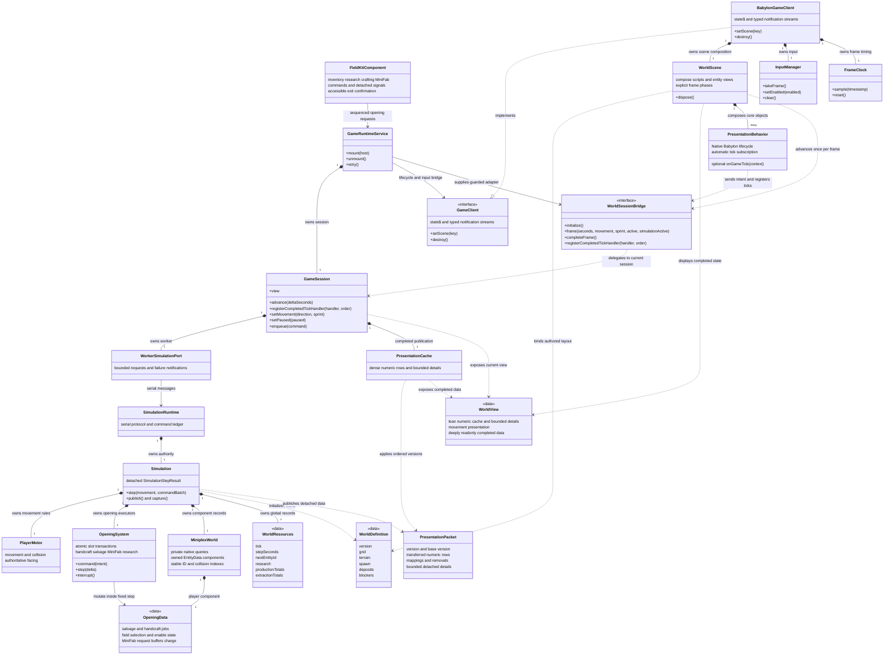
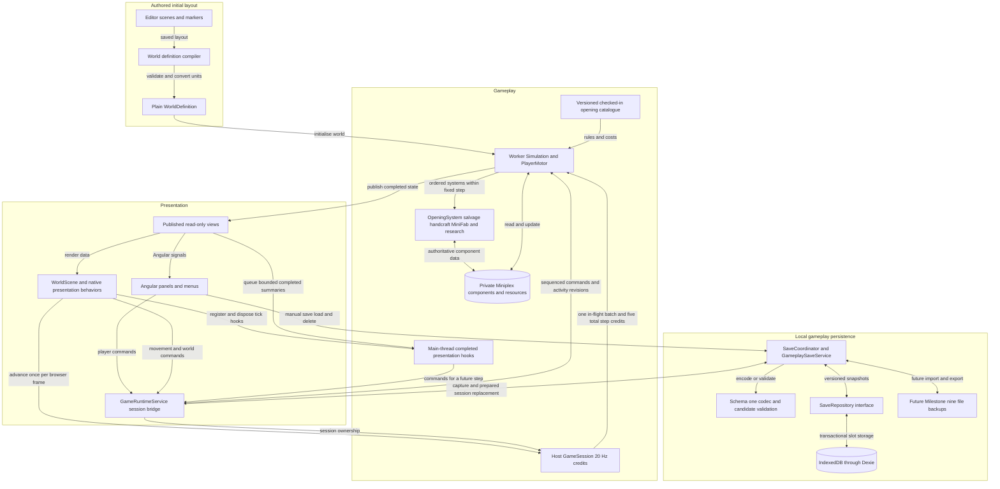
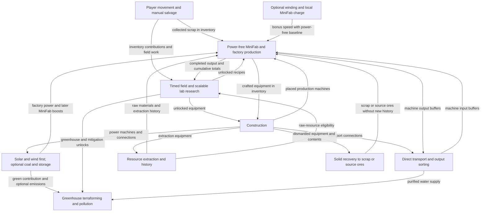

# Scrapworks Technical Design Document

Updated 8 November 2026 for Milestone 4 implementation. Schema-1 saves wrap version-3 world/physics data; SaveCoordinator, SaveRepository and prepared worker/renderer replacement implement the manual slot. The [local-save report](../reports/milestone-04/2026-11-08/README.md) records verification. Migration, opening and ECS performance evidence retain their dated scope.

Scrapworks uses Angular for UI and Babylon.js with Babylon.js Editor for its 3D world. A plain authored-world definition and fixed-step simulation connect presentation to one authoritative ECS world. The opening loop and versioned local saves are implemented; factory rules remain planned. The [GDD](GDD.md) and [player progression design](player-progression.md) own gameplay rules; the [roadmap](../plans/README.md) orders implementation.

## Agreed technical requirements

- Keep the game browser-first, with Angular UI and a fully 3D world/character.
- Author scenes and world layout in one Scrapworks Editor project; attached scripts handle presentation and scene bindings.
- Keep authoritative gameplay in plain TypeScript and save progress locally through versioned data snapshots.
- Defer accounts/cloud saves, remote control and navigation systems until a defined requirement needs them. The current playable physics test supplies the defined requirement for Rapier integration.

The [runtime architecture decision](../decisions/runtime-architecture.md) defines version-2 contracts, ownership, notifications, scene registrations and enforcement.

## Technical stack and current implementation

| Responsibility      | Choice                           | Current implementation                                                                                                                                                                 |
| ------------------- | -------------------------------- | -------------------------------------------------------------------------------------------------------------------------------------------------------------------------------------- |
| Application and UI  | Angular 22, signals, CDK         | Shell, shared viewport, field-kit inventory/research/handcraft/MiniFab panels, winding, exit warning, menus and Retry.                                                                 |
| 3D presentation     | Babylon.js 9.32.0                | Sole renderer at `/`, with `/3d` compatibility redirect; authored scene bindings and runtime character presentation.                                                                   |
| Core object scripts | Scene-owned native Babylon hooks | TypeScript-attached scripts own player input/presentation, camera, selection and placement. Babylon physics remains disabled; Rapier runs inside simulation.                           |
| Physical simulation | Rapier 0.21.0, WebAssembly       | Worker-owned character controller and static/dynamic/kinematic bodies, three 60 Hz substeps per gameplay tick, changed-only pose publication and native-state continuation.            |
| Authoring           | Babylon.js Editor 5.5.3          | Saved inputs export/reload automatically; validated marker metadata compiles into a plain world definition.                                                                            |
| Client subscription | RxJS in main-thread `GameClient` | Per-client replay, unsubscribe, mounting and asynchronous transition guards.                                                                                                           |
| Gameplay            | Plain TypeScript                 | Private Miniplex authority, typed movement/opening commands, deterministic 20 Hz salvage/research/handcraft/MiniFab executors and detached views. Factory progression remains planned. |
| Persistence         | Dexie / IndexedDB                | Schema-1 manual gameplay slot, transaction/token checks, candidate worker/scene/UI restore and production IndexedDB reload acceptance. Separate controls/test stores.                  |

The [cleanup record](../plans/3d-cleanup.md) defines current asset boundaries and retired-source recovery. The [Editor setup guide](../plans/babylon-editor-setup.md) owns export/MCP commands. The [Art Document](../art/README.md) owns camera and visual-production requirements.

## Technical structure diagrams

The class diagram describes the implemented session and opening. The application diagram separates that path from planned gameplay persistence. The gameplay overview includes both the implemented personal opening and later factory/environment branches. Angular, Babylon and Editor objects remain outside authoritative plain records.

### Core class diagram

The application runtime owns one host `GameSession`; the existing render callback supplies bounded credits to one dedicated module worker. `Simulation` exclusively owns private Miniplex components and world resources and delegates authoritative player movement to plain [`PlayerMotor`](../../src/simulation/player-motor.ts). [`WorldScene`](../../src/game/views/world-scene.ts) composes native presentation behaviors and entity views that consume the initial definition and detached `WorldView` values. [`WorldSessionBridge`](../../src/contracts/game-client.ts) connects these scene objects to the application-owned session without exposing its mutable state.

[SVG image](../diagrams/core-class-diagram.svg) / [PNG image](../diagrams/core-class-diagram.png) / [Mermaid source](../diagrams/src/core-class-diagram.mmd)

A filled diamond means ownership, a dotted arrow means a dependency, and the hollow triangle means interface implementation. Presentation receives detached read-only views; simulation alone changes live world data.

### Application system interaction diagram

This is a component and data flow diagram: it shows where commands, state, and saves travel. The fixed-step loop advances gameplay independently of the rendering frame rate. Signals hold the selected UI view of state rather than a second authoritative world.

[SVG image](../diagrams/system-interactions.svg) / [PNG image](../diagrams/system-interactions.png) / [Mermaid source](../diagrams/src/system-interactions.mmd)

Commands are checked inside the worker and completed state is published as detached views. Manual gameplay persistence awaits committed transactions, validates a separate candidate world, prepares its scene/UI and preserves the active session on failure. File transfer remains Milestone 9; the developer test-data dialog stays isolated.

A future cloud repository can implement `SaveRepository` . Accounts, synchronization, and conflict handling remain later work; they are not needed by the prototype simulation.

### Gameplay system interactions

This closer view shows the dependencies between gameplay systems. Arrows describe resources and rules shared through `WorldState` ; they do not require the systems to call each other or maintain duplicate inventories. Construction establishes the machines and connections that power, transport, and production subsequently use.

[SVG image](../diagrams/gameplay-interactions.svg) / [PNG image](../diagrams/gameplay-interactions.png) / [Mermaid source](../diagrams/src/gameplay-interactions.mmd)

Production increases cumulative totals only when craft/machine output completes. Newly extracted resources have separate history; transfers, existing-output collection and refunds add neither history. Timed field and lab research validate prerequisites/eligibility and contribute materials exactly once, then grant the unlock when funded work completes. Enabled Field Research consumes uncommitted inventory gradually in the background, waits/resumes on shortages and preserves per-technology contributions/work on pause or switch. Consumed research materials are non-refundable; each paced cycle atomically consumes one of every still-required material, with all-input availability required and no overspending a completed material cost. Production, Mini Fabricator precursor planning and construction enforce unlocks. Greenhouses initiate restoration; green technology and optional pollution influence greening without a fail state or research lockout.

The dependency arrows do not prescribe tick order. For the Milestone 3 opening, manual commands/current handcraft input commitment have priority, followed by requested MiniFab input draws and then Field Research consumption of remaining uncommitted stock. Revalidate each atomic spend; paused/blocked work gains no hidden progress. The larger transport/power/environment schedule and freshly produced machine-output availability are later Milestone 6 integration work, not unresolved opening gameplay design.

### Planned opening-state expansion

The player ECS entity owns the 24-slot bag, separate tool slot and `OpeningData` component. `OpeningSystem` executes salvage, safe handcrafting, requested MiniFab operations and Field Research inside the existing fixed step, using shared atomic slot transaction rules. Ground piles are separate stable-ID entities with a native query. Research ledgers, histories, time and ID allocation remain world resources. The versioned catalogue in `src/content/opening.ts` declares five technologies, six recipes, separate contribution/eligibility costs, capabilities, source-ID mappings and deferred content; Fibery/import receipts are not runtime dependencies. The bounded opening projection accompanies numeric movement deltas without serializing the ECS population. Plain capture/rebuild includes opening work and validates refund/buffer capacity; gameplay storage remains Milestone 4.

### Planned handcrafting cancellation boundary

Safe handcrafting runs only while its UI is visible; the adapter publishes intent/visibility and the plain simulation owns progress, input commitment, cancellation and refunds. Preflight checks output space after actual per-unit input consumption. The batch protects result/refund capacity across units and its exit warning; other additions/transfers and MiniFab deliveries wait. Enabled Field Research is a consume-only exception after player commands: take uncommitted stock only, never current craft inputs or protected capacity. Research may use finished outputs and affect later batch affordability, so revalidate each next unit. Idle crafting UI does not protect inventory. Warn/suspend before intentional exit; confirmed exit or forced teardown cancels unfinished work, refunds original inputs exactly once and releases protection afterward. Research withdrawals cannot occupy refund space, so refunds never spill. Load/world replacement resolves unseen handcraft cancellation before research draws/other writers. Supplied MiniFab work may finish and hold output. See [the progression rules](player-progression.md#handcrafting-and-interruption).

### Planned inventory capacity and salvage overflow

Inventory has 24 bag slots, a separate equipped-tool slot and no weight metric. Item definitions own stack caps (initially 100 for simple materials); player reach starts at a 2 m ground-plane radius and capacity/reach can grow later. Salvage atomically debits the deposit, inserts what fits and creates recoverable ground resources for the remainder, with an inventory-full notice. Count newly extracted quantity once across both destinations; pickup adds no history. Ground IDs, types, quantities and positions belong in plain world/snapshot state.

Handcrafting checks its inventory destination after actual per-unit input consumption. MiniFab instead starts against actual input/output buffer capacity: ingest one complete operation from uncommitted inventory just before work, directly reuse eligible precursor output and commit new production once into its output buffer. Delivery/direct reuse is only a transfer. Initial buffers hold one operation's ingredients/result (including a recipe's multi-output batch); capacities upgrade later toward item stacks. When output is full and bag delivery fails, retain output and pause/notify/resume. A validated next-input ingestion may precede held-output delivery if it genuinely frees sufficient bag capacity; buffered/partial-stack consumption cannot invent a freed bag slot. Player commands precede automatic intake/delivery; active handcraft capacity protection defers those bag transfers while already supplied MiniFab work may continue. Salvage overflow remains ground drops; MiniFab never spills. See [the capacity rules](player-progression.md#inventory-interaction-range-and-overflow).

## State ownership and module boundaries

The simulation owns authoritative player/world state, movement, collision and placement validation. Planned crafting, research, transport, power and restoration modules will join this boundary. Angular and Babylon send commands to the same session and display published views. Scene frames, animation callbacks, and UI handlers must not advance production or directly spend inventory.

Angular owns the shell, menus, dialogs, controls and gameplay panels. Babylon owns rendering, cameras, picking, visual effects, animation, and input adaptation. Signals expose lifecycle, selection and detached world views without becoming an authoritative world owner.

The centred field kit has Inventory & Crafting and Research tabs in a bounded shell, with scrollable contents and reserved work/progress rows. Switching away from active handcrafting uses the same stay/cancel guard as closing the kit. Salvage and deliberate ground pickup belong to world interaction. UI input ownership stops movement/camera input without stopping the worker, renderer or idle animation; pausing dialogs suspend simulation and character animation separately.

`UiService.openNotification({message, title?, tone?, colour?, icon?, timeout?, key?})` returns an ID and `dismiss()` reference. The notification host is a sibling of the renderer/field kit and fixes its stack to the global viewport's top-right corner. Five notifications are visible in FIFO order; additional notifications queue until a slot opens. Timeouts start on promotion, default to 8,000 ms and pause while hovered or focused; zero is persistent. Keys replace matching visible or queued notices. Colour affects the accent while readable text/background colours remain fixed. Icons are plain text, never HTML. Notification ownership/timers end with the UI service. Opening feedback emits shortages, blocked actions and completion transitions without repeating every worker publication; alerts never reflow the kit.

Use `src/app/features/` for Angular/session integration, `src/game/` for 3D presentation, `src/contracts/` for plain boundaries, `src/simulation/` for authoritative rules, and `src/core/` for framework-independent utilities. Simulation/contracts/core remain free of framework, storage, DOM, and wall-clock dependencies. Phaser source and its package dependency have been removed.

The Editor owns saved cameras, lights, materials, static geometry, and world markers in `assets/`. The compiler in `tools/world/` extracts marker metadata into versioned `WorldDefinition` records without executing attached scripts, validates IDs, bounds, alignment, footprints and hierarchy transforms, and converts centimetres to metres on X/Z. Mutable `WorldState` belongs exclusively to the simulation; detached views cross into presentation. Scene serialization and attached components are not gameplay saves.

`GamePageComponent` provides a scoped runtime and directly owns the renderer host. The runtime owns its `GameClient` subscription, readonly signals, generation guards, mount/unmount, retry, and application session. Babylon owns one engine/frame callback, scene assets, resize observation, transition guards, first-frame readiness and late-load disposal. Its frame advances the application-owned scheduler; no independent simulation timer is started. See the [migration plan](../plans/3d-migration.md) for current lifecycle acceptance and the [dated Phase 2 walkthrough](../plans/3d-phase-2-walkthrough.md) for implementation history.

The document supplies a branded loading shell before JavaScript; Angular keeps the same presentation while its route loads. `GAME_CLIENT_LOADER` dynamically imports the renderer after Angular renders the UI and two animation-frame callbacks allow an intervening paint. Scene changes use the same cancelable paint barrier. The opaque loading cover makes the underlying UI/viewport inert until the destination's first ready frame, including pauses before that frame. `GameClient.loading$` reports `LoadingStatus` (current task text and nullable 0–1 progress) separately from lifecycle state, so progress does not invalidate input. Editor and character loaders supply measured task progress; unmeasured setup remains indeterminate. `LoadingIndicatorComponent` can present any asset task independently of the branded `LoadingScreenComponent`. Runtime ownership and generation guards discard canceled imports and stale scene progress. Responsive menu WebP derivatives are reproduced by [the image preparation tool](../../tools/art/prepare-menu-images.ts), with original PNGs and provenance under `art/`.

### Core object scripts

[PresentationBehavior](../../src/game/lifecycle/presentation-behavior.ts) and [ScenePresentationLifecycle](../../src/game/lifecycle/scene-presentation-lifecycle.ts) own the code-attached behaviors. One ordered before-render dispatcher starts each enabled behavior on its first owned frame and then runs updates. One late dispatcher runs once before render targets, even when Babylon repeats that hook per camera. There is no global playing flag or extra ticker. Editor-attached scripts retain the Editor lifecycle.

| Responsibility                                      | Owner                                                                                    |
| --------------------------------------------------- | ---------------------------------------------------------------------------------------- |
| Shared movement and sprint input                    | `PlayerController` interprets the frame's shared `ActionFrame` and submits plain intent. |
| Authoritative position, collision and facing        | Session-owned `PlayerMotor` in plain simulation code.                                    |
| Character rig, interpolation, turning and animation | `PlayerView`.                                                                            |
| Orbit, zoom, following and occlusion                | `CameraController`.                                                                      |
| Picking and interaction feedback                    | `SelectionController`.                                                                   |
| Build mode, rotation, preview and confirmation      | `PlacementController`.                                                                   |
| Entity meshes and materials                         | Individual view objects, synchronized by entity ID.                                      |

`WorldScene` is the composition root for those objects. `BabylonGameClient` retains browser/render lifecycle responsibilities rather than gameplay-feature branches. The integration defines frame phases explicitly, so incidental construction or array order does not determine behavior:

1. Sample one shared `ActionFrame`, dispatch application/UI actions, and validate ownership.
2. Run camera controls and player input interpretation.
3. Advance the session once, executing zero to five gameplay ticks.
4. Publish completed world state and update player/entity presentation.
5. Follow the player, update occlusion, pick the world and update placement feedback.
6. Draw the scene.

[attachPresentationBehaviors](../../src/game/lifecycle/attach-presentation-behaviors.ts) registers numeric phases: camera input (10), player interpretation (20), session pin/completion/credits (30), player presentation (40), entities (50), selection (60), placement (70). Late hooks run camera follow/occlusion, selection and placement. Ordered hooks execute synchronously so exceptions reach the renderer boundary. Node/ancestor enablement and frame generation/revision guards stop invalid work immediately. Disposal releases observers and tick subscriptions, then destroys resources in reverse order. Healthy sessions survive renderer Retry; failed workers restart only on explicit Retry.

### ECS foundation from Milestone 3

Architecture revision, 28 October 2026: adopt ECS for the opening simulation before inventory, salvage, research and crafting are implemented. [Milestone 3 Step 0](../plans/milestone-03-character-and-manual-opening.md#step-0-establish-and-prove-the-ecs-foundation) selects/proves the library and establishes its actual runtime. [Milestone 6](../plans/milestone-06-first-working-machines.md) adds factory entities/power/processing to that same foundation. The [ECS laboratory](../../tools/ecs-bench/README.md) now pins four development-only candidates for synthetic Node/Chromium investigation; it does not implement an ECS in production Simulation or grant gameplay implementation credit.

The [29 October ECS investigation](../reports/ecs/2026-10-29/README.md) selects **Miniplex 2.0.0**. Miniplex and bitECS meet the 100,000-entity combined simulation/publication budget in both environments; Miniplex has the simpler verified integration. Production adoption now uses one private worker authority and the actual component/lean-view contracts. See the [implementation evidence](../reports/ecs-worker-implementation/2026-10-30/README.md) for qualification and remaining limits.

Worker decision, 29 October 2026, requalified 30 October: start with **one dedicated browser worker owning Simulation and its private ECS world**, with sequential ECS systems. The [lean investigation](../reports/simulation-worker/2026-10-30/README.md) compares **Miniplex 2.0.0 and bitECS 0.4.0**, each inline and in one worker, and retains Miniplex. Both now pass the unchanged normal-workload compute, receiving, callback and input gates using transferred numeric presentation rows and bounded on-demand inventory/selection details. The [rich bridge's failed qualification](../reports/simulation-worker/2026-10-29/README.md) remains historical. Angular/Babylon and physical input remain on the main thread, communicating through plain commands, completed views and explicit detail subscriptions; full captures remain separate. The laboratory establishes the asynchronous session/tick-hook handoff, lifecycle and measured browser costs. Its original prototype remains isolated under tools. Production now uses the asynchronous boundary described by the current class/frame diagrams; the implementation report keeps its measurements separate from laboratory results.

Browser results govern worker qualification: 100,000 meaningful entities on the reference desktop, **60 FPS required and 120 FPS diagnostic**. Begin with authoritative movement views and interpolation; investigate local visual prediction only if latency warrants it. Preserve pause/suspension and no offline catch-up. Node remains a correctness/diagnostic environment; the historical ECS report keeps its original dual-runtime gate. Source-backed assessment of future threading is included now; implementation of multiple simulation workers, shared-memory stores and parallel ECS systems remains deferred until profiling demonstrates a need for more simulation throughput.

The [production implementation plan](../plans/ecs-worker-implementation.md) is complete through Step 0, with [production qualification](../reports/ecs-worker-implementation/2026-10-30/README.md). Its two user-confirmed policies are implemented: existing `onGameTick` hooks are main-thread completed-tick **presentation** notifications, drained during an owned render frame; failure Retry starts a fresh world from the authored initial definition, with no automatic checkpoints. Healthy renderer-only Retry retains its live session; page teardown disposes it. A failed worker or presentation hook requires a fresh authored world.

- **Single authority:** Simulation owns one ECS runtime, component stores and explicit world resources. Component values remain plain gameplay data; queries/indexes/library handles are private runtime machinery. The old mutable WorldState scaffold has been removed. WorldView is a detached projection, not another writable world. WorldDefinition remains authored initialization; renderer GameState remains lifecycle state.
- **Opening composition:** meaningful entities include the player/inventory owner, deposits, ground piles and personal processing jobs/devices. Production entities are player, deposits, piles and development placement buildings. Opening jobs, buffers and charge are player-owned components; generic owner/work/reservation schemas are absent. Keep content immutable and shared time/ID allocation, research and histories as explicit world resources where appropriate; do not invent entities for every item unit or singleton field.
- **Shared domain logic:** slot capacity/transactions, recipe costs/eligibility, work progression, recovery/history rules and result accounting remain plain functions independent of the ECS library. Systems query relevant components and invoke those rules. Handcraft UI requirements, MiniFab charge/precursors and factory arity/power remain executor policies; later machines do not require replacing the opening's inventory or production engine.
- **Existing clock:** retain one application-owned 20 Hz scheduler and the five-step catch-up contract. GameSession supplies host frame credits, counts in-flight steps against the same five-step allowance, and permits one advance request at a time. The worker has no ticker. Simulation's fixed step invokes ordered ECS systems with explicit structural-mutation boundaries; manual/current-handcraft spending precedes requested MiniFab then Field Research. Do not derive priorities from incidental query iteration or run authoritative systems through presentation tick subscriptions. Reuse PlayerMotor's tested movement algorithms against ECS-owned data; camera and player native presentation behaviors continue as presentation/input adapters.
- **Stable boundaries:** game-owned stable IDs identify persisted entities/references; library-recycled IDs and object identity are runtime details. Angular/Babylon consume projections and submit commands without ECS query/component handles. Preserve the useful GameClient/WorldView interface while changing its internal state representation. Profile changed/selective projections and explicit snapshots so repeated full-world cloning does not erase the ECS benefit.
- **Snapshot groundwork:** capture plain versioned component/resource data and rebuild a fresh runtime/queries/ID mapping. Verify continued simulation is equivalent and restoring components never fabricates production/refunds/research contributions. Milestone 4 implements persistence around this boundary; never serialize the ECS world, observers, queries or renderer objects as the save schema.

The prior comparison selected Miniplex 2.0.0 because its measured browser result qualifies and its plain objects/application-owned scheduling fit the maintainability criteria. Its object-identity focus still requires explicit stable IDs. The worker study retains that preference while identifying bitECS's more direct future shared-numeric path and migration obligations; neither library supplies an automatic parallel-system scheduler. A worker boundary is application infrastructure and needs its own qualification. See the dated comparison above, [Miniplex official documentation](https://github.com/hmans/miniplex) and [bitECS threading guidance](https://bitecs.dev/docs/multithreading).

The selection spike must measure representative active/idle/blocked processing, inventory/buffer access, structural churn, memory/allocations and capture/rebuild/view costs at increasing scales in the intended JavaScript environments. Record evidence and select the storage model before feature code, without implementing future factory content. ECS by itself promises neither automatic parallelism nor a frame-rate improvement; optimize measured bottlenecks. Intermediate changes within simulation are expected, while game rules, public presentation boundaries and the tested clock/motor should carry forward.

Production/extraction histories, per-technology consumed-material ledgers and work, the active field technology/enable state, material-wait state and unlocks belong to the saved world. Enabled Field Research runs on simulation steps with the UI closed and alongside other work. It draws uncommitted player stock gradually, after player commands, without full upfront payment/reservation. Missing next inputs wait automatically; disabling field work stops bag withdrawals even while labs continue from their own buffers. Pause/switch retains invested materials/work with no cancellation/refund. Enabled field contributions may join lab research against shared remaining demand without double spending, overshoot or free work; each paced cycle consumes one whole unit of every still-required item atomically, waits for a complete bundle and retains partial cycle time without unpaid catch-up. Already satisfied material totals are excluded. Provisional interval = fully supplied technology work seconds / largest cost quantity; shared lab coordination remains later integration work. Load resolves unseen handcraft refunds before any research draw, and creates no offline progress. See [the progression design](player-progression.md#research-progression).

### Progression state and invariants

The opening MiniFab, baseline battery and winding invariants below are implemented. Upgrade progression, lab coordination, factory power and recycler rules remain future requirements. All records remain plain and simulation-owned; Editor scripts and Angular views submit requests and consume projections.

- MiniFab is a personal subsystem with a separate Angular panel beside inventory. Initial recipes must be researched and handcraftable; later crafted/researched modules can enable hazards/liquids. It follows both component branches and is hand-assembled without factory electricity. Plain state holds one requested target/batch, precursor plan, current operation/input buffer, completed output buffer, capacities, work and blocked reasons. Pull each complete operation at start from uncommitted inventory, optionally reuse output directly, and wait on stock shortages. Reject invalid/locked/cyclic chains without spending; share intermediates without hidden storage. Per-request intake is initial capability; autonomous min/max targets remain a later upgrade.
- Baseline MiniFab work always progresses at 1x without power when ingredients/buffers allow. Initial local charge provides 60 active seconds at 2x speed, draining only during actual processing. Idle, paused, missing-stock, output-blocked and inventory-wait states spend no charge. Split steps at battery expiry/job completion, preserving inputs/work and using baseline speed for uncharged time. Five turns fill initially; gear T decreases toward one. Charge gain = capacity * abs(accepted angular travel degrees) / (360*T), capped at capacity, with concurrent work drain still applied. Unlimited capacity level n = 60*1.5^n boosted seconds, physical level-n cost = base recipe * 2^(n-1); stored charge is not refilled by capacity upgrades. Turns-to-full is independent of capacity. Tier costs/spacing and later source stacking remain future content.
- Winding adapters report actual accepted handle angular travel while the focused/grabbed crank owns input. Pointer drag and selected right-stick direction align the handle; keyboard Up/Right/Down/Left/Up is one turn-equivalent. Credit fractional clockwise/counterclockwise/back-and-forth travel continuously, with no full-turn gate. Filter device noise/centre ambiguity/stale jumps, not genuine reversals; unchanged held keys/centre stick earn nothing. Enforce equivalent configurable angular rate/capacity bounds across adapters and frame schedules. Release/focus/selection ownership changes end the gesture without replaying gaps. Save charge/ranks, not active gestures; no factory electricity or accelerometer implementation is required.
- MiniFab upgrade state distinguishes related general technology, MiniFab-specific research, crafted upgrade ownership and applied effects. Solar/wind/coal/grid upgrades improve speed and coal incurs pollution; no research-complete callback grants the physical upgrade. Grid integration waits for electricity. Inventory-driven min/max automation is a separate later upgrade with unresolved trigger semantics. Persist local charge/capacity and applied upgrades, not current gesture paths or device permission handles.
- Content distinguishes a recipe's distinct ingredient count from quantities: Basic Fabricator accepts one type, Medium two, Advanced three or four. Higher tiers cannot execute lower-arity recipes; recycler and Mini Fabricator capabilities are separate.
- Recycler output comes from a specified random output catalog rather than a selected deterministic recipe. Use a simulation-owned seeded PRNG, save its state and persist any rolled pending output. Blocked output, load and repeated commands cannot reroll a batch.
- Disassembly must preflight its entire body-material return and intact buffers against post-removal bag capacity. If insufficient, leave item/device/job/contents intact, with no partial dismantle, early cancellation or ground spill. A successful atomic action cancels unfinished work with original inputs, recovers contents once and preserves research/history.
- Dismantling completed buildings/items returns full embodied solid value as scrap for scrap-origin material or source ore for other material; source ores require full reprocessing. Liquids are lost, with exact future equivalence/provenance deferred until advanced materials exist. Research inputs are permanently consumed and never refundable. Every completed re-craft counts as production; recovery/refunds/transfers do not. MiniFab cancellation discards partial work and preserves original inputs; return to inventory or retain input/output buffers if blocked. While residue remains, replacement requires the same input types (quantities may differ), and output must clear before another recipe starts. Exact same cancelled recipe may start with uncleared output only if a full next result fits. Save cancellation recipe identity/input types and residual contents; never duplicate refunds or bypass restrictions on load.
- Daylight, fluctuating wind, the non-event wind minimum and Dunkelflaute events derive from saved simulation time/weather state. Save any random state; do not read wall-clock time or use presentation randomness for gameplay decisions. Coal-free progression is required, and weather/pollution cannot create a permanent progression lockout.
- Finite resource quantities are deliberately generous. Future resource configuration and train/loading-station systems remain outside the first prototype.

## Simulation timing and save boundaries

`GameSession.advance(deltaSeconds)` retains a 50 ms accumulator (20 Hz), a five-step catch-up limit and the existing browser frame source. It adds no timer or animation loop and does not depend on physics, physics substeps or global Babylon timing. A zero-tick render frame still updates presentation; excess elapsed time beyond the bounded catch-up budget is discarded.

The [Rapier integration](../../tools/world/README.md#physics-ownership-and-continuation) nests three 1/60 s physics steps inside each authoritative gameplay tick. Physics has no independent clock. Version-3 captures include pinned native physics bytes and project-owned stable identity alongside plain ECS data; geometry/pose validation protects candidate replacement and exact continuation. Protocol/presentation remain version 2, with sparse transferred quaternion rows for physical entities. The current crate/barrel/stack/moving-block layout is authored in the active Game scene and remains test content; performance qualification of large active-body populations is separate work.

`registerCompletedTickHandler(handler, order?)` registers main-thread presentation notifications. The owned render frame pins the latest completed publication, drains at most five summaries in tick/order/registration order, then submits future credits. Context includes the completed tick, fixed duration, world generation and publication tick/version; a catch-up notification may describe an earlier tick than the pinned view. New registrations never replay committed ticks. Unsubscription and ownership changes stop dispatch immediately. Hook commands affect a future step; hook failure retains the completed view and requires explicit authored-world Retry. Worker message handlers never execute scene scripts.

The narrow `PresentationBehavior` base connects an implemented optional `onGameTick(context)` method through `WorldSessionBridge` during native `start` and disconnects it during destruction. The adapter checks script and object activation at dispatch time. Native Babylon lifecycle registration and application tick registration remain distinct; the renderer hooks never become simulation scheduling mechanisms.

Continuous movement is sampled state. Discrete commands are captured once and queued until a tick consumes them, so catch-up cannot repeat a button press. Placement confirmation happens after the current frame's session advance and therefore targets a subsequent tick. Each authoritative step processes queued commands, advances player movement, increments the tick and publishes completed state. A failed step cannot expose partial state.

The bridge distinguishes active gameplay input from active simulation. Focusing the field kit blocks movement/camera/selection but keeps simulation work running. The existing render callback remains the only frame source. Window focus/visibility loss, menus, binding capture, Inspector and renderer failure suspend simulation and clear transient actions. Intentional handcraft exits warn and suspend its unit; confirmed exit or forced interruption refunds that unit exactly once. MiniFab supplied work and research survive UI closure. Resumption cannot replay hidden or blocked time. A completed step is the gameplay save boundary. Local manual saving is implemented; offline production is excluded.

## Persistent game state

Keep active gameplay state in memory. Save a versioned data snapshot containing:

- Player position, inventory, tools and MiniFab subsystem ownership, target/batch, precursor plan, local charge/capacity, crafted/applied upgrades, input/output buffers and capacities, remaining work, blocked reasons and cancelled recipe/input-type residue; later power-source/automatic policies only when implemented. Active winding gestures and device permission handles are session state, not save data.
- Remaining deposits, placed machines, and connections.
- Machine buffers, work progress, and items in transit.
- Stored energy and water.
- Cumulative production/extraction histories, per-technology consumed-material ledgers and remaining/partial work, active field target/enabled state, material-wait state, lab targets and research unlocks.
- Seeded random-stream state, already-selected recycler outputs, daylight/wind/weather/event state and any deterministic coordination state.
- Pollution, vegetation, and simulation time.

Store identifiers and data rather than Angular services, Babylon meshes/materials, scene handles, or Editor components. Recipe and technology definitions belong to the game content; saves reference their identifiers and record a compatible content version.

The list above includes later gameplay. Milestone 4 persists only implemented state using the [field checklist](../plans/milestone-04-first-local-save.md#snapshot-field-checklist): exact bag slots/tool, deposits/piles including elevation, opening jobs/buffers/charge/rate allowance, research/history, clock/ID state and format-3 Rapier continuation. Stack limits, reach, recipe dependencies and base capacities remain immutable versioned content. Current gearing/capacity levels must remain zero until their upgrades are implemented. The internal SimulationCapture includes a transport ledger and pending commands; the durable save contains its completed SimulationSnapshot world payload, not that continuation envelope.

## Local storage and save operations

Use the installed Dexie integration for IndexedDB persistence. Developer test records and settings retain separate adapters. Milestone 4 implements SaveCoordinator and a gameplay-specific SaveRepository/database without changing either existing namespace. One manual slot stores its payload and metadata atomically; periodic autosaves and retained revisions follow in Milestone 9.

Write each snapshot and its metadata together in a transaction. Report save success only after the write completes, and preserve the last successful revision if a later write fails. Avoid relying on a final save when the tab closes.

## Save format and loading

Give saves a durable-envelope schema, compatible content/physics versions, authored-world identity, stable runId, saved timestamp and committed write token. The current simulation worldId equals the authored definition ID; it is not a unique playthrough identity. Keep slot identity, run identity and session/renderer generations distinct. Run IDs and timestamps belong to application composition, outside deterministic simulation.

Show Continue alongside New Game when committed slot metadata exists. Confirm before Load/New Game discards unsaved session progress or Save overwrites a different run; explicitly confirm deletion. New Game leaves the previous slot intact until saved. Continued simulation after a capture remains unsaved even if its asynchronous write later succeeds.

Validate unknown loaded data and build a separate candidate worker, including matching authored definition and exact compatible Rapier native bytes/version. Await a complete publication and prepare presentation/UI before committing through GameSessionOwner. GameSession.hold() preserves the old session under a non-destructive load guard. Normal pause/clearInput interruption remains separate; initial restored activity acknowledgements preserve saved work until its first active step. Candidate/read/validation failure preserves the old job, inventory, world and pause/UI ownership.

When a saved handcraft job exists, reopen Inventory & Crafting and resume its saved unit only after UI readiness and normal activity/visibility rules permit it. Do not repay inputs, refund that resumable unit or advance it invisibly. Fresh session counters, cleared movement/salvage/winding intent, reset elapsed clocks and rebuilt presentation mappings prevent command replay and offline progress. Background MiniFab/research retain their existing spending and exactly-once completion rules. Normal handcraft exit/forced-interruption behavior still applies after restoration.

Milestone 4 initially supports one durable schema and rejects incompatible data without deleting it; older-schema migrations and file import follow in Milestone 9. A future supported migration operates on a copy before candidate construction. Unsupported versions or invalid data leave both the active world and existing saves intact.

Database schema changes and game save migrations are separate concerns.

## File backups and browser storage limits

Provide JSON file export and import as a proposed backup and transfer option. Browser storage is local to the browser profile and website origin; clearing site data can remove saves, and best-effort storage can be evicted. Request persistent storage where supported, but retain file backups because that request may be denied and users can still clear stored data. These limits are documented in [MDN browser storage guidance](https://developer.mozilla.org/en-US/docs/Web/API/Storage_API/Storage_quotas_and_eviction_criteria).

## Future cloud persistence

Keep persistence behind a small save repository interface for listing, loading, saving, and deleting slots. The local IndexedDB repository is implemented. A future cloud repository can use the same versioned snapshot format, while accounts, synchronization, and conflicting revisions remain separate future work. This does not require a backend for the initial prototype.

## Initial verification requirements

The first implementation checks should cover:

- Saving and loading a running factory without changing inventory, research, production totals, or machine progress.
- Continuing the simulation with the same results after restoration.
- Migrating supported older save schemas.
- Invalid saves or failed writes preserving the last usable state.
- Research consuming the required materials exactly once while retaining cumulative production totals.
- Crafting and placement rejecting equipment whose technology has not been researched.
