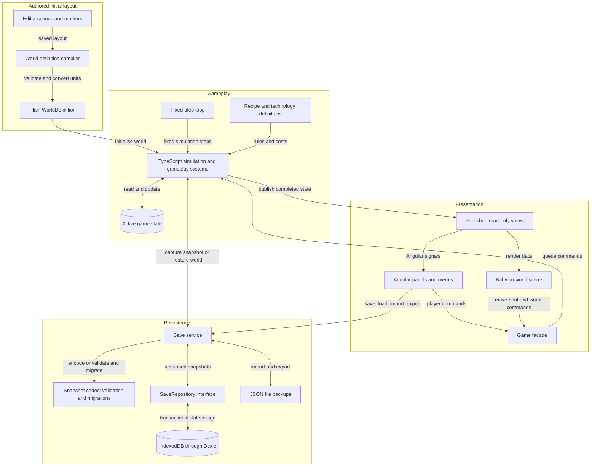
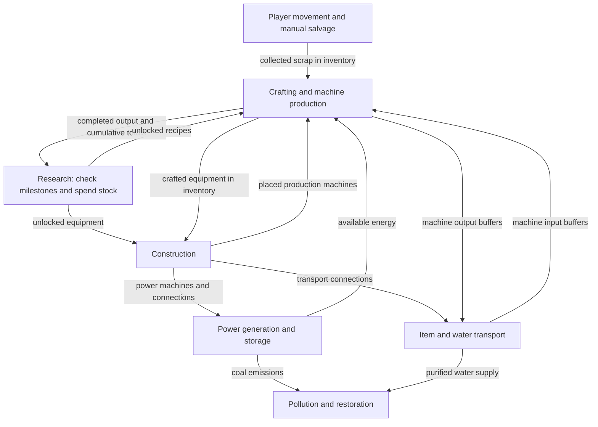

# Scrapworks Technical Design Document

Updated 17 October 2026.

Scrapworks uses Angular for UI and selects Babylon.js with Babylon.js Editor for its 3D world. The shared renderer lifecycle and authored-scene loading are implemented. The authoritative simulation and versioned world saves remain planned. The [GDD](GDD.md) owns gameplay rules and the [roadmap](../plans/README.md) orders implementation.

## Agreed technical requirements

- Keep the game browser-first, with Angular UI and a fully 3D world/character.
- Author scenes and world layout in one Scrapworks Editor project; attached scripts handle presentation and scene bindings.
- Keep authoritative gameplay in plain TypeScript and save progress locally through versioned data snapshots.
- Defer accounts/cloud saves, remote control, physics, and navigation systems until a defined requirement needs them.

## Technical stack and current implementation

| Responsibility      | Choice                         | Current implementation                                                                                    |
| ------------------- | ------------------------------ | --------------------------------------------------------------------------------------------------------- |
| Application and UI  | Angular 22, signals, CDK       | Shell, shared page/viewport, dialogs, lifecycle views, errors and retry. Gameplay panels remain planned.  |
| 3D presentation     | Babylon.js 9.30.0              | `/3d` loads Editor-authored MainMenu/Game scenes, a static rig, and placeholder geometry.                 |
| Authoring           | Babylon.js Editor 5.5.2        | Saved inputs export/reload automatically through the project tooling; marker compilation remains planned. |
| Client subscription | RxJS behind plain `GameClient` | Per-client replay, unsubscribe, mounting and asynchronous transition guards.                              |
| Gameplay            | Plain TypeScript               | Queue/logging scaffold only; no authoritative world or fixed-step rules.                                  |
| Persistence         | Dexie / IndexedDB              | Test-data service/dialog only; no playable-world snapshot or round trip.                                  |
| Earlier runtime     | Phaser 4.2.1                   | Still serves `/` until the cleanup cutover gate passes. New gameplay follows the 3D direction.            |

The [cleanup plan](../plans/3d-cleanup.md) defines the staged transition and the [baseline](../plans/3d-cleanup-baseline.md) records dated validation. The [Editor setup guide](../plans/babylon-editor-setup.md) owns export/MCP commands. The [Art Document](../art/README.md) owns camera and visual-production requirements. Historical 2D instructions remain in [history](../history/README.md).

## Technical structure diagrams

These diagrams describe the proposed complete gameplay architecture, not a list of implemented classes. GameFacade, GameLoop, gameplay systems, SaveCodec, and SaveRepository remain future work. Data boxes represent plain TypeScript records; Angular services, Babylon scene objects, and Editor components stay outside them. The diagram's `WorldState` is planned authoritative gameplay data; the implemented `src/contracts/game-state.ts` describes renderer lifecycle.

### Core class diagram

This diagram shows ownership and dependencies. `Simulation` owns the live world, `GameFacade` provides the presentation boundary, and `SaveService` handles persistence. `GameSystem` represents separate modules for movement and salvage, construction, crafting and machine production, transport, power, research, and pollution and restoration. It does not represent one class containing all those rules.

[SVG image](../diagrams/core-class-diagram.svg) / [PNG image](../diagrams/core-class-diagram.png) / [Mermaid source](../diagrams/src/core-class-diagram.mmd)

A filled diamond means ownership, a hollow diamond means a collection of modules, a dotted arrow means a dependency, and the hollow triangle means interface implementation. Presentation receives read-only views. Only the simulation and its gameplay modules change live gameplay state.

### Application system interaction diagram

This is a component and data flow diagram: it shows where commands, state, and saves travel. The fixed-step loop advances gameplay independently of the rendering frame rate. Signals hold the selected UI view of state rather than a second authoritative world.

[SVG image](../diagrams/system-interactions.svg) / [PNG image](../diagrams/system-interactions.png) / [Mermaid source](../diagrams/src/system-interactions.mmd)

Commands are checked and applied inside the simulation. At a completed step, it publishes views and can supply a detached save snapshot. Storage writes happen asynchronously; saving succeeds only after the repository commits the transaction. Loading validates and migrates data, constructs a candidate world, and replaces the active world at a safe step boundary only after all checks pass. An invalid load leaves the current session intact.

A future cloud repository can implement `SaveRepository`. Accounts, synchronization, and conflict handling remain later work; they are not needed by the prototype simulation.

### Gameplay system interactions

This closer view shows the dependencies between gameplay systems. Arrows describe resources and rules shared through `WorldState`; they do not require the systems to call each other or maintain duplicate inventories. Construction establishes the machines and connections that power, transport, and production subsequently use.

[SVG image](../diagrams/gameplay-interactions.svg) / [PNG image](../diagrams/gameplay-interactions.png) / [Mermaid source](../diagrams/src/gameplay-interactions.mmd)

Production increases cumulative totals only when a craft or machine output completes. Transport and collection move existing items without increasing those totals. Research checks production milestones, current stock, and prerequisites, then consumes the stock and grants the unlock together. Production and construction both enforce the resulting unlocks. Pollution and restoration combine industrial emissions, supplied water, and simulation time to update pollution, vegetation, and greenhouse health.

The dependency arrows do not prescribe tick order. Commands are processed in a consistent order, then systems advance using an explicit schedule that resolves transport, power allocation, production, and environmental updates. Exact ordering and rules for newly produced items or power are implementation decisions to settle before the first playable prototype.

## State ownership and module boundaries

The simulation owns authoritative player/world state and separate gameplay modules for crafting, research, transport, power, and restoration. Angular and Babylon send commands to the same session and display published views. Scene frames, animation callbacks, and UI handlers do not advance production or directly spend inventory.

Angular owns the shell, menus, dialogs, and future gameplay panels. Babylon owns rendering, cameras, picking, visual effects, animation, and input adaptation. Signals expose lifecycle today and selected gameplay views later, without duplicating the world.

Use `src/app/features/` for Angular/session integration, `src/game/babylon/` for 3D presentation, `src/contracts/` for plain boundaries, `src/simulation/` for authoritative rules, and `src/core/` for framework-independent utilities. Keep simulation/contracts/core free of framework, storage, DOM, and wall-clock dependencies. The earlier Phaser Player still moves directly during frames; that behavior is a historical prototype, not the future movement authority.

The Editor owns saved cameras, lights, materials, static geometry, and world markers in `assets/`. A planned compiler extracts marker metadata into versioned `WorldDefinition` records without executing attached scripts. Validate IDs, bounds, footprints, and references; convert centimetres to metres on the X/Z ground plane. Mutable `WorldState` belongs to the simulation and its save format. Scene serialization and attached presentation components are not gameplay saves.

`GamePageComponent` provides a scoped runtime to its shared `GameViewport`. The runtime owns its `GameClient` subscription, readonly signals, generation guards, mount/unmount, retry, and fallback injector cleanup. `GameState` describes this renderer lifecycle. Babylon owns one engine/loop, scenes/assets, resize observation, transition guards, first-frame readiness, and late-load disposal. Both concrete clients remain under `src/game/` during transition: `/` is Phaser and `/3d` is Babylon. Focus/visibility suspension and graphics recovery remain unfinished; see the [Phase 2 walkthrough](../plans/3d-phase-2-walkthrough.md).

Production history and research unlocks belong to the saved world. A research action checks cumulative eligibility, current stock and prerequisites, then spends stock and grants the unlock atomically. It preserves production totals and cannot charge again for completed research. Crafting and placement enforce unlocks. The GDD defines these rules.

## Simulation timing and save boundaries

Use fixed simulation steps with rendering handled separately. A completed step provides a consistent point to capture a save. Exact tick rates should follow prototype measurements.

Implement the proposed pause and resume behaviour described in the GDD: pause when the game is hidden or closed, then resume from the saved simulation time without offline production.

## Persistent game state

Keep active gameplay state in memory. Save a versioned data snapshot containing:

- Player position, inventory, and crafting queues.
- Remaining deposits, placed machines, and connections.
- Machine buffers, work progress, and items in transit.
- Stored energy and water.
- Cumulative production totals and research unlocks.
- Pollution, vegetation, and simulation time.

Store identifiers and data rather than Angular services, Babylon meshes/materials, scene handles, or Editor components. Recipe and technology definitions belong to the game content; saves reference their identifiers and record a compatible content version.

## Local storage and save operations

Use the installed Dexie integration for IndexedDB persistence. The current service stores development test records; it has not yet proved a reload round trip or restored gameplay. Implement complete snapshots and a SaveRepository in Milestone 4, then periodic autosaves and retained revisions in Milestone 9.

Write each snapshot and its metadata together in a transaction. Report save success only after the write completes, and preserve the last successful revision if a later write fails. Avoid relying on a final save when the tab closes.

## Save format and loading

Give saves stable identifiers, a schema version, a game or content version, and a saved timestamp. Validate a loaded or imported snapshot, migrate supported older schemas, and construct the restored world before replacing the active session. Unsupported newer versions or invalid data should leave the active world and existing saves intact.

Database schema changes and game save migrations are separate concerns.

## File backups and browser storage limits

Provide JSON file export and import as a proposed backup and transfer option. Browser storage is local to the browser profile and website origin; clearing site data can remove saves, and best-effort storage can be evicted. Request persistent storage where supported, but retain file backups because that request may be denied and users can still clear stored data. These limits are documented in [MDN browser storage guidance](https://developer.mozilla.org/en-US/docs/Web/API/Storage_API/Storage_quotas_and_eviction_criteria).

## Future cloud persistence

Keep persistence behind a small save repository interface for listing, loading, saving, and deleting slots. Implement the local IndexedDB repository first. A future cloud repository can use the same versioned snapshot format, while accounts, synchronization, and conflicting revisions remain separate future work. This does not require a backend for the initial prototype.

## Initial verification requirements

The first implementation checks should cover:

- Saving and loading a running factory without changing inventory, research, production totals, or machine progress.
- Continuing the simulation with the same results after restoration.
- Migrating supported older save schemas.
- Invalid saves or failed writes preserving the last usable state.
- Research consuming the required materials exactly once while retaining cumulative production totals.
- Crafting and placement rejecting equipment whose technology has not been researched.
