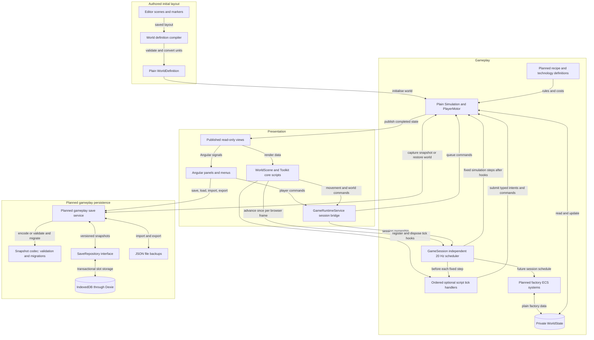
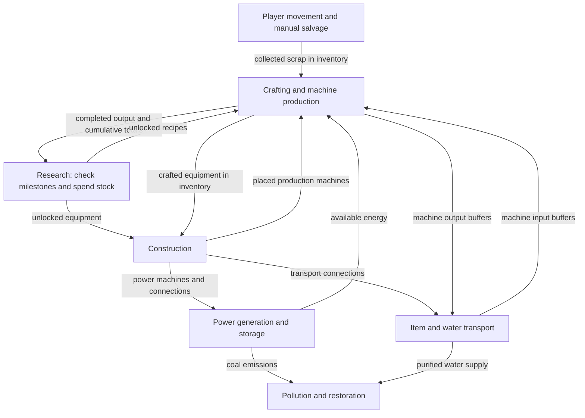

# Scrapworks Technical Design Document

Updated 24 October 2026. Core objects use Toolkit scripts while the application retains its independent gameplay scheduler. Migration evidence remains dated separately from this refactor and future gameplay requirements.

Scrapworks uses Angular for UI and Babylon.js with Babylon.js Editor for its 3D world. A plain authored-world definition and fixed-step movement session now connect scene presentation to authoritative state. Manual/factory rules and versioned world saves remain planned. The [GDD](GDD.md) owns gameplay rules and the [roadmap](../plans/README.md) orders implementation.

## Agreed technical requirements

* Keep the game browser-first, with Angular UI and a fully 3D world/character.
* Author scenes and world layout in one Scrapworks Editor project; attached scripts handle presentation and scene bindings.
* Keep authoritative gameplay in plain TypeScript and save progress locally through versioned data snapshots.
* Defer accounts/cloud saves, remote control, physics, and navigation systems until a defined requirement needs them.

## Technical stack and current implementation

| Responsibility      | Choice                         | Current implementation                                                                                    |
| ------------------- | ------------------------------ | --------------------------------------------------------------------------------------------------------- |
| Application and UI  | Angular 22, signals, CDK       | Shell, shared page/viewport, dialogs, lifecycle views, errors and retry. Gameplay panels remain planned.  |
| 3D presentation     | Babylon.js 9.30.0              | Sole renderer at `/`, with `/3d` compatibility redirect; authored scene bindings and runtime character presentation. |
| Core object scripts | Babylon Toolkit 9.30.0        | TypeScript-attached scripts own player input/presentation, camera, selection and placement; no physics engine is enabled. |
| Authoring           | Babylon.js Editor 5.5.2        | Saved inputs export/reload automatically; validated marker metadata compiles into a plain world definition. |
| Client subscription | RxJS behind plain `GameClient` | Per-client replay, unsubscribe, mounting and asynchronous transition guards.                              |
| Gameplay            | Plain TypeScript               | Private plain WorldState, typed placement command, deterministic 20 Hz movement, collision and detached views. Manual/factory progression remains planned. |
| Persistence         | Dexie / IndexedDB              | Test-data service/dialog only; no playable-world snapshot or round trip.                                  |

The [cleanup plan](../plans/3d-cleanup.md) defines the staged transition and the [baseline](../plans/3d-cleanup-baseline.md) records dated validation. The [Editor setup guide](../plans/babylon-editor-setup.md) owns export/MCP commands. The [Art Document](../art/README.md) owns camera and visual-production requirements. Historical 2D instructions remain in [history](../history/README.md).

## Technical structure diagrams

The class diagram describes the implemented migration boundary. The application diagram separates the current movement/session path from planned factory content and gameplay persistence; the final gameplay diagram remains the future design. Angular services, Babylon objects and Editor components stay outside plain state records. `GameState` describes renderer lifecycle and is separate from authoritative `WorldState`.

### Core class diagram

The application runtime owns one `GameSession`; its scheduler advances `Simulation` through the renderer's existing frame callback. `Simulation` exclusively owns `WorldState` and delegates authoritative player movement to plain [`PlayerMotor`](../../src/simulation/player-motor.ts). [`WorldScene`](../../src/game/views/world-scene.ts) composes Toolkit scripts and entity views that consume the initial definition and detached `WorldView` values. [`WorldSessionBridge`](../../src/contracts/game-client.ts) connects these scene objects to the application-owned session without exposing its mutable state.

[SVG image](../diagrams/core-class-diagram.svg) / [PNG image](../diagrams/core-class-diagram.png) / [Mermaid source](../diagrams/src/core-class-diagram.mmd)

A filled diamond means ownership, a dotted arrow means a dependency, and the hollow triangle means interface implementation. Presentation receives detached read-only views; simulation alone changes live world data.

### Application system interaction diagram

This is a component and data flow diagram: it shows where commands, state, and saves travel. The fixed-step loop advances gameplay independently of the rendering frame rate. Signals hold the selected UI view of state rather than a second authoritative world.

[SVG image](../diagrams/system-interactions.svg) / [PNG image](../diagrams/system-interactions.png) / [Mermaid source](../diagrams/src/system-interactions.mmd)

Commands are checked and applied inside the simulation and completed state is published as detached views. Gameplay snapshot capture/replacement and the persistence branch are planned. Their eventual implementation must await committed transactions, validate a separate candidate world and preserve the active session on failure. The existing test-data save dialog does not implement this branch.

A future cloud repository can implement `SaveRepository` . Accounts, synchronization, and conflict handling remain later work; they are not needed by the prototype simulation.

### Gameplay system interactions

This closer view shows the dependencies between gameplay systems. Arrows describe resources and rules shared through `WorldState` ; they do not require the systems to call each other or maintain duplicate inventories. Construction establishes the machines and connections that power, transport, and production subsequently use.

[SVG image](../diagrams/gameplay-interactions.svg) / [PNG image](../diagrams/gameplay-interactions.png) / [Mermaid source](../diagrams/src/gameplay-interactions.mmd)

Production increases cumulative totals only when a craft or machine output completes. Transport and collection move existing items without increasing those totals. Research checks production milestones, current stock, and prerequisites, then consumes the stock and grants the unlock together. Production and construction both enforce the resulting unlocks. Pollution and restoration combine industrial emissions, supplied water, and simulation time to update pollution, vegetation, and greenhouse health.

The dependency arrows do not prescribe tick order. Commands are processed in a consistent order, then systems advance using an explicit schedule that resolves transport, power allocation, production, and environmental updates. Exact ordering and rules for newly produced items or power are implementation decisions to settle before the first playable prototype.

## State ownership and module boundaries

The simulation owns authoritative player/world state, movement, collision and placement validation. Planned crafting, research, transport, power and restoration modules will join this boundary. Angular and Babylon send commands to the same session and display published views. Scene frames, animation callbacks, and UI handlers must not advance production or directly spend inventory.

Angular owns the shell, menus, dialogs, controls and future gameplay panels. Babylon owns rendering, cameras, picking, visual effects, animation, and input adaptation. Signals expose lifecycle, selection and detached world views without becoming an authoritative world owner.

Use `src/app/features/` for Angular/session integration, `src/game/` for 3D presentation, `src/contracts/` for plain boundaries, `src/simulation/` for authoritative rules, and `src/core/` for framework-independent utilities. Simulation/contracts/core remain free of framework, storage, DOM, and wall-clock dependencies. Phaser source and its package dependency have been removed.

The Editor owns saved cameras, lights, materials, static geometry, and world markers in `assets/`. The compiler in `tools/world/` extracts marker metadata into versioned `WorldDefinition` records without executing attached scripts, validates IDs, bounds, alignment, footprints and hierarchy transforms, and converts centimetres to metres on X/Z. Mutable `WorldState` belongs exclusively to the simulation; detached views cross into presentation. Scene serialization and attached components are not gameplay saves.

`GamePageComponent` provides a scoped runtime and directly owns the renderer host. The runtime owns its `GameClient` subscription, readonly signals, generation guards, mount/unmount, retry, and application session. Babylon owns one engine/frame callback, scene assets, resize observation, transition guards, first-frame readiness and late-load disposal. Its frame advances the application-owned scheduler; no independent simulation timer is started. See the [migration plan](../plans/3d-migration.md) for current lifecycle acceptance and the [dated Phase 2 walkthrough](../plans/3d-phase-2-walkthrough.md) for implementation history.

### Core object scripts

`@babylonjs-toolkit/next` is pinned to 9.30.0 alongside Babylon 9.30.0. Core scripts are constructed and attached in TypeScript; the Editor continues to own scenes, layout and visual bindings. Toolkit owns initialization, render updates, late updates and destruction. Physics callbacks are reserved for future physics features; Havok and physics-based scheduling are not part of this integration.

The adapter uses Toolkit's public `SceneManager.AttachScriptComponent` registration directly. It deliberately omits `InitializeRuntime`, which installs global glTF loader overrides that these code-attached scripts do not need. Native startup calls `awake` on the first render, `start` on the second and `update` from the third. The client waits for script initialization before reporting Game ready. No component lifecycle method is invoked manually.

| Responsibility | Owner |
| --- | --- |
| Shared movement and sprint input | `PlayerController` interprets the frame's shared `ActionFrame` and submits plain intent. |
| Authoritative position, collision and facing | Session-owned `PlayerMotor` in plain simulation code. |
| Character rig, interpolation, turning and animation | `PlayerView`. |
| Orbit, zoom, following and occlusion | `CameraController`. |
| Picking and interaction feedback | `SelectionController`. |
| Build mode, rotation, preview and confirmation | `PlacementController`. |
| Entity meshes and materials | Individual view objects, synchronized by entity ID. |

`WorldScene` is the composition root for those objects. `BabylonGameClient` retains browser/render lifecycle responsibilities rather than gameplay-feature branches. The integration defines frame phases explicitly, so incidental construction or array order does not determine behavior:

1. Sample one shared `ActionFrame`, dispatch application/UI actions, and validate ownership.
2. Run camera controls and player input interpretation.
3. Advance the session once, executing zero to five gameplay ticks.
4. Publish completed world state and update player/entity presentation.
5. Follow the player, update occlusion, pick the world and update placement feedback.
6. Draw the scene.

[`attachScriptsInOrder`](../../src/game/toolkit/attach-scripts-in-order.ts) sorts explicit numeric phases before native Toolkit registration. During one `scene.render()`, native `update` runs camera controls (10), player interpretation (20), `SessionDriver` advancement/publication (30), player presentation (40) and entity presentation (50). Native `late`, before render targets are drawn, runs camera follow/occlusion (10), selection (60) and placement feedback (70). The script ordering belongs to the composition root; optional gameplay tick ordering belongs separately to the session.

Generation, transition and input-revision checks invalidate remaining work when ownership changes during a frame. Scene destruction unregisters scripts before disposing their assets; asynchronous Inspector closure remains ahead of scene/engine disposal. Cancelled loads cannot attach scripts or publish into a newer scene. A healthy session survives viewport recreation and renderer-only Retry. A failed authoritative session exposes only its last completed state and is recreated on explicit Retry.

[`GameplayScript`](../../src/game/toolkit/gameplay-script.ts) guards callbacks against stale ownership and observes both node and scene disposal. Its idempotent teardown calls public `SceneManager.DestroyScriptComponent`: Toolkit 9.30.0's base `ScriptComponent.dispose()` is empty. Native destruction then removes the application's tick subscription and disposes the script's owned resources.

### Future factory ECS

Use ECS for factory entities and shared processing, including machines, production, power, and transport. Evaluate Miniplex first when implementation begins. Keep factory state and scheduling independent of Babylon scene objects.

This is the intended architecture for [Milestone 6: First working machines](../plans/milestone-06-first-working-machines.md), not an installed ECS dependency or an implemented factory. Miniplex remains the leading candidate to evaluate against deterministic queries, entity lifetime, persistence and workload measurements. Factory systems will join the session's explicit simulation schedule, independently of scene-script subscriptions; player and camera continue to use the simpler Toolkit object lifecycle.

Production history and research unlocks belong to the saved world. A research action checks cumulative eligibility, current stock and prerequisites, then spends stock and grants the unlock atomically. It preserves production totals and cannot charge again for completed research. Crafting and placement enforce unlocks. The GDD defines these rules.

## Simulation timing and save boundaries

`GameSession.advance(deltaSeconds)` retains a 50 ms accumulator (20 Hz), a five-step catch-up limit and the existing browser frame source. It adds no timer or animation loop and does not depend on physics, physics substeps or global Babylon timing. A zero-tick render frame still updates presentation; excess elapsed time beyond the bounded catch-up budget is discarded.

`registerTickHandler(handler, order?)` accepts a synchronous callback and returns an idempotent unregister function. Each `GameTickContext` contains the upcoming tick number and fixed duration in seconds. Before each authoritative step, handlers run in numeric execution order, with registration order breaking ties. Additions become eligible on the next tick. Removal or disabling prevents subsequent invocation immediately. Session suspension prevents dispatch.

The narrow `GameplayScript` base connects an implemented optional `onGameTick(context)` method through `WorldSessionBridge` during native `start` and disconnects it during destruction. The adapter checks script and object activation at dispatch time. Toolkit lifecycle registration and application tick registration remain distinct; this is not a second component framework or a manual invocation of Toolkit's physics hooks.

Continuous movement is sampled state. Discrete commands are captured once and queued until a tick consumes them, so catch-up cannot repeat a button press. Placement confirmation happens after the current frame's session advance and therefore targets a subsequent tick. Each authoritative step processes queued commands, advances player movement, increments the tick and publishes completed state. A failed step cannot expose partial state.

Pause/suspension clears movement, pending commands and accumulated time while UI input polling remains available. Resumption cannot replay hidden or blocked time. A completed step is the future save-capture boundary; gameplay snapshot saving and offline production remain unimplemented.

## Persistent game state

Keep active gameplay state in memory. Save a versioned data snapshot containing:

* Player position, inventory, and crafting queues.
* Remaining deposits, placed machines, and connections.
* Machine buffers, work progress, and items in transit.
* Stored energy and water.
* Cumulative production totals and research unlocks.
* Pollution, vegetation, and simulation time.

Store identifiers and data rather than Angular services, Babylon meshes/materials, scene handles, or Editor components. Recipe and technology definitions belong to the game content; saves reference their identifiers and record a compatible content version.

## Local storage and save operations

Use the installed Dexie integration for IndexedDB persistence. The current service stores development test records; it has not yet proved a reload round trip or restored gameplay. Implement complete snapshots and a SaveRepository in Milestone 4, then periodic autosaves and retained revisions in Milestone 9.

Write each snapshot and its metadata together in a transaction. Report save success only after the write completes, and preserve the last successful revision if a later write fails. Avoid relying on a final save when the tab closes.

## Save format and loading

Give saves stable identifiers, a schema version, a game or content version, and a saved timestamp. Validate a loaded or imported snapshot, migrate supported older schemas, and construct the restored world before replacing the active session. Unsupported newer versions or invalid data should leave the active world and existing saves intact.

Database schema changes and game save migrations are separate concerns.

## File backups and browser storage limits

Provide JSON file export and import as a proposed backup and transfer option. Browser storage is local to the browser profile and website origin; clearing site data can remove saves, and best-effort storage can be evicted. Request persistent storage where supported, but retain file backups because that request may be denied and users can still clear stored data. These limits are documented in [MDN browser storage guidance](https://developer.mozilla.org/en-US/docs/Web/API/Storage_API/Storage_quotas_and_eviction_criteria).

## Future cloud persistence

Keep persistence behind a small save repository interface for listing, loading, saving, and deleting slots. Implement the local IndexedDB repository first. A future cloud repository can use the same versioned snapshot format, while accounts, synchronization, and conflicting revisions remain separate future work. This does not require a backend for the initial prototype.

## Initial verification requirements

The first implementation checks should cover:

* Saving and loading a running factory without changing inventory, research, production totals, or machine progress.
* Continuing the simulation with the same results after restoration.
* Migrating supported older save schemas.
* Invalid saves or failed writes preserving the last usable state.
* Research consuming the required materials exactly once while retaining cumulative production totals.
* Crafting and placement rejecting equipment whose technology has not been researched.
