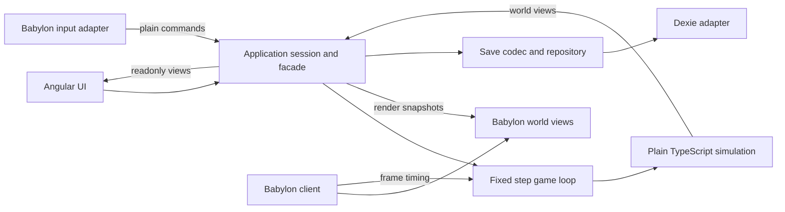

# Scrapworks 3D migration plan

Prepared 11 October 2026. Status: Phase 1 complete; `/3d` runs the Babylon prototype and `/` retains Phaser 4.2.1. Phase 0 was skipped at the user's request.

Move Scrapworks to Babylon.js with a fully 3D world and character. Start with an elevated perspective camera, keep Angular for application UI, and preserve the plain TypeScript factory simulation and local-save direction. Complete a small playable scene before replacing the Phaser adapter, then resume the existing gameplay milestones.

The initial world uses a square construction grid on flat ground. Full 3D rendering supports perspective, lighting, animation and camera rotation without requiring vertical factory construction, terrain deformation or a rigid-body simulation of conveyor items. Those gameplay features can be evaluated separately after the opening works.

[Implementation roadmap](README.md) · [Technical design](../design/TDD.md) · [Gameplay design](../design/GDD.md) · [Art direction](../art/README.md)

## Target and migration scope

| Area             | Target                                                                                                                    |
| ---------------- | ------------------------------------------------------------------------------------------------------------------------- |
| Rendering        | Babylon.js, replacing the Phaser renderer after the scene and lifecycle checks pass                                       |
| Camera           | Elevated perspective camera with bounded pitch, zoom and rotation; compare orthographic projection in the same test scene |
| Character        | Rigged 3D model with idle and walk animation; sprint and interaction animation follow when their gameplay needs them      |
| World            | 3D terrain surfaces, obstacles, deposits and machinery, with logical grid coordinates in metres                           |
| UI               | Angular and existing CDK overlays for menus, inventory, crafting, research, saves and errors                              |
| Rules            | Plain TypeScript simulation owns movement, construction, production, research, pollution and time                         |
| Storage          | Versioned plain world snapshots through Dexie and IndexedDB                                                               |
| Graphics backend | Babylon's WebGL engine first, with WebGL 2 as the initial test target; evaluate WebGPU later                              |
| Physics          | Plain movement and occupancy rules for the first flat scene; add Havok only when a defined interaction needs it           |

Keep the agreed manual opening: empty inventory, no supplied equipment or researched technologies, manual salvage and crafting, and research-gated machinery. The migration scene may contain developer test objects; the playable new-world factory must not grant those objects to the player.

The migration changes presentation and its integration. Completing it does not complete crafting, research, transport, restoration or resilient saving.

## Current starting point

| Existing implementation                                                                                                                                                                                | Migration treatment                                                                                                                                             |
| ------------------------------------------------------------------------------------------------------------------------------------------------------------------------------------------------------ | --------------------------------------------------------------------------------------------------------------------------------------------------------------- |
| [GameClient](../../src/contracts/game-client.ts) and [lifecycle state](../../src/contracts/game-state.ts) expose subscriptions, scene switching and destruction                                        | Retain this boundary while introducing a Babylon adapter. Keep lifecycle state separate from authoritative `WorldState`.                                        |
| [GameRuntimeService](../../src/app/features/game/game-runtime.service.ts) is page-scoped, rejects stale callbacks and unsubscribes before destroying a client                                          | Preserve these lifecycle guarantees and test asynchronous model loading against them.                                                                           |
| [Client factory](../../src/app/features/game/game-client-factory.ts) chooses the renderer behind an injection token                                                                                    | Use this composition point for the temporary Babylon test route and final cutover.                                                                              |
| [Shared game viewport](../../src/app/features/game/game-viewport/game-viewport.ts) and [game page](../../src/app/features/game/game-page/game-page.component.ts) own mounting and the Play Game action | The renderer-neutral host is implemented in Phase 1. Preserve its HTML host, actual button flow and readable errors during cutover.                             |
| [Main menu](../../src/game/scenes/main-menu.scene.ts) draws the background and logo; the page draws the Play Game button                                                                               | Move menu imagery and loading UI to Angular. Retain the existing logo and background assets.                                                                    |
| [Game scene](../../src/game/scenes/game.scene.ts) contains a player and placeholder background                                                                                                         | Replace it with a small 3D scene; there is no implemented factory world to port.                                                                                |
| [Player](../../src/game/gameobjects/player.ts) moves directly in render-frame updates                                                                                                                  | Replace this movement scaffold with sampled input and simulation-owned position.                                                                                |
| [WorldGrid](../../src/game/gameobjects/world/world-grid.ts) contains a private 2 metre cell size                                                                                                       | Make the grid specification a plain shared type and let a dedicated view draw it.                                                                               |
| [Simulation](../../src/simulation/simulation.ts) has a string queue and logging methods                                                                                                                | Establish typed commands, a new-world factory and a fixed-step loop as part of the movement checkpoint.                                                         |
| [Save schema](../../src/app/features/save/schema.ts) contains test records                                                                                                                             | Implement gameplay snapshots in Milestone 4; there are no implemented gameplay saves to convert. Preserve existing test data when changing the database schema. |
| [Tiled project](../../map/untitled.tiled-project), [basic map](../../map/basic-map.tmx) and [terrain atlas](../../public/assets/tilesets/terrain.png) exist                                            | Retain authoring data and artwork. Reuse map semantics where useful; replace Phaser tile-layer rendering.                                                       |

The original [rigged MPFB protagonist](../art/characters/3d/protagonist-mpfb-v1/README.md) is retained as source artwork. That GLB is 25,321,044 bytes, with 195,504 triangles, 10 meshes, 10 materials, 9 embedded images and one 53-joint skin. It contains no animation clips. The [export inspection](../art/characters/3d/protagonist-mpfb-v1/glb-inspection.json) and [Blender roundtrip](../art/characters/3d/protagonist-mpfb-v1/roundtrip-validation.json) establish its export and rig checks. Phase 1 imports the separately authored [runtime protagonist](../../public/assets/models/Protag-v1.glb); animation and performance work remain pending.

Keep its editable source and provenance. Produce a separate runtime derivative when optimizing or adding animation. The asset README records clothing differences from the painted concept; importing it does not settle those art decisions.

## Architecture and responsibilities



The application session owns authoritative state, commands and the fixed-step scheduler. The Babylon client owns the canvas, engine, scene and browser frame callback. Its frame callback advances the application-owned scheduler through a plain callback and renders the resulting views. Use one frame source; do not start an independent simulation timer alongside the Babylon loop.

Rendering may interpolate between completed simulation states. Animation, particle effects and camera motion cannot advance crafting, transport or research. Babylon meshes, vectors, observables and physics objects stay inside `src/game/`; simulation, contracts and core remain free of Angular, Babylon, Phaser, storage and DOM imports.

Introduce modules as their phases need them. The intended layout is:

```text
src/app/features/game/
  game-viewport/             Angular host and accessible fallback
  game-page/                 Menu, loading, error and game presentation
  game-runtime.service.ts   Mounting, subscriptions and session composition
  game-client-factory.ts    Renderer selection
  session/                  GameFacade and fixed-step orchestration
src/contracts/
  game-client.ts            Renderer lifecycle boundary
  game-state.ts             Lifecycle state
  world-view.ts             Plain presentation data
  game-command.ts           Plain player and construction intents
src/core/math/              Plain positions and grid calculations
src/simulation/
  model/                    WorldState and stable identifiers
  content/                  Terrain, items and machine definitions
  systems/                  Movement and later factory rules
src/game/
  bootstrap.ts              Create the Babylon client
  bridge/                   BabylonGameClient and lifecycle publication
  scenes/                   World scene construction and disposal
  cameras/                  Camera controller
  input/                    Keyboard, pointer and focus ownership
  assets/                   Model catalog and loading ownership
  views/                    Player, terrain, machine and grid presentation
tools/world/                Tiled export conversion and validation if retained
public/assets/models/       Runtime GLB derivatives
public/assets/worlds/       Validated plain world definitions
docs/art/                   Editable sources, previews and provenance
```

`BabylonGameClient` coordinates lifecycle; specialized modules load assets, handle input and update views. It must not become a combined loader, world generator, movement system and save service.

## Phase 0 Establish a baseline and acceptance targets

**Result:** a recoverable starting point and a defined scene to judge the migration.

- [ ] Record the current working tree, including the in-progress protagonist work. Keep migration edits distinct from those asset edits and retain a baseline Git revision before renderer cutover.
- [ ] Run the existing application tests, lint and production build. Record custom lint-tool results separately; the earlier milestone report's 24 passing tests and 2 custom-rule failures are historical observations, not current acceptance evidence.
- [ ] Name the primary test computer, browser, viewport and display scale. Record additional browsers and any mobile target separately.
- [ ] Use 60 frames per second at the normal desktop gameplay view as the initial target. Record an agreed lower quality target if the selected hardware requires it; do not use headless software rendering as a performance benchmark.
- [ ] Define the first comparison scene: ground, an engineer placeholder, a tall obstacle, a scrap deposit, a building preview and a repeated-machinery sample.
- [ ] Record camera limits, initial download expectations and provisional asset/frame budgets for that scene. Refine them from the measured prototype before producing a complete art set.

**Finish when:** baseline behavior and the target hardware are recorded, and the comparison scene has a small, fixed scope.

## Phase 1 Prove Babylon inside the existing application

**Result:** an isolated 3D scene using the existing Angular mounting boundary.

Use the [Phase 1 implementation walkthrough](3d-phase-1-walkthrough.md) for the factory, temporary route, client lifecycle, primitive scene and protagonist import.

- [x] Add matching stable versions of `@babylonjs/core` and `@babylonjs/loaders`, lock them in Yarn and verify the Angular production build. Use typed ESM imports and register the glTF loader explicitly. Keep Inspector as an optional development import. See [Babylon package guidance](https://doc.babylonjs.com/setup/frameworkPackages/es6Support).
- [x] Create a temporary development route that supplies `BabylonGameClient` through the existing factory token. Mount one renderer per host; keep the regular Phaser route available during this checkpoint.
- [x] Return a lifecycle client synchronously from the factory, then perform model loading asynchronously inside it. Publish loading, ready and error states through subscriptions so the current synchronous `mount` contract can remain intact.
- [x] Draw ground, a capsule placeholder, one obstacle, lighting and an elevated perspective camera. Test the MPFB GLB separately as an import probe after the primitive scene works.
- [x] Check model scale, feet position, skin binding, material transparency, missing resources and the absence of exported studio cameras/lights. A rig without clips must remain visibly distinguishable from completed animation.
- [x] Show ready only after required assets are usable and a first scene frame can render. Failed imports must produce a useful error and a retry/remount path.

**Completed and verified 11 October 2026.** Phase 0 was skipped at the user's request. `/3d` supplies the Babylon client through the existing factory token; `/` retains Phaser. The shared viewport supplies an HTML host, and each renderer owns its canvas. Babylon core, loaders and the glTF interface types resolve to 9.30.0.

The prototype loads [the runtime protagonist](../../public/assets/models/Protag-v1.glb): 10 skinned meshes, 39,990 triangles, one 52-joint skin and no animation clips, cameras or lights. Skin, clothing, boots and mouth parts export as opaque; hair, eyebrows and eyelashes retain their required alpha blending. The browser checks verify scale, ground contact, skin weights and the first rendered frame. The pose is a static import probe.

Cleanup includes one render callback, host resizing, disposal of scenes and asset containers, canvas removal and rejection of stale asynchronous completions. Loading and errors reach Angular through plain state. A failed import displays its error and offers Retry, which remounts the renderer before allowing Play again.

Validation passed: 31 Chromium tests across 10 files, all axe checks on the Babylon menu, loaded scene, error and retry states, normal lint, 30 custom lint-rule tests and the Angular production build. Both routes were also checked on the running development server with no browser warnings or errors. The focused checks are in [Babylon client tests](../../src/game/babylon/babylon-game-client.spec.ts) and [Babylon page tests](../../src/app/features/game/game-page/babylon-game-page.component.spec.ts).

**Finish when:** Play enters a visible Babylon scene, the model import probe succeeds, and the prototype builds without coupling Angular consumers to Babylon objects.

## Phase 2 Preserve lifecycle and input ownership

**Result:** the scene survives normal application use and asynchronous interruption.

Use the [Phase 2 implementation walkthrough](3d-phase-2-walkthrough.md) to build on Phase 1's existing lifecycle and cleanup, then add input ownership, suspension, graphics recovery and the remaining browser checks.

- [ ] Give each client its own engine, subscriptions and resource ownership. Use `ResizeObserver` on the host to call engine resize and update camera sizing, including zero-sized or temporarily hidden hosts.
- [ ] Preserve generation guards for remounts and add a transition token for overlapping asynchronous scene/model loads within one client. Dispose assets that finish loading after their owner has been destroyed or superseded.
- [ ] Make destruction idempotent. Stop the render callback, release keyboard/pointer handlers and observers, disconnect resize and visibility listeners, dispose owned assets, scene and engine, and remove the canvas. Dispose shared model resources only after their final user releases them.
- [ ] Define input ownership: gameplay movement, camera drag and placement shortcuts operate only while the viewport owns input. Angular dialogs and text fields take priority. Clear held movement on blur, hidden tabs, pause, load and teardown.
- [ ] Pause simulation while hidden and reset the time accumulator on resume. Handle lost rendering capability with an explicit lifecycle state and controlled recovery; avoid progressing gameplay while the user cannot interact with it.
- [ ] Adapt the existing host/runtime browser checks to real Babylon initialization. Cover repeated mount/unmount, separate hosts, resize, failed asset loading, destruction during loading and a late completion from an old transition.

**Finish when:** repeated creation and removal leave no canvases, active render callbacks or listeners, and an old load cannot change the newly mounted game's state.

## Phase 3 Establish coordinates movement camera and picking

**Result:** the player moves through the grid and points at the correct cell from different camera views.

- [ ] Use metres with a plain `WorldPosition` containing `x`, `y` and `z`; `y` is elevation and the ground grid uses `x` and `z`. Start with the existing 2 metre cell size. Record the map origin, cardinal directions and model-forward convention together.
- [ ] Choose Babylon's left-handed scene convention initially and let the glTF loader handle right-handed model conversion once. Isolate any facing correction under the character's visual root; do not mirror meshes or reverse gameplay coordinates to repair an import. See [glTF coordinate handling](https://doc.babylonjs.com/features/featuresDeepDive/importers/glTF).
- [ ] Define grid lookup as `column = floor(x / metresPerCell)` and `row = floor(z / metresPerCell)`. Treat cells as half-open regions and reject coordinates at or beyond the outer boundary. Test centres, edges and out-of-map positions independently of rendering.
- [ ] Send normalized movement intent to the application session. Advance position at a fixed simulation duration, with a simple player footprint, occupied-cell collision and map limits. Keep the presentation transform derived from that position.
- [ ] Start with movement relative to the camera: project camera forward and right onto the ground plane, normalize the resulting direction and send plain values. Camera rotation must not change movement speed.
- [ ] Configure an `ArcRotateCamera` around a smoothed player target, with bounded pitch, radius and rotation controls. Compare orthographic and perspective modes using the same geometry; record the selected field of view and defaults after judging placement and character readability. See [Babylon cameras](https://doc.babylonjs.com/features/featuresDeepDive/cameras/camera_introduction).
- [ ] Give camera dragging and building interaction distinct gestures. Prevent camera controls from consuming movement keys or pointer clicks that belong to placement.
- [ ] Pick only the intended terrain surface for construction, excluding the player, preview and effects. Convert the world hit to a cell; use separate entity picking for selecting machines and deposits. Verify rotated cameras, zoom, high display scale and an offset canvas. See [mesh picking](https://doc.babylonjs.com/features/featuresDeepDive/mesh/interactions/picking_collisions).

**Finish when:** movement distance is consistent across render rates, the camera remains usable, and a pointer selects the same world cell across camera and viewport changes.

## Phase 4 Prepare a runtime character and visual style

**Result:** a readable animated engineer rendered from a reproducible asset export.

- [ ] Keep the MPFB `.blend`, preset and source library intact. Create a versioned runtime derivative under the established character art folder; export its GLB to `public/assets/models/` with source and export records.
- [ ] Measure the current model in Babylon on the target hardware. Reduce geometry and material/texture cost where those measurements justify it, preserving silhouette, facial identity, outfit and skin weights. Record triangle counts, material count, texture sizes, transfer size and the chosen limits.
- [ ] Add idle and in-place walk clips, documenting names and rig mappings. Retarget against the actual MPFB skeleton and test clothing deformation. Drive animation state and playback speed from published movement; simulation owns translation, so root motion must not move the player again.
- [ ] Validate the exported clips in Babylon, including transitions, turning, pause/resume and the neutral pose. Add sprint only when the movement design retains sprint; add salvage/crafting cues with those interactions.
- [ ] Translate the preferred flatter finish into consistent materials, restrained lighting and simple shadows. Compare dusty soil, dark machinery, green vegetation and pale advanced buildings at gameplay scale.
- [ ] Test an obstacle between camera and engineer. Use camera adjustment or a controlled obstruction fade if needed; preserve an understandable player location and avoid hiding placement targets.
- [ ] Validate a runtime derivative after optimization and export, including scale, bounds, UVs, skinning, clips, transparency and external resource references. Retain the existing license and authorship records for derived assets.

**Finish when:** idle and walk work in the browser, the player is readable in the perspective view, and the derivative meets the recorded asset and frame budgets.

## Phase 5 Adapt world authoring and construction presentation

**Result:** a small data-driven map with deposits, collision and a correct building preview.

Retain Tiled as the initial authoring option for terrain categories, blocked cells, spawns and deposits in `map/`. Its pixel projection is an editor display choice; the 64 by 52 terrain atlas must not determine 3D world dimensions. The existing [Tiled plan](tiled-world-integration.md) supplies useful data conventions, while this phase replaces its Phaser tile-layer and screen-projection steps.

- [ ] Export one finite map into a versioned, validated plain `WorldDefinition` with grid dimensions, terrain IDs, spawn, deposits and blockers. Resolve external tileset metadata during conversion and map authoring IDs to stable gameplay IDs.
- [ ] Keep terrain decoding independent from Babylon. Map terrain IDs to surface materials and vegetation definitions in a presentation catalog; map building IDs to model assets in a separate catalog.
- [ ] Render simple chunked ground surfaces first. Match the environmental direction with soil, rock, water and grass materials before adding complex slopes or blending. Preserve the 2D atlas as reference or a reusable texture where appropriate.
- [ ] Use simple blocker footprints for movement and lightweight picking surfaces for selection. Detailed visual mesh geometry must not determine whether a machine fits the grid.
- [ ] Add an unpickable building preview that snaps to the authoritative grid, rotates in quarter turns and displays validity from footprint, reach, occupancy and availability rules. Send placement commands rather than committing construction from a mesh callback.
- [ ] Let a developer fixture demonstrate placement without inventory grants. The playable manual opening continues to enforce inventory and research requirements as those systems arrive.
- [ ] Save terrain/map identity, player position, entity IDs, footprints and orientation as plain values. Renderer reconstruction loads models from IDs; Babylon scene serialization is not the gameplay save format.

**Finish when:** the authored map places the player correctly, selection is reliable and construction previews agree with the simulation's placement rules.

## Phase 6 Cut over and remove the Phaser runtime

**Result:** the regular game route uses Babylon, with coherent UI, dependencies and documentation.

- [ ] Switch the factory's default implementation after Phases 1–5 pass. Retain the shared `GameViewport` introduced in Phase 1 and update route providers and tests for the default Babylon adapter.
- [ ] Move title imagery, loading status and asset errors into Angular. Keep `MainMenu` and `Game` as logical screen keys for the first cutover; retire `Boot` and `Preloader` from the contract after their callers/tests are migrated. No duplicate Babylon boot scene hierarchy is required.
- [ ] Preserve lifecycle subscription replay, stopped/error behavior and stale-callback rejection. Extend gameplay commands and views through plain session interfaces when needed; do not add Babylon types to `GameClient`.
- [ ] Replace Phaser-specific tests with tests of the same user behavior and a real Babylon browser check. Retain the actual Play Game click, resize and teardown coverage rather than only testing component creation.
- [ ] Remove Phaser scene/gameobject/bridge code and the dependency only after searches show no remaining runtime or test consumers. Update package description, keywords, applicable `AGENTS.md` guidance and renderer-specific examples.
- [ ] Keep previous source/artwork in Git history and preserve authored Tiled files, logo, cursor, concept art and character sources. Remove temporary development routes when their acceptance checks are covered.
- [ ] Reconcile the TDD, Art Document, roadmap, Milestones 1 and 3, and diagram sources with the implemented 3D path. Regenerate any changed diagram exports and repair links. Retain the GDD's opening, research and restoration semantics.

**Finish when:** Babylon is the only game renderer, production builds contain no Phaser dependency, and the docs distinguish implemented migration work from unfinished gameplay.

## Phase 7 Resume gameplay and measure a growing factory

**Result:** the migration connects to the existing milestone sequence and scales to its intended prototype.

| Existing milestone             | Work after migration                                                                                                          |
| ------------------------------ | ----------------------------------------------------------------------------------------------------------------------------- |
| 1 Project and integration      | Close the Babylon canvas, representative grid and lifecycle checks; finish remaining tooling/storage verification separately. |
| 2 Simulation foundation        | Expand the movement checkpoint's `WorldState`, commands and fixed-step loop into the complete planned simulation foundation.  |
| 3 Character and manual opening | Add deposits, salvage, manual jobs and Angular inventory/crafting views; use the 3D player for feedback.                      |
| 4 First local save             | Add versioned snapshots, a real IndexedDB reload and renderer reconstruction from the restored world.                         |
| 5 Research                     | Preserve cumulative production and consume current stock exactly once when granting an unlock.                                |
| 6 First working machines       | Add generator/recycler state and model views. Machine animations display job progress without owning it.                      |
| 7 Transport                    | Render logical in-transit items with interpolation; use instances or buffers where measured demand warrants it.               |
| 8 Restoration                  | Drive vegetation, ground treatment, water, particles and lighting from simulation health and day/night values.                |
| 9 Save resilience              | Continue revisions, migration, import/export and failure recovery using plain world data.                                     |
| 10 Portfolio prototype         | Profile the completed loop, tune quality controls and verify the complete empty-start acceptance route.                       |

Build a repeatable performance fixture with recorded counts of machinery, vegetation and visible transport items. Measure frame time, draw calls, mesh/material counts, memory, loading time and remount behavior on the Phase 0 hardware. Compare the empty scene, normal prototype scene and stress fixture under the same camera and display scale.

Use regular instances for individually changing objects and chunked thin instances for mostly static repeated geometry when appropriate. Thin instances share visibility as a group and have different addition/removal costs; they need deliberate grouping. See [Babylon thin instances](https://doc.babylonjs.com/features/featuresDeepDive/mesh/copies/thinInstances).

Add LOD, limited shadow casters, texture compression, render-resolution controls or lighter vegetation only where measurements identify a bottleneck. Test selecting, updating and removing instanced objects as well as drawing them.

Havok remains optional. Introduce it through a dedicated adapter if slopes, jumping or physical interactions become requirements, with explicit ownership of player position and fixed-step updates. Factory contents and conveyor transfers remain simulation records. If physics state becomes authoritative, define how position, velocity and other relevant state survive save/load before enabling it. See [Havok initialization](https://doc.babylonjs.com/features/introductionToFeatures/chap9/physics/).

## Validation and completion

During implementation, run `yarn test`, `yarn run lint` and `yarn run ng -- build` at each renderer integration checkpoint. Run `yarn run test:lint` when changing the separate lint tooling and record it independently. Use browser rendering checks for Babylon behavior and plain TypeScript tests for movement, occupancy and factory invariants.

The migration acceptance route is:

1. Mount the game page, load required assets and enter the 3D world through Play Game.
2. Move cardinally and diagonally, turn the camera, zoom and resize the host; confirm movement and picking remain correct.
3. Walk behind an obstacle and inspect character visibility, animation and placement feedback.
4. Open a modal or focus an input; verify gameplay shortcuts stop and held movement clears.
5. Hide and restore the tab; verify the world does not gain hidden-time production or resume with a large movement jump.
6. Fail an asset load, destroy during a pending load and remount; verify useful errors and no stale state or leaked resources.
7. Repeat teardown/remount and profile the normal and stress scenes on target hardware.
8. Once Milestone 4 is implemented, save and reload the 3D opening; compare continuation under the same commands and confirm rendering reconstructs from plain state.

Migration is complete after the regular route, lifecycle, movement/camera/picking, runtime character, small authored world and Phaser removal checks pass. The save continuation check belongs to Milestone 4 and must not be reported complete merely because rendering migrated.

## First implementation session

Start with Phases 0 and 1: record the baseline, add the Babylon packages, and render a ground plane, capsule and perspective camera through the current client factory on a temporary route. Then run the MPFB model import probe. Leave final character optimization, animation and machinery artwork until the browser scene and lifecycle work reliably.
