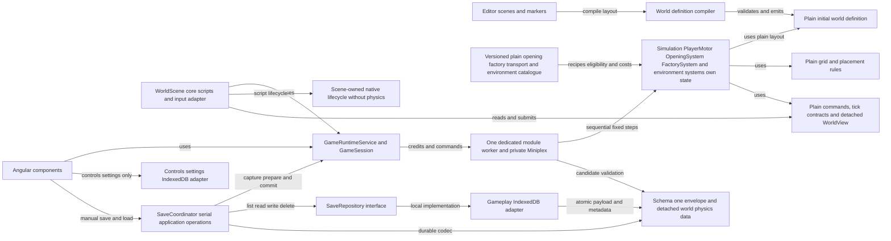
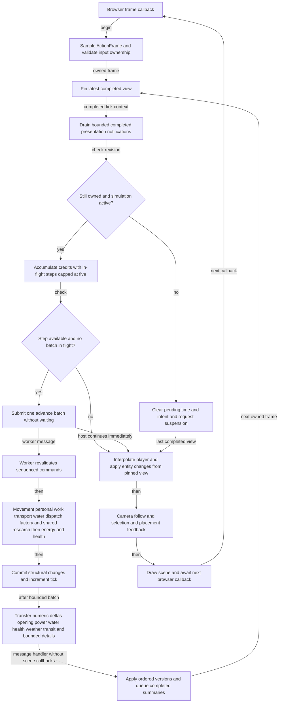
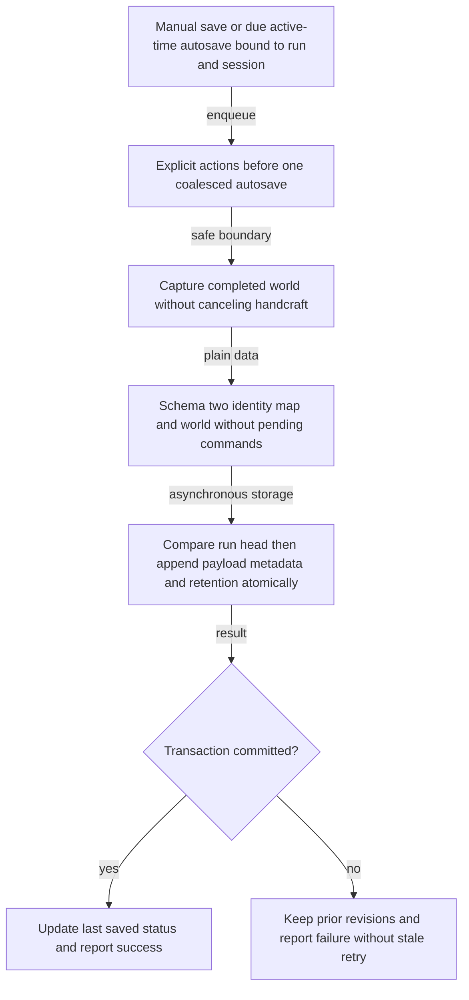
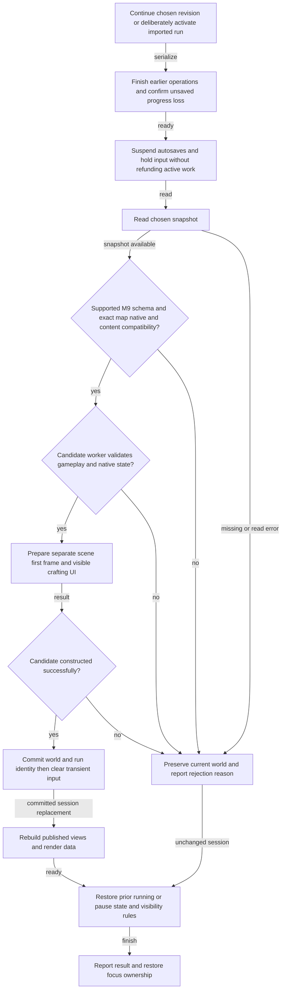
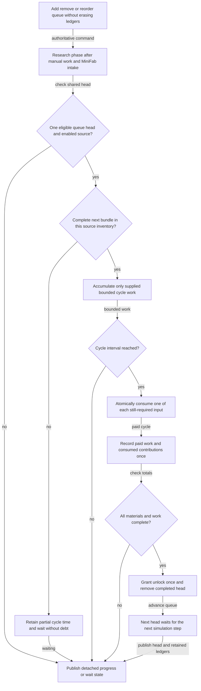

# Scrapworks Implementation Plan

Updated 10 November 2026 after [Milestone 10 implementation](milestone-10-portfolio-prototype.md#implementation-verification--10-november-2026), based on `3b7daa2` with uncommitted local changes. M1–M9 remain complete. M10 is In Progress: current-asset onboarding, Chromium/Firefox baseline and portable diagnostics, production verification and the [local portfolio handoff](../portfolio/README.md) are implemented. The user will human-playtest later, so the 30–60 minute first-restoration target and numerical balance remain provisional. The separate [asset audit and final qualification plan](portfolio-assets-and-final-qualification.md) is deferred and unchanged; final performance approval depends on settled assets. No hosted CI, public hosting or other-device qualification is claimed.

Build a browser-first 3D game with Angular UI, Babylon presentation, Editor-authored layout, a plain TypeScript simulation, and local Dexie/IndexedDB snapshots. The [GDD](../design/GDD.md), [player progression decisions](../design/player-progression.md), [TDD](../design/TDD.md), and [Art Document](../art/README.md) own their respective requirements.

## Migration to 3D

The [migration plan](3d-migration.md) and [acceptance record](../reports/migration/2026-10-23/README.md) record the completed renderer migration. The [acceptance checklist](3d-implementation-checklist.md), [runtime walkthrough](3d-phase-2-walkthrough.md) and [Editor setup](babylon-editor-setup.md) explain the implemented ownership and authoring workflow.

Babylon is the sole world renderer at `/`; `/3d` redirects to it. Saved Editor markers compile into a versioned plain world definition, and one session advances authoritative movement/collision at 20 Hz. The fixture includes an animated protagonist, orbit/follow camera, picking, controls, pause/suspension and isolated development placement checks. Normal worlds start with no inventory, equipment, machines or research unlocks.

Core objects now use native presentation behaviors composed by `WorldScene`, with plain `PlayerMotor` retaining authoritative movement. The host session delivers ordered completed-tick presentation hooks during its owned render frame, independently of physics. See the [core object design](../design/TDD.md#core-object-scripts) and [timing contract](../design/TDD.md#simulation-timing-and-save-boundaries). The [ECS foundation starts in Milestone 3](../design/TDD.md#ecs-foundation-from-milestone-3), before new inventory/salvage/research/crafting runtime work. The [comparison](../reports/ecs/2026-10-29/README.md) selected Miniplex 2.0.0; the user confirmed a single worker for Simulation/ECS as the starting architecture. The [lean requalification](../reports/simulation-worker/2026-10-30/README.md) now qualifies both candidates with transferred numeric views and bounded inventory/selection details, retaining Miniplex. The rich bridge's failed budgets remain historical. The actual Angular/Babylon worker path has production integration acceptance; see the [implementation report](../reports/ecs-worker-implementation/2026-10-30/README.md) for performance qualification. Keep 60 FPS required, 120 FPS diagnostic and interpolation before visual prediction. The report also assesses future multithreading suitability; multi-worker ECS implementation remains deferred unless simulation profiles warrant a later investigation. Milestone 6 extends the established ECS world with factories.

The [cleanup record](3d-cleanup.md) describes retired tools/assets and their recovery sources. Fresh [authoring workflow validation](../reports/workflow/2026-10-23/README.md) verifies export/reload, failed-save retention and recovery.

The [production ECS/worker implementation plan](ecs-worker-implementation.md) established Step 0. Milestones 3–6 execute the opening and factory on that same authority and clock. Completed-tick hooks, authored-world Retry and plain capture/rebuild remain in place; Milestone 4 implements gameplay persistence.

Manual salvage, recipe jobs, inventory interaction, background Field Research, the MiniFab, factory machines/labs and M7 transport/sorting are implemented. M8 restoration, water, weather, storage and optional coal are implemented; local acceptance is complete. Gameplay saves have their own repository and real production IndexedDB acceptance; controls settings remain separate.

## Milestones at a glance

The [Fibery project tracker](fibery-tracking.md) provides the live task board, milestone hierarchy and current-design work view. Its initial import preserves the implementation credit and outstanding requirements below; it does not resume gameplay implementation.

| Milestone                                                                           | Playable result                                                       | Current state                                                                                                                                                                                                                                                   |
| ----------------------------------------------------------------------------------- | --------------------------------------------------------------------- | --------------------------------------------------------------------------------------------------------------------------------------------------------------------------------------------------------------------------------------------------------------- |
| [1. Project and integration](milestone-01-project-and-integration.md)               | One reliable canvas and authored fixture                              | Complete for integration: reviewed changes committed; clean pinned-Yarn install and full CI pass. See [CI evidence](../reports/ci/2026-10-28/README.md).                                                                                                        |
| [2. Simulation foundation](milestone-02-simulation-foundation.md)                   | A world advances and pauses predictably                               | Plain world/session, typed fixture command, detached views, 20 Hz clock and pause implemented and tested.                                                                                                                                                       |
| [3. Character and manual opening](milestone-03-character-and-manual-opening.md)     | Find scrap, field-research tools/recipes and use the Mini Fabricator  | Implemented and verified: empty-handed opening, inventory/salvage, timed research, safe handcrafting, MiniFab, winding and accessible UI. See the dated opening report.                                                                                         |
| [4. First local save](milestone-04-first-local-save.md)                             | Continue a saved opening with visible handcraft, MiniFab and research | Implemented: schema-1 manual slot, transactional storage, guarded worker/scene/UI replacement, visible craft resume and production browser acceptance.                                                                                                          |
| [5. Research](milestone-05-research.md)                                             | Expand research, craft Basic research kits and edit a shared queue    | Implemented and locally verified: 14 technologies/seven recipes, retained-progress queue, narrow M4 save compatibility, accessible UI and shared lab rule fixtures. Physical factories/labs follow in Milestone 6.                                              |
| [6. First working machines](milestone-06-first-working-machines.md)                 | Manually supply renewable-powered recycling, fabrication and labs     | Complete and locally verified: empty-handed earned construction, wired proportional solar/wind power, bounded recycling, Basic/Medium fabrication, extraction, two shared-queue labs, full recovery and Save/reload/Continue. Batteries/coal remain M8.         |
| [7. Transport](milestone-07-transport.md)                                           | Automate direct supply and sort mixed recycler output                 | Complete and locally verified: paid power-free conveyors/sorter, directed neighbouring ports, fair bounded transfers, strict blocked destinations, full recovery, exact continuation, earned recycler/fabrication/scrap-return UI route and desktop/mobile AXE. |
| [8. Restoration and energy choices](milestone-08-restoration-and-energy-choices.md) | Restore every land/water cell on the expanded map                     | Implemented: persistent fair-frontier health, rain-fed lake/pipes, slow forecast-driven coal/batteries, a 20 by 20 map and strict map-bound saves. Complete and locally verified.                                                                               |
| [9. Save resilience](milestone-09-save-resilience.md)                               | Name runs, autosave, recover and transfer progress                    | Complete and locally verified: 2-active-minute autosaves, 5 autosave/3 manual revisions per run, corrupt-head recovery, safe JSON import/export, storage-failure backup and schema-2 compatibility from M9 onward. Exact map binding retained.                  |
| [10. Portfolio prototype](milestone-10-portfolio-prototype.md)                      | Understandable local demo with a 30–60 minute first restoration run   | In Progress: current-asset engineering and provisional local handoff delivered. Human pacing/balance awaits the user's later playtest; asset audit/final qualification remains separate and deferred. Hosting and other hardware unqualified.                   |

Use the linked milestone files as the detailed checklists rather than duplicating their tasks here. Keep one small authored map, adding one useful system at a time. Start empty-handed; accounts, cloud sync, remote control, combat, and a large technology tree remain deferred.

The [Milestone 9 measurements](milestone-09-save-resilience.md#implementation-verification--9-november-2026) support retaining the current object save representation. [M10 Step 4](milestone-10-portfolio-prototype.md#step-4-measure-and-address-performance) records a representative **current-asset baseline** and portable test first. Freeze workloads/gates and record asset/build identities, renderer/input timing, memory, loading/payload costs and actual save/load interruptions. Reuse that protocol for **final qualification after the separate asset plan**, comparing baseline/final results without treating an early pass as final asset approval. Other hardware remains unqualified until available. Full/virtual gameplay and all benchmarks remain local/manual and outside CI/GitHub Actions.

## Detailed milestone plans

Milestones 2–3 received foundation work during migration. The 27 October design revision preserves that credit and moves the small timed field-research/recipe-unlock slice into Milestone 3, alongside onboarding, salvage and MiniFab crafting. The revised 28 October opening teaches safe handcrafting through tools, materials and mechanical/electrical parts before MiniFab research and four-ingredient hand assembly. Handcrafting ends on UI exit with a warning and an unfinished-unit refund. The MiniFab is presented beside inventory and always works without power; optional physical winding charges a local speed boost independently of factory electricity. Milestone 4 saves work, contributions, charge and distinct research/upgrade ownership. Milestone 5 expands the tree and lab rules; Milestone 6 integrates the renewable-powered placed factory, and Milestone 7 adds sorting and direct transport. Milestone 8 demonstrates researched greenhouse restoration without a fail state. Milestones 3–7 have completed implementation evidence. M8 and M9 are implemented with local acceptance complete; M10 retains its outstanding portfolio/target-device scope.

Opening targets are improved-tool research in about a minute and first player-requested automatic crafting within 15–20 minutes for relaxed new players or under five minutes for experienced players. Base components remain useful downstream. MiniFab acquisition/form/baseline power are settled; [later design and provisional balance](../design/player-progression.md#implementation-readiness-and-later-design-work) include playtest refinement of recipe/recycler/renewable values, source-ore/liquid recovery details and weather/restoration balance. Later MiniFab onboard solar/wind/coal, grid and inventory automation each need the related technology where applicable, separate MiniFab research and actual crafted upgrades. Grid waits for electricity; pure ores, trains and resource-configuration UI need explicit later slices.

## Current code layout

```text
scrapworks/
  scrapworks.bjseditor       One Editor project
  art/                   Blender projects, source artwork, references and provenance
  assets/                Authored scenes and export inputs
  public/scene/          Generated browser scenes and worlds/game.json (ignored)
  public/assets/         Existing browser-served runtime assets
  src/
    app/features/        Angular UI, controls and GameRuntimeService
    session/             Host coordinator, ports and lean presentation cache
    workers/             Dedicated simulation worker entry
    contracts/           Lifecycle, input, WorldDefinition and detached WorldView
    game/                Babylon client, WorldScene, native presentation behaviors and entity views
    simulation/          Authoritative rules, PlayerMotor and plain world data
    core/                Framework-independent utilities
    scripts.ts           Generated presentation-script registry (ignored)
  docs/
    design/              GDD and TDD
    art/                 Visual design document
    plans/               Active roadmap and detailed checklists
    diagrams/            Mermaid sources and exported images


  tools/                 World compiler, export, Editor, art, diagram and cleanup utilities
```

Add simulation model/content/system modules as the next milestone needs them. Keep simulation, contracts, and core free of frameworks, renderers, storage, the DOM, and wall-clock reads. UI and scene adapters send commands and consume views; they do not own a second world.

Editor markers compile into a versioned plain `WorldDefinition` for initial layout. `Simulation` owns private Miniplex component records and world resources; `GameState` describes renderer lifecycle. `GameSession` owns the accumulator and sampled movement. Gameplay coordinates use metres on X/Z, with centimetres converted at the Editor/presentation boundary. Plain captures and fresh-runtime rebuild now support schema-1 gameplay saves through SaveRepository and the manual save UI.

## Suggested simulation schedule

The host pins the latest completed view, drains bounded completed-tick presentation notifications, then submits future credits. There is one 20 Hz accumulator, one in-flight advance and one shared five-step allowance; suspension cancels pending commands/input and discards hidden time. Scripts cannot change the tick they report. The implemented worker order is commands/movement → handcraft/salvage → requested MiniFab → item transport → weather/refill/fluid flow/returns → factory preparation/dispatch/work → shared lab/field research → actual energy/fuel/water/emission settlement → lower-cadence health/objective → structural commits/tick → lean publication. Manual/current handcraft and MiniFab commitments precede the field draw; labs pay only from their own buffers.

| Phase within one tick          | Responsibility                                                                                                                                                                                   |
| ------------------------------ | ------------------------------------------------------------------------------------------------------------------------------------------------------------------------------------------------ |
| 1. Commands and movement       | Validate salvage, crafting/device targets, research contributions, recovery and placement in order; apply sampled movement with fixed delta time                                                 |
| 2. Personal work and transport | Complete handcraft/salvage and requested MiniFab work; then move phase-start item stock. Advance weather/refill, equalize pipes, reserve fluid transfers and process returns/clean-water bypass. |
| 3. Production preparation      | Establish eligible factory jobs and reserve manufacturing ingredients once; labs check local bundles without upfront reservation; retain pending recycler output                                 |
| 4. Power                       | Plan forecast-driven coal ramps, renewable capacity and bounded battery discharge against runnable wired demand; allocate work proportionally.                                                   |
| 5. Production work             | Advance player/Mini Fabricator/factory work and funded field/lab research; commit output/history or completed unlock once, respecting capacity                                                   |
| 6. Energy and environment      | Settle actual machine/research joules, coal fuel/water/emissions and net battery charge/discharge; apply saved positive/negative health budgets every 20 ticks.                                  |
| 7. Time and objective          | Latch all-cell restoration once; commit structural changes and increment the sole simulation tick.                                                                                               |
| 8. Publication                 | Publish read-only views and supply any requested detached snapshot of the completed step                                                                                                         |

Milestone 6 implements [proportional allocation](milestone-06-first-working-machines.md#agreed-scope-and-decisions--8-november-2026) across runnable demand in each explicitly wired network; stable ordering makes calculation deterministic. Unused generation is curtailed. Daylight/wind and real lab buffers are included; M8 extends it with batteries, fuel/coal, event weather and environmental phases. The [numerical catalogue](../design/restoration-catalogue.md) defines actual-work settlement, fuel progress and charge/discharge ordering. The table also spans later transport/environment work.

## Acceptance route and focused checks

Perform this route locally and manually at the end of each relevant milestone and for the completed prototype. Never add full/virtual or accelerated-clock gameplay routes to CI/GitHub Actions. M10 separately records human real-time pacing/usability and automated correctness evidence:

1.  Start from the agreed empty-handed bootstrap, complete movement onboarding and find scrap promptly.
2.  Research tools/material recovery, then handcraft safe components through both assembly branches. Warn/cancel/refund unfinished handcraft work on UI exit; keep completed units. Research and hand-assemble the MiniFab from plates, wire and both parts without factory electricity.
3.  Request a stack-bounded final item with missing precursors from the inventory-side panel; let power-free crafting proceed while doing other work. Optionally wind the crank/right stick for speed, verify baseline continues after depletion and check the opening timing targets.
4.  Save during precursor work and field research, reload and complete each material payment, output and unlock once.
5.  Establish a coal-free solar/wind-powered recycler, fabricator and laboratory; verify faster shared research as labs scale.
6.  Add extraction, direct transport and sorting for random recycler output; verify machine recipe arity, solid-value recovery and exact attributed return of unconsumed infrastructure water without duplication. Source-ore/general-liquid systems remain deferred.
7.  Save with pending random output, lab work, transit items, storage, weather and unfinished restoration; restore identical continued outcomes and random sequences.
8.  Research and construct greenhouses; restore all 400 land/water cells to 100% through renewable variability without a fail state. Completion stays latched and play continues. M10 targets this first checkpoint in 30–60 minutes of new-player real play.
9.  Compare optional coal-heavy choices and later mitigation; research, green alternatives and recovery must stay reachable.
10. Load invalid snapshots and inject failed writes; preserve the current world and last good revision. Export/import and repeat continuation checks.

Focus automated tests on rule invariants, conservation, research atomicity, save round trips, and migrations. Use a small browser integration check for actual IndexedDB persistence and canvas lifecycle; an in-memory repository cannot establish that browser storage works. Keep visual polish checks manual until the presentation stabilizes.

## Additional implementation diagrams

The [class diagram](../design/TDD.md#core-class-diagram), [application overview](../design/TDD.md#application-system-interaction-diagram) and dependency/fixed-step diagrams describe the implemented session, opening, saves, factory and transport phase. Environment branches execute on the existing worker; M8 adds actual-work energy settlement after shared research and deterministic lower-cadence health propagation.

### Module dependency diagram

Runtime arrows mean imports or interface dependencies. The Editor-to-compiler-to-definition arrows show the build-time authoring path. Simulation depends only on plain layout data and shared grid rules; it never imports the Editor or renderer. SaveCoordinator serializes operations through SaveRepository, while the candidate worker validates full gameplay/native state before application replacement.

[SVG image](../diagrams/module-dependencies.svg) / [PNG image](../diagrams/module-dependencies.png) / [Mermaid source](../diagrams/src/module-dependencies.mmd)



### Fixed step loop diagram

Only completed steps publish lean presentation. The host uses the existing browser frame source, independently of physics. Completed-tick hooks run after pinning the latest publication and before submitting future credits. Worker execution is asynchronous; a render frame never waits for the new batch. Pause clears pending time/input and acknowledges bounded in-flight work. Gameplay save/load holds preserve work for capture or rollback and discard elapsed credits on release, including partial factory jobs and pending results.

[SVG image](../diagrams/fixed-step-loop.svg) / [PNG image](../diagrams/fixed-step-loop.png) / [Mermaid source](../diagrams/src/fixed-step-loop.mmd)



### Save flow diagram

Implemented for named manual/autosave histories in Milestone 9. Requests bind to run/slot/session, explicit actions precede one coalesced autosave, and completed capture preserves handcraft. One transaction checks the run head, appends immutable data and applies independent 5-autosave/3-manual retention. Only committed progress receives success; conflicts/aborts preserve prior data. JSON emergency export uses a validated capture without requiring storage.

[SVG image](../diagrams/save-flow.svg) / [PNG image](../diagrams/save-flow.png) / [Mermaid source](../diagrams/src/save-flow.mmd)



### Load flow diagram

Implemented for Continue and in-game Load. After any discard confirmation and earlier operations, a non-destructive hold preserves the old session. A separate worker validates gameplay/native state; a separate Babylon scene renders its first frame, and Angular stages the saved crafting panel. Only then does ownership change. Failure disposes the candidate and preserves the active world. Schema support and exact map/native compatibility are checked independently. Imported files are preflighted and committed as new local runs before a separate deliberate activation uses this path.

[SVG image](../diagrams/load-flow.svg) / [PNG image](../diagrams/load-flow.png) / [Mermaid source](../diagrams/src/load-flow.mmd)



### Research transaction diagram

The implemented shared queue has one active head for Field Research and future labs. Queue edits are authoritative commands and retain per-technology contributions/partial work even when the current task is removed. After manual/current-handcraft and requested MiniFab spending, the research phase revalidates the head and source-local complete bundle before advancing bounded cycle work and paying once. Completion removes the head and the next technology starts on the next step; blocked heads wait in order. Lab scaling and deterministic source ordering use the same plain rules in fixtures; physical labs remain Milestone 6.

[SVG image](../diagrams/research-transaction.svg) / [PNG image](../diagrams/research-transaction.png) / [Mermaid source](../diagrams/src/research-transaction.mmd)



## Phase 7 stopping point

Migration stopped at Phase 7 as recorded by the [23 October evidence](../reports/migration/2026-10-23/README.md). On 2 November the user separately authorized the complete Milestone 3 implementation; the researched opening and MiniFab are delivered. On 8 November the user opened Milestone 4 with a current-state review and plan update. Its six save packages are implemented and locally verified; later factory systems remain outside that scope.
