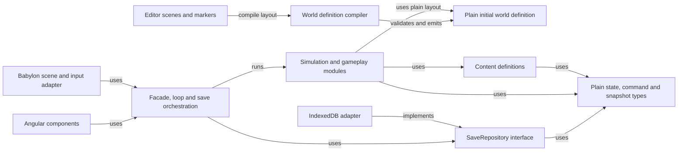
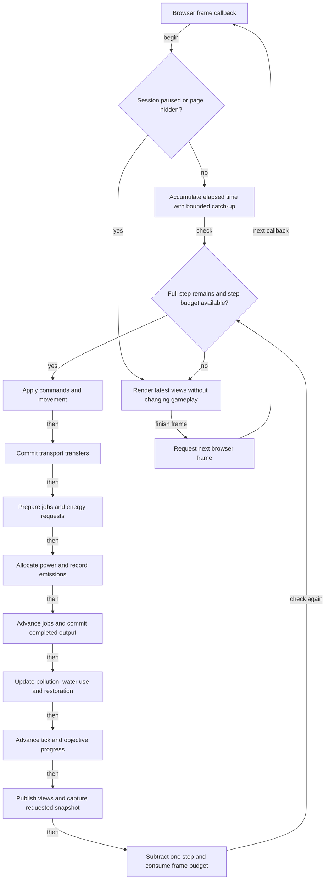
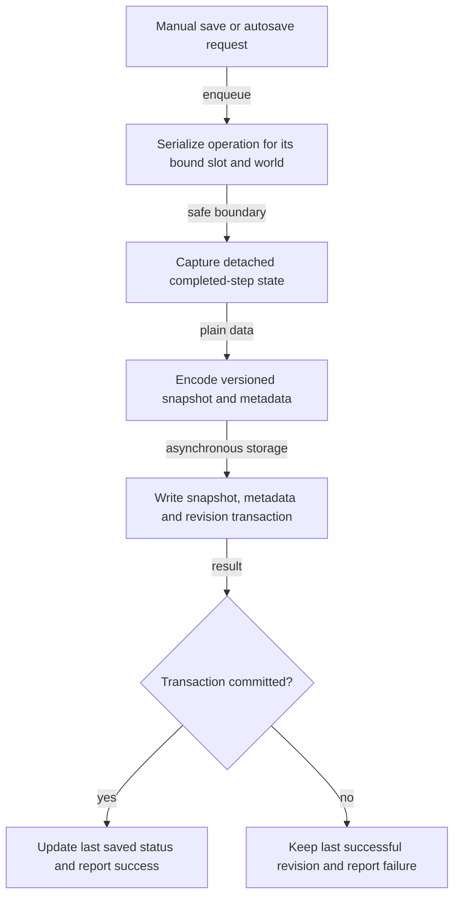
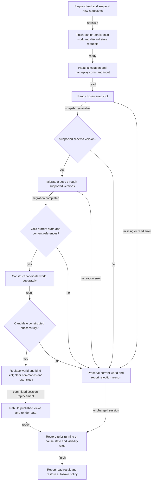
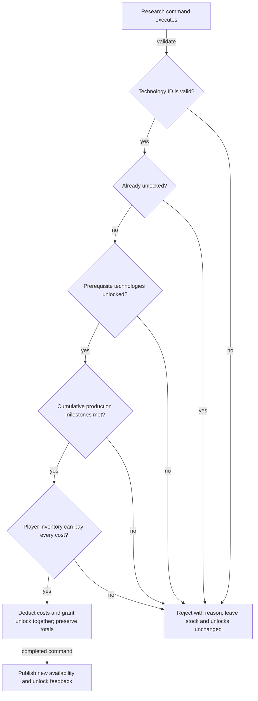

# Scrapworks Implementation Plan

Updated 17 October 2026. The user implements the game; cleanup tooling and documentation support that work.

Build a browser-first 3D game with Angular UI, Babylon presentation, Editor-authored layout, a plain TypeScript simulation, and local Dexie/IndexedDB snapshots. The [GDD](../design/GDD.md), [TDD](../design/TDD.md), and [Art Document](../art/README.md) own their respective requirements.

## Migration to 3D

Start remaining code work with [your implementation checklist](3d-implementation-checklist.md). It orders the save-UI correction, input/lifecycle work, authored definition, runtime cutover and first playable/save slice, and links the detailed plans without duplicating their full requirements.

Follow the [3D cleanup plan](3d-cleanup.md) and [baseline/progress record](3d-cleanup-baseline.md). Preservation and documentation reconciliation are delivered, with a [repository/reference handoff](../reports/cleanup/2026-10-17/README.md). The [asset/export audit](../reports/assets/2026-10-17/README.md) has reduced deployment contents while preserving sources. Development watching and failure retention are implemented. World-marker compilation, lifecycle/input completion and runtime cutover remain open for the user.

The [migration plan](3d-migration.md) supplies technical detail; the [Editor setup](babylon-editor-setup.md) owns executable authoring/export commands. The [Phase 2 walkthrough](3d-phase-2-walkthrough.md) is active implementation guidance. The [completed Phase 1 walkthrough](3d-phase-1-walkthrough.md) is historical code-built-scene guidance.

Today `/` still uses Phaser and `/3d` uses the Editor-authored Babylon scenes. After the cleanup cutover gate passes, Babylon becomes the default and Phaser can be removed without waiting for the complete manual opening or animation polish. Historical Tiled/sprite instructions are indexed in [history](../history/README.md).

## Milestones at a glance

| Milestone                                                                           | Playable result                                | Current state                                                                                            |
| ----------------------------------------------------------------------------------- | ---------------------------------------------- | -------------------------------------------------------------------------------------------------------- |
| [1. Project and integration](milestone-01-project-and-integration.md)               | One reliable canvas and authored fixture       | Shared lifecycle and Editor scene loading implemented; fixture, activity/input, and cutover checks open. |
| [2. Simulation foundation](milestone-02-simulation-foundation.md)                   | A world advances and pauses predictably        | Queue/logging scaffold; no authoritative world or fixed-step session.                                    |
| [3. Character and manual opening](milestone-03-character-and-manual-opening.md)     | Walk, salvage scrap, and craft basic materials | Static 3D rig; earlier 2D movement is a prototype only. Gameplay unimplemented.                          |
| [4. First local save](milestone-04-first-local-save.md)                             | Reload and continue the manual opening         | Dexie test records/dialog only.                                                                          |
| [5. Research](milestone-05-research.md)                                             | Earn, pay for, and unlock technology           | Not started.                                                                                             |
| [6. First working machines](milestone-06-first-working-machines.md)                 | Place a coal generator and powered recycler    | Not started.                                                                                             |
| [7. Transport](milestone-07-transport.md)                                           | A conveyor line supplies machine buffers       | Not started.                                                                                             |
| [8. Restoration and energy choices](milestone-08-restoration-and-energy-choices.md) | Sustain the greenhouse through day and night   | Not started.                                                                                             |
| [9. Save resilience](milestone-09-save-resilience.md)                               | Autosave, recover, and transfer progress       | Unvalidated test-data import/export scaffold only.                                                       |
| [10. Portfolio prototype](milestone-10-portfolio-prototype.md)                      | Complete, understandable small-map demo        | Shell, source art, and rendering foundation.                                                             |

Use the linked milestone files as the detailed checklists rather than duplicating their tasks here. Keep one small authored map, adding one useful system at a time. Start empty-handed; accounts, cloud sync, remote control, combat, and a large technology tree remain deferred.

## Detailed milestone plans

Implement Milestones 2–4 as the first gameplay slice after the cleanup foundation: plain world/session, authoritative movement and manual jobs, then a validated save/reload. Research and machinery build on that result. Renderer migration does not complete the underlying gameplay requirements.

## Suggested code layout

```text
scrapworks/
  scrapworks.bjseditor       One Editor project
  art/                   Blender projects, source artwork, references and provenance
  assets/                Authored scenes and export inputs
  public/scene/          Generated browser scenes (ignored)
  public/assets/         Existing browser-served runtime assets
  src/
    app/features/        Angular UI, session orchestration, save adapters
    contracts/           Plain lifecycle and session boundaries
    game/babylon/        Scene loading, input adaptation, camera and rendering
    game/bridge/         Earlier Phaser bridge, retained until cutover
    simulation/          Authoritative rules and plain world data
    core/                Framework-independent utilities
    scripts.ts           Generated presentation-script registry (ignored)
  docs/
    design/              GDD and TDD
    art/                 Visual design document
    plans/               Active roadmap and detailed checklists
    diagrams/            Mermaid sources and exported images
    history/             Superseded 2D instructions and dated evidence
  map/                   Historical Tiled sources
  tools/                 Export, Editor, art, diagram and cleanup utilities
```

Add simulation model/content/system modules as the next milestone needs them. Keep simulation, contracts, and core free of Angular, Babylon, Phaser, Dexie, the DOM, and wall-clock reads. UI and scene adapters send commands and consume views; they do not own a second world.

Editor markers will compile into a versioned plain `WorldDefinition` for initial layout. The simulation owns mutable `WorldState` ; the existing `GameState` contract describes renderer lifecycle. Gameplay coordinates use metres on X/Z, with centimetres converted at the Editor/presentation boundary. Do not generate a framework or every proposed class in advance.

## Suggested simulation schedule

Choose and document this before Milestone 6. The following order is a starting recommendation; keep it explicit so later changes can be checked against saved-state continuation tests.

| Phase within one tick     | Responsibility                                                                                                                                        |
| ------------------------- | ----------------------------------------------------------------------------------------------------------------------------------------------------- |
| 1. Commands and movement  | Process queued intents in order; validate salvage, crafting, research and placement; apply sampled movement with fixed delta time                     |
| 2. Transport              | Move existing items and water with destination reservations; production output from this tick waits until the next transport phase                    |
| 3. Production preparation | Establish eligible jobs, reserve ingredients once, and calculate their energy requests                                                                |
| 4. Power                  | Generate energy, resolve storage and demand in stable order, and record actual fuel use and emissions                                                 |
| 5. Production work        | Advance manual and machine jobs; commit completed output and production totals once, respecting buffer capacity                                       |
| 6. Environment            | Consume available greenhouse water and update pollution and restoration; freshly supplied resources are used according to this documented phase order |
| 7. Time and objective     | Advance the simulation tick and update saved day/night objective progress                                                                             |
| 8. Publication            | Publish read-only views and supply any requested detached snapshot of the completed step                                                              |

Power allocation should be deterministic, such as ordering competing consumers by stable machine ID. Decide whether a generator burns a whole fuel item into stored energy or advances a fuel job over time, and save that progress. Decide when batteries charge relative to consumer allocation. Exact quantities remain balance values, but these accounting rules must be explicit.

## Acceptance route and focused checks

Perform this route at the end of each relevant milestone and for the completed prototype:

01. Start with an empty player inventory and no unlocked equipment.
02. Walk to a deposit, salvage scrap, and complete manual crafts.
03. Save during a craft, reload, and complete it once.
04. Meet a research milestone; spend some materials elsewhere and observe the insufficient-stock rejection; replenish stock and research once.
05. Craft and place a generator and recycler, then automate input and output.
06. Save with a running machine, an item in transit, stored energy/water, and unfinished restoration.
07. Restore the same state; step both the original snapshot branch and the restored branch with the same commands and compare their outcomes.
08. Add cleaner power and storage, run through night, and complete the greenhouse objective.
09. Load an invalid snapshot and simulate a failed save write; confirm the current world and last good save survive.
10. Export the run, import it into a new slot, and repeat the continuation check.

Focus automated tests on rule invariants, conservation, research atomicity, save round trips, and migrations. Use a small browser integration check for actual IndexedDB persistence and canvas lifecycle; an in-memory repository cannot establish that browser storage works. Keep visual polish checks manual until the presentation stabilizes.

## Additional implementation diagrams

The existing [class diagram](../design/TDD.md#core-class-diagram), [application overview](../design/TDD.md#application-system-interaction-diagram), and [gameplay overview](../design/TDD.md#gameplay-system-interactions) remain useful alongside these more specific diagrams. Editable sources and image exports are linked below. The rates and ordering shown here are the plan's proposed starting choices.

### Module dependency diagram

Runtime arrows mean imports or interface dependencies. The Editor-to-compiler-to-definition arrows show the build-time authoring path; the simulation depends only on plain layout data and never imports the Editor or renderer. `SaveService` receives a repository implementation through the application composition root.

[SVG image](../diagrams/module-dependencies.svg) / [PNG image](../diagrams/module-dependencies.png) / [Mermaid source](../diagrams/src/module-dependencies.mmd)



### Fixed step loop diagram

Only complete simulation steps mutate gameplay. Rendering can interpolate positions but cannot progress jobs. A paused session can still display its latest views and capture its latest completed state.

[SVG image](../diagrams/fixed-step-loop.svg) / [PNG image](../diagrams/fixed-step-loop.png) / [Mermaid source](../diagrams/src/fixed-step-loop.mmd)



### Save flow diagram

Capture is synchronous at a safe boundary. The detached snapshot is then written asynchronously while gameplay may continue. An unsuccessful transaction leaves the last committed revision available.

[SVG image](../diagrams/save-flow.svg) / [PNG image](../diagrams/save-flow.png) / [Mermaid source](../diagrams/src/save-flow.mmd)



### Load flow diagram

Load pauses gameplay and autosaves after earlier persistence work finishes. Failure leaves the old world intact. Success replaces the world only after a candidate has been fully validated and constructed. File import uses the same validation path before storing a new slot.

[SVG image](../diagrams/load-flow.svg) / [PNG image](../diagrams/load-flow.png) / [Mermaid source](../diagrams/src/load-flow.mmd)



### Research transaction diagram

All checks use the authoritative state when the queued command executes. A second queued request sees the first unlock and is rejected without another payment. There is no asynchronous operation between the checks and the commit.

[SVG image](../diagrams/research-transaction.svg) / [PNG image](../diagrams/research-transaction.png) / [Mermaid source](../diagrams/src/research-transaction.mmd)



## First work session

Continue the cleanup's authored fixture and unfinished lifecycle/input work before cutting over. For actual gameplay implementation, establish plain world data and a fixed-step session, then movement, manual salvage/crafting, and a validated local-save round trip. See the [first gameplay checkpoint](3d-cleanup.md#first-gameplay-checkpoint-after-cleanup).
