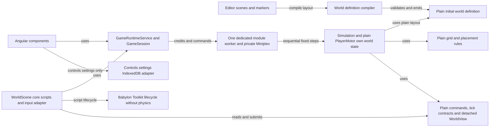
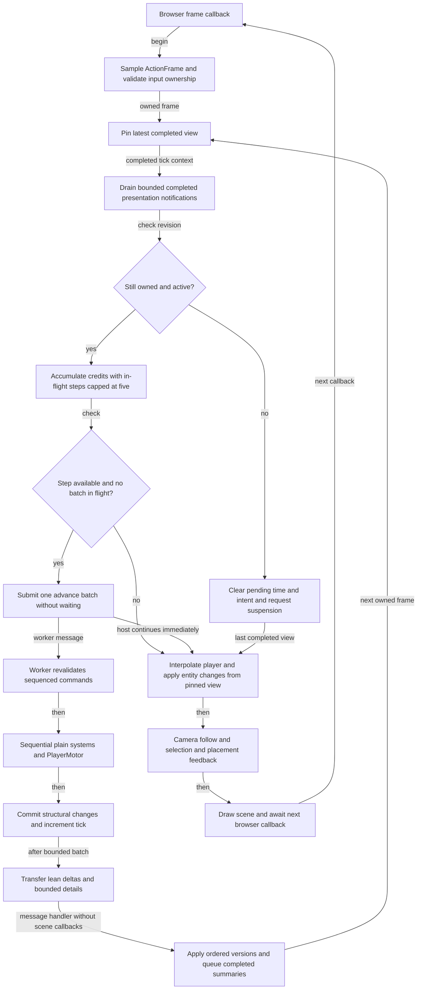
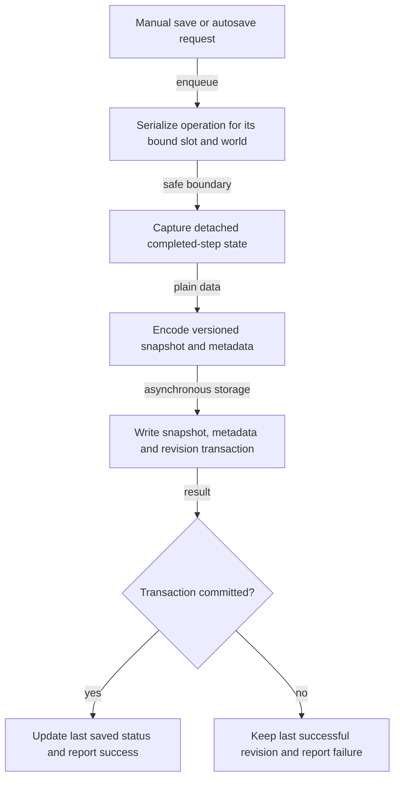
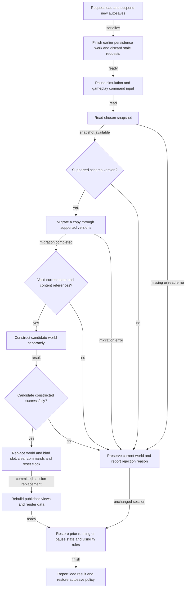
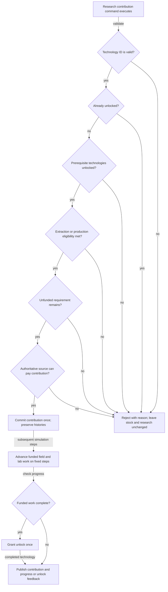

# Scrapworks Implementation Plan

Updated 30 October 2026 with Miniplex selection and successful lean single-worker requalification, retaining the progression, Mini Fabricator and renewable-first peaceful terraforming decisions. Milestone 3 retains its migration credits and includes bootstrap field research. The production Miniplex worker migration is implemented; qualification is recorded separately from later gameplay. The 23 October migration acceptance remains a dated checkpoint; [28 October full CI](../reports/ci/2026-10-28/README.md) closes Milestone 1 reproducibility.

Build a browser-first 3D game with Angular UI, Babylon presentation, Editor-authored layout, a plain TypeScript simulation, and local Dexie/IndexedDB snapshots. The [GDD](../design/GDD.md), [player progression decisions](../design/player-progression.md), [TDD](../design/TDD.md), and [Art Document](../art/README.md) own their respective requirements.

## Migration to 3D

The [migration plan](3d-migration.md) and [acceptance record](../reports/migration/2026-10-23/README.md) record the completed renderer migration. The [acceptance checklist](3d-implementation-checklist.md), [runtime walkthrough](3d-phase-2-walkthrough.md) and [Editor setup](babylon-editor-setup.md) explain the implemented ownership and authoring workflow.

Babylon is the sole world renderer at `/`; `/3d` redirects to it. Saved Editor markers compile into a versioned plain world definition, and one session advances authoritative movement/collision at 20 Hz. The fixture includes an animated protagonist, orbit/follow camera, picking, controls, pause/suspension and isolated development placement checks. Normal worlds start with no inventory, equipment, machines or research unlocks.

Core objects now use Toolkit scripts composed by `WorldScene`, with plain `PlayerMotor` retaining authoritative movement. The host session delivers ordered completed-tick presentation hooks during its owned render frame, independently of physics. See the [core object design](../design/TDD.md#core-object-scripts) and [timing contract](../design/TDD.md#simulation-timing-and-save-boundaries). The [ECS foundation starts in Milestone 3](../design/TDD.md#ecs-foundation-from-milestone-3), before new inventory/salvage/research/crafting runtime work. The [comparison](../reports/ecs/2026-10-29/README.md) selected Miniplex 2.0.0; the user confirmed a single worker for Simulation/ECS as the starting architecture. The [lean requalification](../reports/simulation-worker/2026-10-30/README.md) now qualifies both candidates with transferred numeric views and bounded inventory/selection details, retaining Miniplex. The rich bridge's failed budgets remain historical. The actual Angular/Babylon worker path has production integration acceptance; see the [implementation report](../reports/ecs-worker-implementation/2026-10-30/README.md) for performance qualification. Keep 60 FPS required, 120 FPS diagnostic and interpolation before visual prediction. The report also assesses future multithreading suitability; multi-worker ECS implementation remains deferred unless simulation profiles warrant a later investigation. Milestone 6 extends the established ECS world with factories.

The [cleanup record](3d-cleanup.md) describes retired tools/assets and their recovery sources. Fresh [authoring workflow validation](../reports/workflow/2026-10-23/README.md) verifies export/reload, failed-save retention and recovery.

The [production ECS/worker implementation plan](ecs-worker-implementation.md) is complete through Step 0: the existing fixture, opening schemas/shared rules, lean production views and capture/continuation are implemented and qualified. Completed-tick presentation hooks and authored-world restart on worker/presentation failure Retry follow the user-confirmed policies. Later salvage, research, crafting and MiniFab gameplay remain pending; implementation stops at the foundation.

Manual salvage, recipe jobs, inventory interaction, research, machines, transport, restoration and gameplay saves remain unimplemented. Controls settings persisting through IndexedDB do not establish world saving.

## Milestones at a glance

The [Fibery project tracker](fibery-tracking.md) provides the live task board, milestone hierarchy and current-design work view. Its initial import preserves the implementation credit and outstanding requirements below; it does not resume gameplay implementation.

| Milestone                                                                           | Playable result                                | Current state                                                                                                                                               |
| ----------------------------------------------------------------------------------- | ---------------------------------------------- | ----------------------------------------------------------------------------------------------------------------------------------------------------------- |
| [1. Project and integration](milestone-01-project-and-integration.md)               | One reliable canvas and authored fixture       | Complete for integration: reviewed changes committed; clean pinned-Yarn install and full CI pass. See [CI evidence](../reports/ci/2026-10-28/README.md).                                    |
| [2. Simulation foundation](milestone-02-simulation-foundation.md)                   | A world advances and pauses predictably        | Plain world/session, typed fixture command, detached views, 20 Hz clock and pause implemented and tested.                                                   |
| [3. Character and manual opening](milestone-03-character-and-manual-opening.md)     | Find scrap, field-research tools/recipes and use the Mini Fabricator | Step 0 ECS/worker foundation, movement, collision, picking and deposit data implemented. Onboarding, salvage, timed research, recipe/device jobs and inventory UI pending. |
| [4. First local save](milestone-04-first-local-save.md)                             | Restore Mini Fabricator and field research in progress | Gameplay snapshots and restore unimplemented. Controls IndexedDB reload verified separately; old save dialog remains test data. |
| [5. Research](milestone-05-research.md)                                             | Expand the tree toward dedicated craftables and scalable labs | Not started. Bootstrap research is planned in Milestone 3; physical factory/lab integration follows in Milestone 6. |
| [6. First working machines](milestone-06-first-working-machines.md)                 | Manually supply renewable-powered recycling, fabrication and labs | Not started. Random recycler outputs, fabrication arity, extraction and full recovery are planned. |
| [7. Transport](milestone-07-transport.md)                                           | Automate direct supply and sort mixed recycler output | Not started. Trains and loading/unloading stations are later-game work. |
| [8. Restoration and energy choices](milestone-08-restoration-and-energy-choices.md) | Research greenhouses and demonstrate peaceful terraforming | Not started. Expanded weather/storage, optional coal and pollution mitigation remain planned. |
| [9. Save resilience](milestone-09-save-resilience.md)                               | Autosave, recover, and transfer progress       | Unvalidated test-data import/export scaffold only.                                                                                                          |
| [10. Portfolio prototype](milestone-10-portfolio-prototype.md)                      | Complete, understandable small-map demo        | Migration presentation, controls, production packaging and small-fixture profiling verified. Complete factory route and representative performance pending. |

Use the linked milestone files as the detailed checklists rather than duplicating their tasks here. Keep one small authored map, adding one useful system at a time. Start empty-handed; accounts, cloud sync, remote control, combat, and a large technology tree remain deferred.

## Detailed milestone plans

Milestones 2–3 received foundation work during migration. The 27 October design revision preserves that credit and moves the small timed field-research/recipe-unlock slice into Milestone 3, alongside onboarding, salvage and MiniFab crafting. The revised 28 October opening teaches safe handcrafting through tools, materials and mechanical/electrical parts before MiniFab research and four-ingredient hand assembly. Handcrafting ends on UI exit with a warning and an unfinished-unit refund. The MiniFab is presented beside inventory and always works without power; optional physical winding charges a local speed boost independently of factory electricity. Milestone 4 must save work, contributions, charge and distinct research/upgrade ownership. Milestone 5 expands the tree and lab rules; Milestone 6 integrates the renewable-powered placed factory, and Milestone 7 adds sorting and direct transport. Milestone 8 demonstrates researched greenhouse restoration without a fail state. No gameplay implementation is part of this documentation update.

Opening targets are improved-tool research in about a minute and first player-requested automatic crafting within 15–20 minutes for relaxed new players or under five minutes for experienced players. Base components remain useful downstream. MiniFab acquisition/form/baseline power are settled; [later design and provisional balance](../design/player-progression.md#implementation-readiness-and-later-design-work) include provisional recipe costs/durations, later lab coordination, source-ore/liquid recovery details, recycler distribution and weather/restoration balance. Later MiniFab onboard solar/wind/coal, grid and inventory automation each need the related technology where applicable, separate MiniFab research and actual crafted upgrades. Grid waits for electricity; pure ores, trains and resource-configuration UI need explicit later slices.

## Current code layout

```text
scrapworks/
  scrapworks.bjseditor       One Editor project
  art/                   Blender projects, source artwork, references and provenance
  assets/                Authored scenes and export inputs
  public/scene/          Generated browser scenes and worlds/game.json (ignored)
  public/assets/         Existing browser-served runtime assets
  src/
    app/features/        Angular UI, controls and GameRuntimeService
    session/             Host coordinator, ports and lean presentation cache
    workers/             Dedicated simulation worker entry
    contracts/           Lifecycle, input, WorldDefinition and detached WorldView
    game/                Babylon client, WorldScene, Toolkit scripts and entity views
    simulation/          Authoritative rules, PlayerMotor and plain world data
    core/                Framework-independent utilities
    scripts.ts           Generated presentation-script registry (ignored)
  docs/
    design/              GDD and TDD
    art/                 Visual design document
    plans/               Active roadmap and detailed checklists
    diagrams/            Mermaid sources and exported images


  tools/                 World compiler, export, Editor, art, diagram and cleanup utilities
```

Add simulation model/content/system modules as the next milestone needs them. Keep simulation, contracts, and core free of frameworks, renderers, storage, the DOM, and wall-clock reads. UI and scene adapters send commands and consume views; they do not own a second world.

Editor markers compile into a versioned plain `WorldDefinition` for initial layout. `Simulation` owns private Miniplex component records and world resources; `GameState` describes renderer lifecycle. `GameSession` owns the accumulator and sampled movement. Gameplay coordinates use metres on X/Z, with centimetres converted at the Editor/presentation boundary. Plain validated captures and fresh-runtime rebuild are foundation infrastructure; no gameplay SaveRepository or save UI exists yet.

## Suggested simulation schedule

The host pins the latest completed view, drains bounded completed-tick presentation notifications, then submits future credits. One dedicated worker executes commands, sequential domain work, PlayerMotor, structural commits and tick increment before lean publication. There is one 20 Hz accumulator, one in-flight advance and one shared five-step allowance; suspension cancels pending commands/input and discards hidden time. Scripts cannot change the tick they report. Stock spending is explicit manual/current handcraft, requested MiniFab, then Field Research policy; these executors remain later work. The factory schedule below remains a future recommendation.

| Phase within one tick     | Responsibility                                                                                                                                        |
| ------------------------- | ----------------------------------------------------------------------------------------------------------------------------------------------------- |
| 1. Commands and movement  | Validate salvage, crafting/device targets, research contributions, recovery and placement in order; apply sampled movement with fixed delta time |
| 2. Transport              | Move existing items and water with destination reservations; production output from this tick waits until the next transport phase                    |
| 3. Production preparation | Establish eligible precursor/factory/lab jobs, reserve ingredients once, and calculate energy requests; retain any already-rolled recycler output |
| 4. Power                  | Generate energy, resolve storage and demand in stable order, and record actual fuel use and emissions                                                 |
| 5. Production work        | Advance player/Mini Fabricator/factory work and funded field/lab research; commit output/history or completed unlock once, respecting capacity |
| 6. Environment            | Consume available greenhouse water and update pollution and restoration; freshly supplied resources are used according to this documented phase order |
| 7. Time and objective     | Advance the simulation tick, saved daylight/weather/event state and peaceful terraforming checkpoint progress |
| 8. Publication            | Publish read-only views and supply any requested detached snapshot of the completed step                                                              |

Power allocation should be deterministic, such as ordering competing consumers by stable machine ID. Decide whether a generator burns a whole fuel item into stored energy or advances a fuel job over time, and save that progress. Decide when batteries charge relative to consumer allocation. Exact quantities remain balance values, but these accounting rules must be explicit.

## Acceptance route and focused checks

Perform this route at the end of each relevant milestone and for the completed prototype:

1.  Start from the agreed empty-handed bootstrap, complete movement onboarding and find scrap promptly.
2.  Research tools/material recovery, then handcraft safe components through both assembly branches. Warn/cancel/refund unfinished handcraft work on UI exit; keep completed units. Research and hand-assemble the MiniFab from plates, wire and both parts without factory electricity.
3.  Request a stack-bounded final item with missing precursors from the inventory-side panel; let power-free crafting proceed while doing other work. Optionally wind the crank/right stick for speed, verify baseline continues after depletion and check the opening timing targets.
4.  Save during precursor work and field research, reload and complete each material payment, output and unlock once.
5.  Establish a coal-free solar/wind-powered recycler, fabricator and laboratory; verify faster shared research as labs scale.
6.  Add extraction, direct transport and sorting for random recycler output; verify machine recipe arity and full solid recovery as scrap/source ore, with explicit liquid loss and no material duplication.
7.  Save with pending random output, lab work, transit items, storage, weather and unfinished restoration; restore identical continued outcomes and random sequences.
8.  Research and construct greenhouses, then demonstrate the chosen small-map terraforming checkpoint through renewable variability without a fail state.
9.  Compare optional coal-heavy choices and later mitigation; research, green alternatives and recovery must stay reachable.
10. Load invalid snapshots and inject failed writes; preserve the current world and last good revision. Export/import and repeat continuation checks.

Focus automated tests on rule invariants, conservation, research atomicity, save round trips, and migrations. Use a small browser integration check for actual IndexedDB persistence and canvas lifecycle; an in-memory repository cannot establish that browser storage works. Keep visual polish checks manual until the presentation stabilizes.

## Additional implementation diagrams

The [class diagram](../design/TDD.md#core-class-diagram) and [application overview](../design/TDD.md#application-system-interaction-diagram) describe current boundaries and identify future branches. The dependency and fixed-step diagrams below show implemented migration behavior. Save, load, research and the [gameplay overview](../design/TDD.md#gameplay-system-interactions) remain future design.

### Module dependency diagram

Runtime arrows mean imports or interface dependencies. The Editor-to-compiler-to-definition arrows show the build-time authoring path. Simulation depends only on plain layout data and shared grid rules; it never imports the Editor or renderer. Future gameplay persistence will add a repository boundary separately.

[SVG image](../diagrams/module-dependencies.svg) / [PNG image](../diagrams/module-dependencies.png) / [Mermaid source](../diagrams/src/module-dependencies.mmd)



### Fixed step loop diagram

Only completed steps publish lean presentation. The host uses the existing browser frame source, independently of physics. Completed-tick hooks run after pinning the latest publication and before submitting future credits. Worker execution is asynchronous; a render frame never waits for the new batch. Pause clears pending time/input and acknowledges bounded in-flight work. Plain capture/rebuild is infrastructure; gameplay saves and factory jobs remain future work.

[SVG image](../diagrams/fixed-step-loop.svg) / [PNG image](../diagrams/fixed-step-loop.png) / [Mermaid source](../diagrams/src/fixed-step-loop.mmd)



### Save flow diagram

Future design, not implemented. The worker capture request resolves with detached data at a completed boundary. Gameplay persistence remains future work. The detached snapshot will be written asynchronously while gameplay may continue. An unsuccessful transaction must leave the last committed revision available.

[SVG image](../diagrams/save-flow.svg) / [PNG image](../diagrams/save-flow.png) / [Mermaid source](../diagrams/src/save-flow.mmd)



### Load flow diagram

Future design, not implemented. Load must pause gameplay and autosaves after earlier persistence work finishes. Failure must leave the old world intact. Success replaces the world only after a candidate has been fully validated and constructed. File import will use the same validation path before storing a new slot.

[SVG image](../diagrams/load-flow.svg) / [PNG image](../diagrams/load-flow.png) / [Mermaid source](../diagrams/src/load-flow.mmd)



### Research transaction diagram

Future design, not implemented. Contribution checks use authoritative state at command execution, and each accepted payment/reservation commits synchronously. Timed field/lab work occurs on later simulation steps; funded work grants an unlock once at completion. Contribution granularity and worker coordination remain open design details. This replaces the earlier immediate pay-and-unlock diagram.

[SVG image](../diagrams/research-transaction.svg) / [PNG image](../diagrams/research-transaction.png) / [Mermaid source](../diagrams/src/research-transaction.mmd)



## Phase 7 stopping point

Migration implementation is complete and its stopping point remains recorded by the [23 October evidence](../reports/migration/2026-10-23/README.md). The 27 October request authorizes saving progression decisions and updating milestones, not implementing their gameplay. Milestone 3's researched opening/Mini Fabricator and Milestone 4's gameplay saves remain unimplemented; the [progression specification](../design/player-progression.md) supersedes older gameplay ordering while preserving dated migration evidence.
