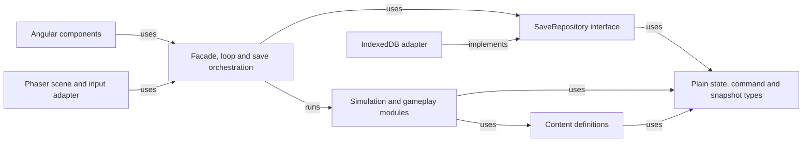
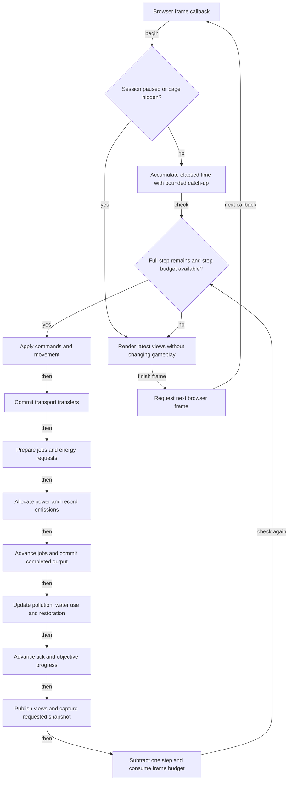
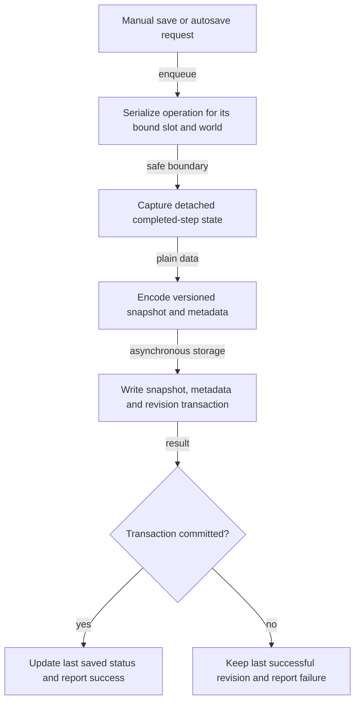
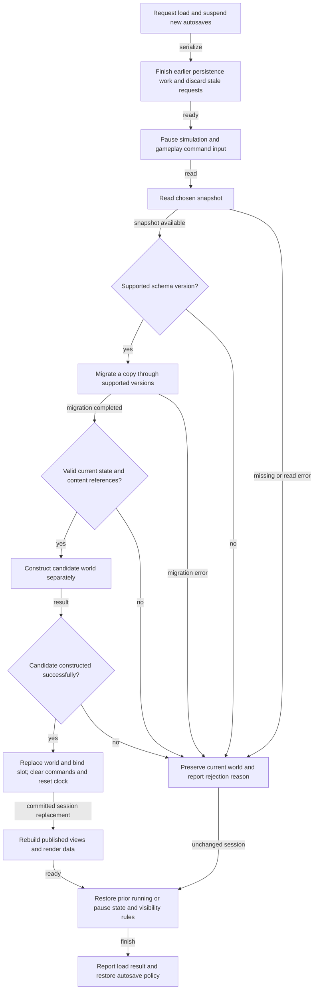
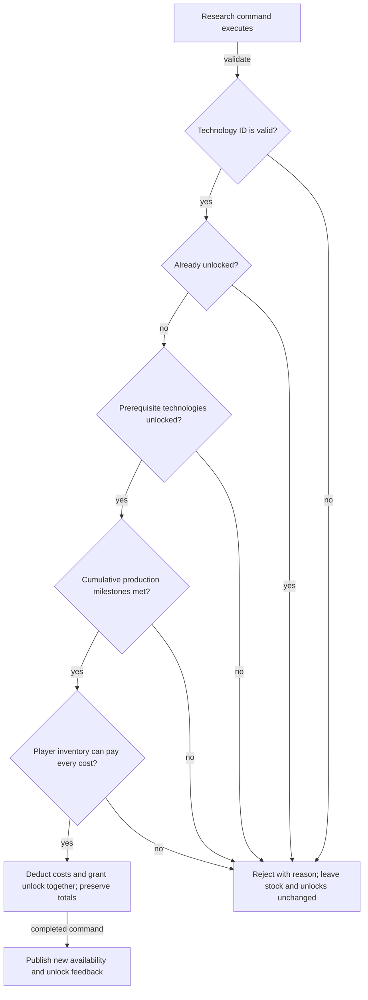

# Scrapworks Implementation Plan

Updated 4 October 2026.

This is a guide for you to implement Scrapworks yourself. Work through the milestones in order, finishing the playable result and checks for each before expanding it. The [GDD](../design/GDD.md) defines gameplay, the [TDD](../design/TDD.md) explains the architecture, and the [Art Document](../art/README.md) remains the source for visual specifications.

Angular, Phaser, RxJS client state, Angular signals, and Dexie are installed. The renderer integration is implemented; the plain TypeScript simulation and browser-save service are scaffolds. Tick rates, resource access rules, and system ordering below remain starting recommendations rather than settled game balance.

## Milestones at a glance

| Milestone                       | Playable result                                     | Main work                                             | Current status                                    |
| ------------------------------- | --------------------------------------------------- | ----------------------------------------------------- | ------------------------------------------------- |
| 1. Project and integration      | Angular shell with one working game canvas          | Tooling, renderer lifecycle, module boundaries        | Partially complete; renderer integration complete |
| 2. Simulation foundation        | A world advances and pauses predictably             | Data model, commands, fixed steps                     | Queue scaffold only                               |
| 3. Character and manual opening | Walk, collect scrap, and craft basic materials      | Projection, movement, salvage, crafting, inventory UI | Phaser movement and art scaffold only             |
| 4. First local save             | Reload and continue the manual opening              | Snapshot codec, save repository, manual slot          | Dexie test-data and dialog scaffold only          |
| 5. Research                     | Earn, pay for, and unlock basic technology          | Production history, prerequisites, atomic unlocks     | Not started                                       |
| 6. First working machines       | Build a coal generator and powered recycler         | Construction, fuel, power, machine jobs               | Not started                                       |
| 7. Transport                    | A conveyor line supplies and removes machine output | Buffers, connections, item movement                   | Not started                                       |
| 8. Restoration                  | Compare coal with solar and sustain the greenhouse  | Day and night, storage, water, pollution, health      | Not started                                       |
| 9. Save resilience              | Autosave, recover, and move progress through files  | Revisions, migrations, errors, import and export      | Unvalidated file-transfer scaffold only           |
| 10. Portfolio prototype         | A complete, understandable small-map demo           | Feedback, presentation, balancing, acceptance checks  | Shell and artwork foundation only                 |

Keep one small authored map throughout these milestones. Add one working machine or technology at a time. Remote control, accounts, cloud synchronization, combat, and a large technology tree remain future work.

## Detailed milestone plans

Each milestone has a step-by-step checklist, completion checks, reference diagrams, and implementation notes. Progress was reconciled with source inspection and fresh checks on 4 October 2026. A scaffold is recorded without marking its full gameplay or persistence requirement complete.

1. [Milestone 1 Project and integration](milestone-01-project-and-integration.md)
2. [Milestone 2 Simulation foundation](milestone-02-simulation-foundation.md)
3. [Milestone 3 Character and manual opening](milestone-03-character-and-manual-opening.md)
4. [Milestone 4 First local save](milestone-04-first-local-save.md)
5. [Milestone 5 Research](milestone-05-research.md)
6. [Milestone 6 First working machines](milestone-06-first-working-machines.md)
7. [Milestone 7 Transport](milestone-07-transport.md)
8. [Milestone 8 Restoration and energy choices](milestone-08-restoration-and-energy-choices.md)
9. [Milestone 9 Save resilience](milestone-09-save-resilience.md)
10. [Milestone 10 Portfolio prototype](milestone-10-portfolio-prototype.md)

## Suggested code layout

All project files belong inside the `scrapworks/` Git repository. These top-level folders now exist:

```text
scrapworks/
  docs/
    README.md             Documentation index
    design/               Game and technical design
    plans/                Roadmap and milestone checklists
    art/                  Art direction, prompts, records, and source samples
      characters/         Character samples and prompts
      world/              Environmental progression concepts
      machinery/          Machine-generation concepts
      branding/           Logo source, prompt, and preparation record
      ui/                 Cursor source, prompt, and preparation record
    diagrams/             Rendered SVG and PNG diagrams
      src/                Mermaid diagram sources
  public/assets/          Browser-served runtime images
  src/
    app/features/game/    Game page, canvas host, runtime, and client factory
    app/features/save/    Save/load interface and current Dexie scaffold
    contracts/            Plain client, lifecycle state, and event contracts
    core/                 Framework-independent utilities
    game/
      bridge/             PhaserGameClient and per-game event handling
      scenes/             Phaser scene lifecycle and rendering
      gameobjects/        Phaser objects and current presentation movement
      bootstrap.ts        Listener attachment before scene startup
    simulation/           Plain TypeScript simulation scaffold
  tools/
    diagrams/             Diagram rendering utility
    eslint/               Separate custom lint-rule tooling
```

For Milestones 2–8, add `model/`, `content/`, and `systems/` under `src/simulation/` when their requirements arrive. Put simulation scheduling and UI view orchestration in the Angular game feature; put snapshot validation and repository adapters in the save feature when Milestone 4 needs them.

Keep `src/simulation/`, shared contracts, and `src/core/` free of Angular, Phaser, Dexie, DOM APIs, and wall-clock reads. `src/game/` deliberately contains the Phaser adapter; it is not the authoritative rules layer. Angular consumers use the plain `GameClient` boundary rather than the concrete Phaser implementation. The current contracts' `GameState` describes renderer lifecycle, so define a separate `WorldState` for authoritative gameplay.

The TDD class names describe responsibilities. You can implement gameplay systems as functions or small modules; a shared base class and an entity-component framework are not prerequisites. Introduce a module when its milestone needs it rather than generating every file up front. See the [module dependency diagram](#module-dependency-diagram).

## Milestone 1 Project and integration

**Build:** a runnable Angular shell with a canvas host and a minimal Phaser scene.

**Current:** Angular–Phaser integration is complete. The fresh application suite passes 24 tests; normal lint and production build pass. The grid scene, verified storage experiment, separate formatter checks, and dependency commit remain open.

- [x] Establish and record the installed Angular, Node, Phaser, Dexie, and TypeScript toolchain; verify it with builds and browser tests.
- [ ] Review and commit the intended dependency setup and Yarn lockfile.
- [x] Generate the Angular application in `scrapworks/`, with strict TypeScript settings and browser rendering. Follow the [Angular setup guide](https://angular.dev/installation); SSR is unnecessary for the prototype canvas.
- [x] Establish build and test commands using the generated tooling. Run the plain TypeScript queue smoke test in Node to prove game modules can be tested without Angular component setup. See [Angular testing guidance](https://angular.dev/guide/testing).
- [x] Mount through a component-owned element, use a per-game client and page-scoped runtime, handle resizing, and verify repeated teardown/remounting and the Play Game button.
- [ ] Add a representative square-grid scene around the placeholder character and verify its small-screen layout.
- [ ] Reconcile the two currently failing custom formatter tests; normal application lint already passes.
- [ ] Make one small Dexie experiment in a disposable development slot: write a plain record, read it back after page reload, and delete that slot. This checks the chosen storage integration; it is not the final save service.

**Finish when:** the shell builds; the canvas loads, resizes, and can be recreated without duplicate listeners or loops; the storage experiment survives reload. Phaser's [installation guide](https://docs.phaser.io/phaser/getting-started/installation) and the [Dexie Angular guide](https://dexie.org/docs/Tutorial/Angular) are integration references, not permission to place game rules in those libraries.

## Milestone 2 Simulation foundation

**Build:** the smallest authoritative simulation, independent of graphics.

- [ ] Define a new-world factory with an empty player inventory, no tools or machines, zero production totals, and no research unlocks. World deposits are map resources, not player possessions.
- [ ] Start with player position, deposits, inventories, simulation tick, and stable entity IDs. Extend this state as later milestones add jobs, machines, connections, stored energy and water, and environmental values. Persist the next entity-ID counter so loading cannot reuse an existing ID.
- [ ] Use JSON-compatible data: records, arrays, numbers, strings, and booleans. Save recipe and technology IDs. Store or version the fixed step duration so saved tick counts cannot silently run at a different rate after an update. Keep services, sprites, callbacks, command queues, and selected UI panels outside the saved world.
- [ ] Define commands and results. A command expresses intent, such as moving, salvaging, crafting, researching, or placing equipment. Its owning system validates it against the current state before changing anything. Return a specific rejection reason for the interface.
- [ ] Add a fixed-step loop. Begin with **20 steps per second** as a measurement baseline. A frame accumulates elapsed time and runs complete 50 ms steps; rendering remains independent. Keep a bounded catch-up budget, such as five steps per frame, and discard excess elapsed time after a long stall instead of simulating an unlimited backlog.
- [ ] Handle explicit pause, hidden tabs, and focus loss. Clear held movement on focus loss; reset the elapsed-time baseline and accumulator on resume. Hidden time does not become offline production. Permit snapshots of the latest completed state while paused.

**Check:** repeated commands never create negative quantities; the same initial state, ordered commands, and tick count produce the same result; hiding and resuming the page does not advance the factory through hidden time. Use simulation time for recipes and daylight. If randomness is later introduced, give it a saved deterministic seed and generator state. Browser scheduling references: [requestAnimationFrame](https://developer.mozilla.org/en-US/docs/Web/API/Window/requestAnimationFrame) and [Page Visibility API](https://developer.mozilla.org/en-US/docs/Web/API/Page_Visibility_API).

**Finish when:** you can create, step, pause, resume, and inspect the world without relying on Phaser's physics or frame count. Follow the [fixed-step loop diagram](#fixed-step-loop-diagram).

## Milestone 3 Character and manual opening

**Build:** walk to scrap, collect it, and handcraft metal plates and wire.

- [ ] Keep positions and building footprints in world coordinates. Implement paired world-to-screen and screen-to-world transforms in the renderer adapter. Test tile selection at several camera positions and zoom levels; the angled presentation must not change the square world grid.
- [ ] Sample keyboard direction, normalize diagonal movement, and apply movement speed using the fixed step. Begin with tile occupancy and simple collision. Camera following is presentation logic.
- [ ] Add a salvage command that checks range, remaining deposit quantity, and inventory capacity before transferring scrap. Empty deposits stop producing. Use a marker or the current single idle pose while directional animations remain unfinished.
- [ ] Define starting manual recipes in the content catalog. Consume ingredients once when a job starts; store its recipe ID, reserved ingredients, and remaining work in the state. Produce outputs and increment cumulative totals once when it completes. Defer cancellation until its refund rules are defined.
- [ ] Add Angular inventory and crafting panels through `GameFacade`. Publish selected view records when relevant state changes, and use computed signals for derived panel values. Never expose mutable live inventory objects to components: a read-only signal alone does not prevent deep mutation, as explained in the [signals guide](https://angular.dev/guide/signals).

**Check:** out-of-range salvage and unaffordable crafts leave state unchanged; collecting or moving existing items does not increase production history; a completed craft increases history exactly once.

**Finish when:** a new player can make basic materials entirely through their starting abilities. Use the [Art Document](../art/README.md) for sprite and projection requirements; keep placeholders until this loop works.

## Milestone 4 First local save

**Build:** one manual browser save slot with reliable restoration.

- [ ] Define a `SaveSnapshot` envelope with a schema version, content version, stable world ID, saved timestamp, and a detached copy of gameplay state. Keep slot ID and revision metadata explicit. Every new gameplay field must be covered by snapshot creation and validation.
- [ ] Define `SaveRepository` operations for list, save, load, and delete. Implement an in-memory adapter for focused tests and an IndexedDB adapter for the browser.
- [ ] Capture a snapshot only from a completed step, or the latest completed state while paused. Serialize save and load operations in `SaveService`; bind each request to its slot and world when it is requested. Track a session generation that changes on world replacement, and reject a queued capture from an older generation. The live simulation can continue while the captured snapshot is written asynchronously.
- [ ] Validate structure, supported versions, numeric ranges, known content IDs, and references before loading. Construct the restored world separately, then replace the active world at a safe boundary. Clear old commands, reset the loop accumulator, and rebuild presentation views after replacement.
- [ ] Show save completion only after the storage transaction commits. Handle a missing slot or failed operation with a useful message while preserving the usable session.

**Check:** save during a manual crafting job, reload, and finish that job without losing ingredients or producing twice. Capture a snapshot, continue playing, and confirm the captured data does not change with the live state.

**Finish when:** page reload restores position, deposits, inventory, crafting work, production totals, and simulation time. Follow the [save](#save-flow-diagram) and [load](#load-flow-diagram) diagrams. Re-run this check as each later system gains saved state.

## Milestone 5 Research

**Build:** basic power research using cumulative production and a material payment.

- [ ] Define technology IDs, prerequisites, required produced quantities, material payments, and recipe unlocks in content. Initially use the required quantities as both the production milestone and payment, matching the GDD.
- [ ] For the prototype, pay research from the **player inventory**. This is a recommended starting rule; access to connected factory stock can be added when its interaction rules are designed.
- [ ] Validate that the technology is incomplete, its prerequisites are met, cumulative totals meet the milestones, and current inventory can pay. Deduct all costs and add the unlock in one synchronous command operation, with no asynchronous gap between checking and spending.
- [ ] Enforce unlocks in crafting as well as construction. Show Produced, Available, prerequisites, and equipment crafting costs separately in the research panel.
- [ ] Check the small technology tree for cycles and unreachable prerequisites. All requirements must be obtainable from starting recipes or earlier unlocks; basic power cannot depend on a powered recycler.

**Check:** totals sufficient but stock insufficient rejects research; duplicate requests charge once; partial payment cannot occur; totals survive spending and save/load. The GDD's illustrative 28 plates and 14 wire example is a useful test fixture, not finalized balance.

**Finish when:** the player can research and craft a generator through the manual opening. See the [research transaction diagram](#research-transaction-diagram).

## Milestone 6 First working machines

**Build:** place a coal generator and a recycler, supply them manually, and collect machine output.

- [ ] Define machine footprints, orientation, ports, inventories, permitted recipes, and power requirements. Placement consumes a crafted equipment item, so ingredients are not charged for a second time at placement.
- [ ] Validate unlocks, ownership of equipment, character reach, terrain, occupied tiles, and connection endpoints inside the simulation. The placement preview uses the same rule function and is rechecked when the placement command executes.
- [ ] Persist machine jobs, fuel work, input/output buffers, and energy storage. Manual loading and unloading transfer existing items and do not count as production.
- [ ] Add power supply and demand using consistent energy units and capacity limits. Specify fuel burn behavior explicitly: coal emissions correspond to fuel actually burned. For the small map, simple authored connection graphs are enough.
- [ ] Run machine jobs with allocated energy. Reserve ingredients once at job start. A job waits for power and cannot deposit more output than its buffer can hold. Keep completed-but-blocked work in saved state and count output only when it is committed to a buffer.

**Check:** a locked or overlapping placement costs nothing; a powered recycler advances; an unpowered or blocked one waits; refilling buffers never duplicates totals; restoring a mid-job machine preserves its remaining work and fuel.

**Finish when:** the first useful automated material production works with manual input and output. Add transport after this system is inspectable.

## Milestone 7 Transport

**Build:** connect a small conveyor route to the recycler.

- [ ] Define directional connections, capacity, throughput, and persisted items in transit. Begin with a small fixed network and avoid complex routing.
- [ ] Make transfer decisions from the transport state at the start of the phase, reserve destinations, and commit them together. An item moves at most one transport step per tick; iterating several belts must not move it repeatedly in that tick.
- [ ] Handle disconnected ports, full buffers, and blocked destinations without deleting or duplicating items. Use stable IDs to resolve competing transfers consistently.
- [ ] Render item movement from transit data. Visual interpolation is optional; it must not move inventory in the simulation.

**Check:** item quantities are conserved across transfers; blocked belts resume correctly; save/load preserves item locations; collecting conveyed output does not increment production history again.

**Finish when:** conveyors feed and drain a recycler without manual transfer. Implement water connections using similarly explicit capacity and conservation rules when Milestone 8 needs them.

## Milestone 8 Restoration and energy choices

**Build:** the complete small-map objective with coal, solar, storage, purified water, and greenhouse recovery.

- [ ] Add the remaining small research chain and craftable equipment. Include solar panels, a purifier, and basic energy or water storage with obtainable prerequisites.
- [ ] Derive day and night from simulation time. Allocate solar generation, coal generation, and stored energy in a consistent order; cap storage and prevent negative energy. Use daylight at the start of the tick for this tick's solar supply.
- [ ] Implement purifier jobs and greenhouse water use with conserved water quantities. Keep resource flow and storage values in state.
- [ ] Use one understandable pollution model first. A map-wide value is a reasonable initial implementation; regional spreading can wait. Add emissions, recovery, and health rules with explicit rates and limits.
- [ ] Evaluate the goal across a complete day/night period using saved progress counters. The player must sustain greenhouse health and factory operation; saving cannot reset a failed interval or skip the nighttime requirement. Define the exact thresholds and operation requirement as balance parameters before coding the goal.
- [ ] Publish environmental values for presentation. Translate them into gradual visual changes following ART.md, with environmental health independent of machinery generation.

**Check:** coal offers useful power and visible restoration costs; solar drops at night; storage is required for a chosen continuous clean layout; damaging the landscape can be recovered from; a mid-night save resumes the same energy and objective state.

**Finish when:** you can complete the objective and compare an early coal layout with a cleaner layout.

## Milestone 9 Save resilience

**Build:** autosaves, a retained previous revision, migrations, and file backups.

- [ ] Write snapshot and metadata together, retaining the last successful revision if a new write fails. Keep a previous autosave revision and let the player choose it without overwriting the latest one during inspection.
- [ ] Schedule autosaves from elapsed session activity, capturing completed states. During load, suspend autosaves and gameplay input, finish earlier persistence work, and discard stale queued autosave requests before replacement. Resume according to the prior pause state and current page visibility.
- [ ] Add sequential migrations with sample fixtures from older schemas. Migrate a copy, validate the result against current content and state invariants, and reject unsupported newer versions. Database upgrades and save-data migrations are separate operations.
- [ ] Export a chosen valid snapshot as JSON. Import through the same migration and validation path, then save it into a new slot so an import does not silently overwrite existing progress.
- [ ] Handle storage failures and explain local-browser save ownership. Provide file backups; persistent-storage permission is an optional browser feature, not a guarantee. See the storage limits linked in the TDD.

**Check:** failed writes preserve the last successful revision; malformed imports and newer schemas leave the active world intact; a supported older save migrates; rapidly requested save/load operations cannot write a different world's snapshot to the active slot.

**Finish when:** you can recover a previous save and transfer a run through a JSON file without losing research, factory progress, or environmental state.

## Milestone 10 Portfolio prototype

**Build:** a coherent demo that explains its systems through play.

- [ ] Replace placeholders gradually using ART.md. Use simple presentation first; direction sets and animation sheets still need production preparation before runtime use.
- [ ] Add machine inspection, clear blocked/power states, research affordability feedback, pollution feedback, save status, pause controls, and a short opening objective. Keep diagnostics in a development panel.
- [ ] Balance the combined research and equipment costs. Play from a genuinely empty new world rather than a stocked debug fixture.
- [ ] Measure frame time, simulation cost, view update cost, and save duration on a representative map. First address needless per-frame Angular updates, full-world copies, or sprite recreation. Workers and a more complex state library should follow measured need.
- [ ] Build a production bundle and check it from a static preview, including asset paths and local saves under that origin. Changing the hosting origin creates a different browser-save location; use export/import if transferring a development run.
- [ ] Prepare a short portfolio explanation of the simulation boundary, environmental trade-off, research model, and save format, plus a reproducible demo route.

**Finish when:** the acceptance route below works from a new world and from a restored one, with no console errors or broken input after pause, resize, or canvas recreation.

## Suggested simulation schedule

Choose and document this before Milestone 6. The following order is a starting recommendation; keep it explicit so later changes can be checked against saved-state continuation tests.

| Phase within one tick     | Responsibility                                                                                                                                        |
| ------------------------- | ----------------------------------------------------------------------------------------------------------------------------------------------------- |
| 1. Commands and movement  | Process queued intents in order; validate salvage, crafting, research and placement; apply sampled movement with fixed delta time                     |
| 2. Transport              | Move existing items and water with destination reservations; production output from this tick waits until the next transport phase                    |
| 3. Production preparation | Establish eligible jobs, reserve ingredients once, and calculate their energy requests                                                                |
| 4. Power                  | Generate energy, resolve storage and demand in stable order, and record actual fuel use and emissions                                                 |
| 5. Production work        | Advance manual and machine jobs; commit completed output and production totals once, respecting buffer capacity                                       |
| 6. Environment            | Consume available greenhouse water and update pollution and restoration; freshly supplied resources are used according to this documented phase order |
| 7. Time and objective     | Advance the simulation tick and update saved day/night objective progress                                                                             |
| 8. Publication            | Publish read-only views and supply any requested detached snapshot of the completed step                                                              |

Power allocation should be deterministic, such as ordering competing consumers by stable machine ID. Decide whether a generator burns a whole fuel item into stored energy or advances a fuel job over time, and save that progress. Decide when batteries charge relative to consumer allocation. Exact quantities remain balance values, but these accounting rules must be explicit.

## Acceptance route and focused checks

Perform this route at the end of each relevant milestone and for the completed prototype:

1. Start with an empty player inventory and no unlocked equipment.
2. Walk to a deposit, salvage scrap, and complete manual crafts.
3. Save during a craft, reload, and complete it once.
4. Meet a research milestone; spend some materials elsewhere and observe the insufficient-stock rejection; replenish stock and research once.
5. Craft and place a generator and recycler, then automate input and output.
6. Save with a running machine, an item in transit, stored energy/water, and unfinished restoration.
7. Restore the same state; step both the original snapshot branch and the restored branch with the same commands and compare their outcomes.
8. Add cleaner power and storage, run through night, and complete the greenhouse objective.
9. Load an invalid snapshot and simulate a failed save write; confirm the current world and last good save survive.
10. Export the run, import it into a new slot, and repeat the continuation check.

Focus automated tests on rule invariants, conservation, research atomicity, save round trips, and migrations. Use a small browser integration check for actual IndexedDB persistence and canvas lifecycle; an in-memory repository cannot establish that browser storage works. Keep visual polish checks manual until the presentation stabilizes.

## Additional implementation diagrams

The existing [class diagram](../design/TDD.md#core-class-diagram), [application overview](../design/TDD.md#application-system-interaction-diagram), and [gameplay overview](../design/TDD.md#gameplay-system-interactions) remain useful alongside these more specific diagrams. Editable sources and image exports are linked below. The rates and ordering shown here are the plan's proposed starting choices.

### Module dependency diagram

Arrows mean imports or interface dependencies, not the direction of resource flow. The core never imports presentation or library adapters. `SaveService` receives a repository implementation through the application composition root.

[SVG image](../diagrams/module-dependencies.svg) / [PNG image](../diagrams/module-dependencies.png) / [Mermaid source](../diagrams/src/module-dependencies.mmd)



### Fixed step loop diagram

Only complete simulation steps mutate gameplay. Rendering can interpolate positions but cannot progress jobs. A paused session can still display its latest views and capture its latest completed state.

[SVG image](../diagrams/fixed-step-loop.svg) / [PNG image](../diagrams/fixed-step-loop.png) / [Mermaid source](../diagrams/src/fixed-step-loop.mmd)



### Save flow diagram

Capture is synchronous at a safe boundary. The detached snapshot is then written asynchronously while gameplay may continue. An unsuccessful transaction leaves the last committed revision available.

[SVG image](../diagrams/save-flow.svg) / [PNG image](../diagrams/save-flow.png) / [Mermaid source](../diagrams/src/save-flow.mmd)



### Load flow diagram

Load pauses gameplay and autosaves after earlier persistence work finishes. Failure leaves the old world intact. Success replaces the world only after a candidate has been fully validated and constructed. File import uses the same validation path before storing a new slot.

[SVG image](../diagrams/load-flow.svg) / [PNG image](../diagrams/load-flow.png) / [Mermaid source](../diagrams/src/load-flow.mmd)



### Research transaction diagram

All checks use the authoritative state when the queued command executes. A second queued request sees the first unlock and is rejected without another payment. There is no asynchronous operation between the checks and the commit.

[SVG image](../diagrams/research-transaction.svg) / [PNG image](../diagrams/research-transaction.png) / [Mermaid source](../diagrams/src/research-transaction.mmd)



## First work session

Start with Milestone 1's Angular shell and one canvas. Your first checkpoint is a grid and placeholder character that survive resize and canvas teardown correctly, plus one plain TypeScript rule test. In the next session, establish the new-world data and fixed-step loop before adding salvage. This keeps each session's result small enough to inspect and gives later features a stable place to live.
