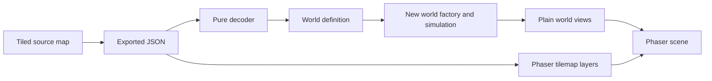

# Tiled world integration plan

Prepared 4 October 2026. Status: planned; source and installed Phaser 4.2.1 inspected.

Use Tiled to author the terrain, starting locations, resource deposits, and fixed obstacles for Scrapworks. Load its exported JSON with Phaser's existing tilemap support, and convert the gameplay data into a framework-independent world definition. The simulation will own the changing world; the scene will display it.

The first checkpoint is a small authored map with the existing character at its spawn, a following camera, and correct tile selection. Add authoritative movement, resource interaction, and saving through the existing milestones after that checkpoint.

[Implementation roadmap](README.md) · [Technical design](../design/TDD.md) · [Art direction](../art/README.md)

## Current starting point

| Existing file                                               | Current behavior                                                                 | Integration work                                                                                                             |
| ----------------------------------------------------------- | -------------------------------------------------------------------------------- | ---------------------------------------------------------------------------------------------------------------------------- |
| [Preloader](../../src/game/scenes/preloader.scene.ts)       | Loads the logo and player using an `assets` path                                 | Load the map JSON and tileset image; validate the map before starting MainMenu                                               |
| [Game scene](../../src/game/scenes/game.scene.ts)           | Creates a player at pixel position `(0, 0)` and centers the camera during layout | Create map layers, position the player from the authored spawn, and follow it within map bounds                              |
| [WorldGrid](../../src/game/gameobjects/world/world-grid.ts) | Scaffold with a private tile size of 2 metres                                    | Give it a focused rendering responsibility; put physical grid rules in plain TypeScript                                      |
| [Player](../../src/game/gameobjects/player.ts)              | Moves directly in pixels from WASD and Shift                                     | Keep it for the display checkpoint; migrate movement to simulation commands in Milestone 3                                   |
| [Simulation](../../src/simulation/simulation.ts)            | String queue and logging methods                                                 | Introduce world state and a new-world factory in Milestone 2                                                                 |
| [GameClient](../../src/contracts/game-client.ts)            | Lifecycle subscription, scene switching, and destruction                         | Keep Phaser objects behind this boundary; extend the application boundary with plain gameplay views and commands when needed |

The current `contracts/GameState` represents renderer lifecycle. Introduce a separate `WorldState` for gameplay. No terrain tileset is present in `public/assets` yet; the world comparison images are concept art rather than ready-to-use tiles.

The [existing Tiled project](../../map/untitled.tiled-project) is under `map/`, with that folder as its project root and no custom property types yet. Continue from it for the authoring setup below.

## Step 1 Choose the map and coordinate conventions

Use the following proposed starting settings. They follow the existing square world grid and the art document's view along one grid axis.

| Setting           | Starting recommendation                                                    |
| ----------------- | -------------------------------------------------------------------------- |
| Orientation       | Orthogonal, north at the top                                               |
| Extent            | Finite map, 64 columns by 64 rows                                          |
| Physical cell     | 2 metres by 2 metres, retaining the WorldGrid scaffold's intent            |
| Tiled tile pixels | 64 wide by 52 high, as a first art/projection trial                        |
| Origin            | Top-left map corner, with positive X right and positive Y down             |
| Rendering         | Native tile dimensions at layer scale 1; camera zoom controls display size |
| Layer data        | Uncompressed numeric arrays in exported JSON                               |

The logical cells remain square in metres. Their rectangular pixel footprint approximates the foreshortening in the [proposed camera view](../art/README.md#camera-and-painted-finish); 52 is approximately `64 × sin(55°)`. Phaser's 2D camera does not create that viewing angle automatically. Ground artwork and coordinate conversion provide the projection. Review this proportion with the existing character before making a full tileset.

For this axis-aligned projection, use these conversions:

```text
cell column = floor(world metres X / metresPerTile)
cell row    = floor(world metres Y / metresPerTile)

render X = world metres X / metresPerTile × tileWidthPixels
render Y = world metres Y / metresPerTile × tileHeightPixels

world metres X = render X / tileWidthPixels × metresPerTile
world metres Y = render Y / tileHeightPixels × metresPerTile

cell center in metres = ((column + 0.5) × metresPerTile,
                         (row + 0.5) × metresPerTile)
cell index = row × mapWidth + column
```

Treat cells as half-open regions: the left/top edge belongs to the cell; the right/bottom edge belongs to the next cell. Reject points outside the map, including its exact right/bottom boundary. Keep world metres, tile coordinates, render pixels, and viewport pixels distinct in names and types.

- [ ] Record these choices in one shared grid specification.
- [ ] Implement physical cell lookup in plain TypeScript and rendering conversion in the Phaser adapter.
- [ ] Check conversions at cell centers, boundaries, and negative coordinates.
- [ ] Test a small ground sample beside the player and settle the tile proportions before preparing more art.

**Finish when:** an authored cell, the player's ground position, and a selection marker all agree on the same location.

## Step 2 Set up the Tiled authoring files

Use the existing Tiled project in `map/` and keep editable maps separate from browser assets. Give the project a descriptive name such as `scrapworks.tiled-project` when ready. Tiled projects can store custom enums and classes; their export settings can embed tilesets and resolve object properties. See [Tiled custom properties](https://doc.mapeditor.org/en/stable/manual/custom-properties/) and [export preferences](https://doc.mapeditor.org/en/stable/manual/preferences/#export-options).

Suggested new paths:

```text
map/
  scrapworks.tiled-project
  maps/prototype-world.tmx
  tilesets/terrain.tsx

docs/art/world/tilesets/
  ...editable artwork and preparation notes...

public/assets/
  maps/prototype-world.json
  tilesets/terrain.png
```

The external `terrain.tsx` is shared authoring data. Its metadata must be embedded in the runtime JSON. The PNG remains a separate asset that Phaser loads explicitly. Tiled can reference that PNG directly from the source tileset, avoiding a second copy of the prepared runtime image.

Add `public/assets/tilesets` as another project folder for convenient browsing. Keep local `*.tiled-session` files out of version control; the shared project file holds the authoring configuration.

Create an atlas named `terrain` with simple placeholder ground and water tiles initially. Match its tile dimensions to the map; start with margin and spacing of zero. Document any later atlas padding and supply the same margin/spacing to Phaser.

Use this first layer contract; names are case-sensitive:

| Layer          | Tiled kind                           | Purpose                                                                        |
| -------------- | ------------------------------------ | ------------------------------------------------------------------------------ |
| `Ground`       | Tile layer, required                 | Fully filled terrain grid; each tile supplies terrain and traversal properties |
| `GroundDetail` | Tile layer, optional                 | Painted ground decoration with no gameplay effects                             |
| `Blockers`     | Object layer, required, may be empty | Grid-aligned rectangles that prevent walking and construction                  |
| `Spawns`       | Object layer, required               | Exactly one player spawn point                                                 |
| `Deposits`     | Object layer, required, may be empty | Resource points used to initialize mutable deposits                            |

Give each ground tile explicit `terrainId: string`, `walkable: bool`, and `buildable: bool` properties. For example, soil can allow both actions while water allows neither. These are proposed Scrapworks fields; artwork or tile numbers do not define the rule.

Use these map properties:

```text
mapId: string = "prototype-world"
mapRevision: int = 1
schemaVersion: int = 1
metresPerTile: float = 2
```

`schemaVersion` versions the Scrapworks authoring contract. `mapRevision` versions this map's layout and gameplay content. Tiled's own `version` and `tiledversion` fields have separate meanings.

Define the initial object conventions:

| Object class      | Shape and placement                                                  | Required custom properties                                                                                       |
| ----------------- | -------------------------------------------------------------------- | ---------------------------------------------------------------------------------------------------------------- |
| `PlayerSpawn`     | Point at a cell center in `Spawns`                                   | `spawnId: string = "player"`                                                                                     |
| `ResourceDeposit` | Point at a cell center in `Deposits`; initial footprint is one cell  | `entityId: string`, `resourceId: string`, `initialQuantity: int`, `blocksMovement: bool`, `blocksBuilding: bool` |
| `StaticBlocker`   | Rectangle in `Blockers`; corners and dimensions follow the cell grid | None initially; it blocks both movement and building                                                             |

Start with a scrap deposit such as `entityId = "scrap-001"`, `resourceId = "scrap"`, positive quantity, `blocksMovement = false`, and `blocksBuilding = true`. Resource IDs must exist in the game's content catalog. Add only the resources supported by the current milestone.

Use explicit string entity IDs for persistence; preserve them when relocating an existing deposit. Tiled's GIDs identify map tiles, and its numeric object IDs are editor identities. Neither becomes a saved resource or item ID.

- [ ] Create all required layers, even when the object layers are empty.
- [ ] Keep layers ungrouped, with zero offsets and parallax factors of 1 for the first importer.
- [ ] Set point markers at cell centers; fine-grid divisions of 2 make half-cell placement convenient.
- [ ] Keep spawn and deposits in valid cells; put the spawn on walkable terrain clear of blockers.
- [ ] Place a few scrap deposits, a water edge, and open space for later construction.
- [ ] Review explicit properties in the export rather than relying on project-only defaults.

**Finish when:** Tiled contains one small, readable starting area with a valid spawn and no starting equipment grants.

## Step 3 Establish a reliable JSON export

Use **File > Export As** to write `public/assets/maps/prototype-world.json`. Tiled supports JSON export and command-line export through `--export-map`; see its [JSON format](https://doc.mapeditor.org/en/stable/reference/json-map-format/) and [export workflow](https://doc.mapeditor.org/en/stable/manual/export/).

In Tiled's export preferences, enable **Embed tilesets** and **Resolve object types and properties**. Keep the source tileset external for reuse. If templates are introduced later, detach them during export or add deliberate template resolution to the importer.

Set the map's tile-layer format to CSV/uncompressed before exporting. The JSON result should contain numeric `data` arrays, rather than compressed strings. Check the actual file; the editor setting's name does not change the fact that runtime data is JSON.

The installed Phaser 4.2.1 source confirms two relevant limitations: `src/tilemaps/parsers/tiled/ParseTilesets.js` skips entries containing external `source` references, and `ParseTileLayers.js` skips compressed layers. The recommended export profile avoids both. It also keeps one atlas, finite dimensions, simple objects, and ordinary tilemap layers until the first map works.

- [ ] Verify each exported tileset has its name, tile dimensions, image metadata, and tile properties embedded; no tileset `source` remains.
- [ ] Verify every tile layer has the expected dimensions and a numeric array of `width × height` entries.
- [ ] Enable repeat-last-export-on-save after checking the initial destination.
- [ ] Commit source maps, project/types, source tilesets, prepared PNGs, and exported JSON together.
- [ ] Record the Tiled version used. Later add an export script and map validator so contributors and CI can reproduce the export without depending on personal preferences.

Angular already copies `public/**` into the build, so no new asset rule is needed. A file at `public/assets/maps/prototype-world.json` is requested as `assets/maps/prototype-world.json`. Verify this with the production preview and the actual hosting base path.

**Finish when:** an export can be reproduced and the map JSON and atlas are available under the intended browser URLs.

## Step 4 Validate the map and load it into the scene

Use Phaser's existing `tilemapTiledJSON`, `make.tilemap`, `addTilesetImage`, and `createLayer` APIs. No additional runtime map plugin is needed for this profile. See the [Phaser Tilemap API](https://docs.phaser.io/api-documentation/4.0.0/class/tilemaps-tilemap); method availability was also checked in the installed 4.2.1 source.

Add these calls to the existing `Preloader.preload()`, after its `this.load.setPath('assets')`:

```typescript
this.load.tilemapTiledJSON('prototype-world', 'maps/prototype-world.json');
this.load.image('terrain', 'tilesets/terrain.png');
```

The map loader caches a wrapper containing `format` and `data` in the tilemap cache. Retrieve its raw `data` through a small loader adapter and pass it as `unknown` to a pure `decodeTiledMap()` function. Validate it in `Preloader.create()` before starting MainMenu, so Play Game is enabled only after required content passes validation.

The decoder should produce a plain `WorldDefinition` with map identity/revision, dimensions, metres per cell, terrain IDs, traversal/building flags, blocker cells, spawn position, and initial deposits. It imports no Angular, Phaser, or browser APIs. Keep render tile IDs and texture bindings in separate presentation data.

Validate the supported profile rather than accepting every Tiled feature:

- [ ] Correct map type, supported Scrapworks schema version, finite orthogonal layout, and positive dimensions matching the chosen grid specification.
- [ ] Required layers with unique names and correct kinds; valid array lengths and embedded single-atlas metadata.
- [ ] Recognized terrain/resource IDs, property types, and object classes; positive integer deposit quantities and unique entity IDs.
- [ ] One in-bounds, unobstructed player spawn; centered resource points and aligned, in-bounds blocker rectangles.
- [ ] Zero offsets, unit parallax, and supported object shapes; reject unsupported groups, external templates, or transformed objects with a useful message.
- [ ] Ground cells all filled; empty GID 0 is allowed only in optional decorative layers.
- [ ] Resolve tile properties using the GID's tileset and local tile ID. Strip all Tiled transform bits first, then subtract `firstgid`; never assume the GID equals the local ID.
- [ ] Initially allow only ordinary and horizontal/vertical-flipped tiles. Reject diagonal/hex rotation flags for the rectangular tile profile before handing it to Phaser.

Tiled documents empty cells, tileset-local IDs, and transform flags in its [global tile ID reference](https://doc.mapeditor.org/en/stable/reference/global-tile-ids/). The importer's restrictions above are proposed Scrapworks rules.

Report semantic validation errors through `GameEvent.SCENE_ERROR`, with a message identifying the layer/object/property. Loader errors already use that lifecycle channel. A valid JSON file can still contain an invalid level, so download success alone must not emit readiness.

In `Game.create()`, delegate layer creation to the focused `WorldGrid` renderer. The essential Phaser calls are:

```typescript
const map = this.make.tilemap({ key: 'prototype-world' });
const tileset = map.addTilesetImage('terrain', 'terrain');
if (!tileset) throw new Error('Required terrain tileset is unavailable.');

const ground = map.createLayer('Ground', tileset, 0, 0);
if (!ground) throw new Error('Required Ground layer is unavailable.');
ground.setDepth(-1000);
```

The first `terrain` is the tileset's name inside Tiled; the second is Phaser's loaded image key. Create `GroundDetail` only when present, below actors. Instantiate resource visuals from the decoded definition for the display checkpoint, then from live simulation views once Milestone 2 is connected. Read object metadata explicitly; object layers do not automatically create gameplay entities.

- [ ] Position the player's ground anchor at the decoded spawn converted into render pixels.
- [ ] Adjust sprite origin/offset so its feet agree with that ground anchor; verify against the actual transparent player image.
- [ ] Set camera bounds from `map.widthInPixels` and `map.heightInPixels`, and use `camera.startFollow(player)`.
- [ ] Retain viewport resizing, and remove the existing resize-time `centerOn()` behavior once following is established.
- [ ] Handle maps smaller than a zoomed viewport by centering them sensibly; check spawn near map edges.
- [ ] Convert pointer viewport coordinates through the active camera to render-world pixels, then through the inverse projection to metres/cells. Apply camera conversion exactly once.
- [ ] Draw a reusable selected-cell marker; create the tilemap once per scene, rather than building one sprite per terrain cell.
- [ ] For tall props later, sort actor/prop sprites by projected ground Y. Fixed foreground layers cannot provide actor-dependent overlap on their own.
- [ ] Catch scene-construction errors and publish the error state before `SCENE_READY`.
- [ ] Dispose the map/layers and owned subscriptions on scene shutdown, using exact callback references and idempotent cleanup.

Use named Phaser runtime imports and type-only imports for types. The snippets run inside scene methods and need no global `Phaser` object or default import.

**Finish when:** Play Game displays the authored terrain and character, camera following works, and clicking a cell selects it correctly after resize, scroll, and zoom.

## Step 5 Initialize the authoritative world

Complete this with [Milestone 2](milestone-02-simulation-foundation.md) and the movement work in [Milestone 3](milestone-03-character-and-manual-opening.md).



The application session creates a new world from the definition once. Scene creation and canvas remounting reconnect presentation to the active session. Explicit New Game creates a new world; resuming or loading uses existing state.

- [ ] Initialize terrain and static blockers from the definition, player position from the spawn, and deposits with stable IDs and initial remaining quantities.
- [ ] Start with empty inventory, no placed machines or equipment, no research unlocks, and zero production totals, following the GDD.
- [ ] Keep mutable deposit quantities, constructed entities, and environmental changes in `WorldState`.
- [ ] Validate construction using terrain eligibility plus static blockers and current dynamic occupancy. Keep movement and building flags independent.
- [ ] Advance player position in world metres inside the simulation. Normalize input there or at its typed input boundary, then project the resulting position for rendering.
- [ ] Resolve map boundaries and collision against the defined player footprint. Check the swept movement/path or bounded substeps so fast motion cannot cross a blocked cell.
- [ ] Clear held movement on focus loss, pause, scene shutdown, and world replacement.
- [ ] Render the latest views; clearing a deposit changes occupancy/visuals according to simulation rules without editing the Tiled source.

The current player moves at equal pixel speeds on both axes. With compressed render height that implies different physical speeds, so its direct movement remains a temporary display scaffold. The authoritative implementation should use metres per second and apply projection afterward. Keep one owner of movement/collision; Phaser physics is unnecessary for the initial grid rules.

**Finish when:** walking, occupancy, and resource state are consistent with the same plain world model and independent of camera settings.

## Step 6 Keep map identity compatible with saves

Prepare this boundary now and implement persistence with [Milestone 4](milestone-04-first-local-save.md).

- [ ] Save `mapId` and `mapRevision` alongside the complete authoritative `WorldState` for the first small-map save format, including modified terrain, deposits, occupancy, and player position.
- [ ] Restore that snapshot rather than rerunning the new-world factory; a depleted deposit must stay depleted.
- [ ] Resolve the matching presentation map before replacing the active world. Initially reject revision mismatches with a visible explanation and preserve the current session.
- [ ] Increment the map revision when gameplay layout, spawn/deposit identities, or terrain rules change. Introduce migrations or retained revision assets before supporting older layouts.
- [ ] Reconstruct sprites, tilemap layers, cameras, and subscriptions from restored data; keep them outside snapshots.

**Finish when:** an export edit cannot silently refill resources or replace a saved world's layout.

## Suggested implementation files

Add these as their responsibilities become necessary; this is a proposed layout, not existing implementation.

| Path                                       | Responsibility                                                            |
| ------------------------------------------ | ------------------------------------------------------------------------- |
| `src/content/world-definition.ts`          | Plain authored-world contract and supported content IDs                   |
| `src/content/tiled/decode-tiled-map.ts`    | Validate raw JSON and translate the supported Tiled profile               |
| `src/core/world/grid.ts`                   | Physical cell lookup, indexing, bounds, and footprint helpers             |
| `src/game/world/world-projection.ts`       | Metres/render-pixel conversion and camera-aware picking adapter           |
| `src/game/world/world-map-assets.ts`       | Map/cache keys, explicit atlas bindings, and loader/cache adapter         |
| `src/game/gameobjects/world/world-grid.ts` | Existing scaffold developed into tilemap/selection rendering and disposal |
| `src/simulation/world/world-state.ts`      | Authoritative mutable world records                                       |
| `src/simulation/world/create-world.ts`     | Initialize a new world from validated authored data                       |

Use relative imports for `src/content` initially, or deliberately add an alias to `tsconfig.json`; `@content` does not currently exist. Keep scene orchestration small, decoding separate from rendering, and physical rules reusable without a renderer.

## Verification checkpoints

Add focused tests as the implementation reaches each checkpoint:

| Check                   | Evidence to collect                                                                                                                                            |
| ----------------------- | -------------------------------------------------------------------------------------------------------------------------------------------------------------- |
| Pure importer           | Valid exported fixture yields expected cells, blockers, spawn, and deposits; bad layer names, properties, unsupported features, and duplicate IDs are rejected |
| GID handling            | Different `firstgid` values and supported flips preserve terrain properties; empty required-ground cells and unsupported flags are rejected                    |
| Projection and picking  | Centers and boundaries round-trip; camera movement, zoom, and resize still select the expected cell                                                            |
| Actual Play Game action | Extend the existing `game-page.component.spec.ts` browser test to click the button and assert the map layers and authored spawn exist                          |
| Error state             | Missing JSON/PNG and semantically invalid maps show an alert and never publish ready gameplay                                                                  |
| Lifecycle               | Repeated scene entry and host recreation keep one canvas, one set of layers, and one response per input; independent games do not share mutable worlds         |
| Simulation and saving   | Equal physical movement across render schedules, collision at speed, empty new-world inventory, and depleted deposits preserved on load                        |
| Accessible interface    | Keyboard/focus handling and any new DOM controls/errors pass axe and WCAG AA checks; inspect canvas/world readability manually                                 |

For Phaser-backed UI changes, run the repository's required checks:

```sh
yarn test
yarn run lint
yarn run ng -- build
```

Also preview the production build to check map/atlas requests and inspect the world at small and large host sizes. Browser tests should exercise the real event handler and wait for asynchronous Phaser destruction during cleanup.

## First work session

1. Settle the 2-metre logical cell and initial pixel proportions using a tiny ground sample.
2. Continue the Tiled project in `map/`; add the atlas, five layers, one spawn, and a few scrap deposits.
3. Export embedded, uncompressed JSON into `public/assets/maps` and verify its properties.
4. Add the pure decoder and Preloader validation, then render Ground and the player at the authored spawn.
5. Add camera following and a cell-selection marker; extend the Play Game browser regression and run the required checks.

This delivers the representative grid scene needed by Milestone 1. It establishes the authored definition for Milestone 2 while leaving authoritative movement, salvage, and save behavior to their planned milestones.
