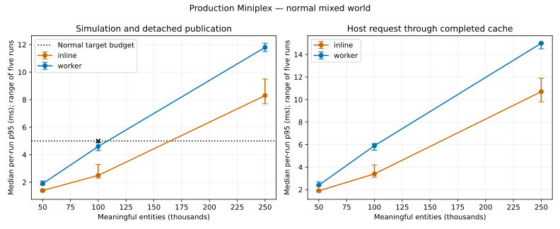
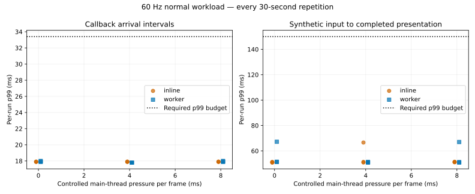

# Production Miniplex worker foundation

30 October 2026. **Implemented and qualified. Milestone 3 Step 0 is complete.** All 94 production qualification jobs passed with no failures or timeouts. Continue with one private Miniplex authority in one dedicated worker. Later gameplay implementation remains pending.

This implements the [approved production plan](../../../plans/ecs-worker-implementation.md) for Milestone 3 Step 0. The original [library comparison](../../ecs/2026-10-29/README.md) and [lean laboratory qualification](../../simulation-worker/2026-10-30/README.md) remain separate historical evidence. Production now has one private Miniplex 2.0.0 authority in one dedicated module worker, with sequential fixed steps. Angular, input and Babylon remain on the main thread.

## Delivered boundary

- `src/session/` owns readiness, one host accumulator, one in-flight advance, the shared five-step allowance, sequenced commands/cancellations, revisions, bounded inspections, capture barriers and termination. The inline port is an explicit test/development control outside the normal application graph.
- `src/simulation/ecs-runtime.ts` owns components, cached native queries, game IDs, generation-safe wire slots, collision indexes and world resources. Plain transaction/reservation/work primitives remain independent of Miniplex. Normal initialization has an empty 24-slot bag, no equipped tool or gameplay unlocks.
- The production publisher transfers 14-field Float64 rows and removals. Inventory-only mutations update bounded detached details without redundant numeric rows. The host applies ordered versions, requests one full resynchronization after a gap, and exposes a completed cache and changed sets to renderers.
- Toolkit `onGameTick` is a main-thread completed-tick presentation notification. An owned frame pins the latest completed view, drains summaries, then submits future credits. Hooks cannot change or roll back their reported tick. New registrations do not replay committed summaries.
- Worker/presentation failure retains the last complete view. Retry restarts from the authored initial definition. Healthy renderer-only Retry retains its session; page teardown disposes it. Error handling closes page dialogs and focuses Retry, including a crash while paused.
- Plain capture/rebuild preserves components, resources, IDs, work, reservations, held output, history, charge and command accounting. It excludes library handles, wire slots and physical input. No gameplay saves, automatic checkpoints, new recipe catalogue or opening gameplay executors are delivered.

## Qualification protocol

Measured source is frozen at `73e85e6`, with per-file hashes and environment/launch manifests in the raw run. Full primary trials use five independent fresh Chromium processes per configuration, at least two seconds and 200 disposable-world warm-up ticks in the retained runtime/system context, then 2,000 fixed 50 ms steps. Sorting, capture, hashing, decoder checks and the independent integer-work oracle are outside timing.

The actual production schemas are populated with 60% processors, 20% 24-slot inventory owners, 10% deposits and 10% ground piles; the persistent player occupies an owner entry. Normal/idle/active activity, real atomic transfers, explicit spending priority, reservations, replenishment, output and history remain meaningful throughout. Churn replaces the other 1% at constant population and repairs ownership before commit. The benchmark composition stays outside production imports.

The normal target remains 100,000 entities: median per-run compute/publication p95 ≤5 ms and p99 ≤8 ms; observed receiving p95 ≤2 ms and p99 ≤4 ms. Every required 60 Hz normal paced trial must pass callback p95/p99 ≤18.5/33.4 ms and sampled input-to-completed-presentation p95/p99 ≤100/150 ms. Three 30-second repetitions cover each 0/4/8 ms host pressure case. 120 Hz is diagnostic, and its achieved cadence is reported.

The isolated harness does not render one mesh per entity. The actual built Angular/Babylon acceptance scene separately recorded **18 meshes, 15 visible/active meshes and 14 draw calls in a complete frame** at 1280×800. It passed same-origin worker CSP, a non-root base path, physical keyboard movement with rendered-player convergence, menu pause, WebGL context-loss/healthy Retry retaining the same worker and position, idle worker crash, authored-world Retry and termination. These counts are a functional scene sample, not a rendering-scale or target-device qualification. [Built acceptance evidence](packaging.json) includes the actual worker URL and scene measurements.

## Results and adoption

The actual production runtime passes every unchanged adoption gate at 100,000 normal entities. Values below are medians of five independently measured per-run percentiles, except the paced rows, which show the worst of all nine required worker trials.

| Measurement | p95 | p99 | Required ceiling |
| --- | ---: | ---: | --- |
| Worker simulation + detached publication | **4.60 ms** | **5.60 ms** | 5 / 8 ms |
| Worker observed receiver/cache application | **1.20 ms** | **1.40 ms** | 2 / 4 ms |
| Worker round trip through completed cache | 5.90 ms | 7.20 ms | Reported separately |
| Inline simulation + detached publication | 2.50 ms | 3.90 ms | Control |
| Worker 60 Hz callback arrival, worst required run | **17.70 ms** | **18.00 ms** | 18.5 / 33.4 ms |
| Worker synthetic input to completed presentation, worst required run | **66.20 ms** | **67.20 ms** | 100 / 150 ms |

Worker CPU p95 repetitions are **4.9, 4.5, 4.7, 4.3, 4.6 ms**; p99 repetitions are **6.0, 5.3, 5.7, 5.3, 5.6 ms**. [Complete results](results.md), [primary CSV](trials.csv), [paced CSV](paced.csv) and [summary](summary.json) publish every repetition, spread, maximum, throughput and work counter. An [independent integer-work oracle](work-verification.json), importing no production systems, verifies all **60** primary trials' operations, transfers, replacements, extraction, changed rows and buffer bytes. All target normal state hashes agree across both execution modes. No world becomes depleted to make a timing look better.



At 50,000 normal entities worker compute/publication is 1.9/2.5 ms; at 250,000 it is **11.8/14.6 ms**. At 100,000, mostly idle is 1.0/1.5 ms, fully active **10.8/14.1 ms**, and 1% structural churn **9.8/11.3 ms**. Those stress cases complete correctly but exceed the normal compute budget; the adoption pass applies to the agreed normal mix. These results do not justify a universal 250,000-entity or all-active promise.

All required normal paced trials have zero long tasks and zero discarded time, with at most one request outstanding. Worst worker backlog is 79.6 ms; worst individual callback interval is 23.1 ms. Idle and fully active worker diagnostics at 8 ms host pressure also maintain approximately 60 callbacks/second. Timer-emulated 120 Hz achieves only **64.38 Hz worker / 64.48 Hz inline**, so it provides no 120 FPS qualification. Input numbers measure sampled synthetic intent through acknowledgement to the next completed presentation callback, rather than physical input-to-photon.



Both inline and worker controls pass normal 60 Hz responsiveness here. The worker adds CPU/transport cost; its benefit is keeping sequential simulation and most allocation/GC work off the rendering thread. Separate churn CPU profiles show the main thread approximately 77% sampled idle in worker mode, with receiving/cache application the largest active cost. This supports the chosen ownership boundary without claiming a higher full-game frame rate. Keep interpolation; this evidence does not require visual prediction or multiple ECS workers.

Normal publications contain 14,002 numeric rows / **1,568,224 transferred bytes** and two detail records, versus a full 100,000-row / 11,200,000-byte numeric cache. Inventory-only changes do not resend numeric rows. The 14-field Float64 format preserves positions, flags, quantity, work, charge, reservation/held totals and completion status. Routine publication does not serialize all inventories or research/history.

Timing separates systems (including explicit dirty tracking), remaining step execution, and direct publication. The `structural` timer is the residual step cost outside the injected domain system and includes commands, movement and commits; it is not a pure structural-only measurement. `packing` is zero because the publisher writes directly into the transferred layout. `observedReceiver` starts at JavaScript message delivery, includes `MessageEvent.data` and request/cache processing, and can omit earlier browser-internal deserialization. Round trips and paced callback intervals include delivery. Timers/profiles are independent; adding component percentiles does not produce a combined percentile.

## Capture, packaging and memory

Single-run target diagnostics record worker initialization **1,648.6 ms**, capture **1,419.2 ms**, JSON encode/decode **73.2/137.2 ms**, and rebuild plus initial presentation **1,887.2 ms**. Snapshot JSON is **44,559,083 bytes**. Capture is an explicit completed-batch barrier and is expensive; there is no automatic checkpoint schedule. Cold loading/first-tick data remain separate in each trial. Initialization includes world construction and first cache application rather than isolating bare-library import. The actual production worker asset is **42,941 minified bytes / 12,405 gzipped bytes**, containing the runtime and Miniplex; this is the worker asset size, not an incremental whole-app bundle comparison.

Separate instrumented runs include a 10,000-tick churn soak and 20 create/capture/rebuild/dispose cycles in both modes. Values sum CDP used JS heap and backing storage across main/worker contexts, in MiB; they exclude browser RSS/native IPC buffers and are not peak RAM. Embedder and allocated-heap values are recorded separately in [memory.csv](memory.csv), without adding them again to used heap.

| Mode | Populated | After soak | Rebuilt, capture held | Rebuilt, capture released | World disposed | After termination/cycles |
| --- | ---: | ---: | ---: | ---: | ---: | ---: |
| Inline | 93.90 | 80.57 | 164.29 | 97.08 | 2.01 | 2.13 |
| Worker | 97.57 | **84.70** | 171.85 | 101.26 | 2.55 | 1.65 |

Worker live retained total remains **84.70 MiB** from tick 500 to 10,000; inline changes 80.44→80.57 MiB. Every cycle leaves zero worker targets; disposed-cycle totals change only 2.05→2.13 MiB inline and 1.61→1.71 MiB worker. The worker main context holds a numeric cache/ID mappings and one detached watched-player record, not a second authoritative world. The initial populated checkpoint also retains its full packet, which is released before steady measurement. Rebuilt live representations retain more memory after capture release, without cumulative growth across disposal cycles; this diagnostic does not fully attribute that representation difference.

[Eight heap snapshots](heap-evidence.json) identify **101,000** component payloads in worker authority after churn: 100,000 live plus exactly 1,000 previous-generation entities held by the benchmark fixture's `byOrdinal` index until its next-tick refresh. Direct retaining edges all lead to that bounded fixture index; this is harness retention, not a growing ECS population. The main context has 100,000 lightweight ID mappings and one subscribed player payload. All five post-world-disposal/termination snapshots have **zero concrete fixture payloads**, and the 11,200,000-byte cache backing node disappears. No node over 1 MiB remains after disposal. This is finite evidence against persistent world retention in the tested lifecycle, not a universal leak-free guarantee.

[CPU/allocation/GC evidence](profile-evidence.json) retains both execution contexts. Sampled cumulative allocation is about **21.23 GiB inline / 22.88 GiB worker across contexts** in the churn diagnostic; these are allocation estimates over repeated replacement, not live RAM or exact native-buffer traffic. CPU hot spots include publication, cache application, native query insertion and the synthetic domain/churn path. GC tracing includes explicit checkpoint collections and nested/concurrent events: its large major-GC maxima must not be read as ranking-tick pauses or summed across event names. Ranking trials never force GC. Retained-object evidence and sampled allocation volume are reported separately.

## Correctness and required checks

The final world suite passes **41 tests**, including independent inventory conservation, atomic renewal, stock priority, structural boundaries, generation reuse, nested detachment, growth to 100,000, asymmetric wire decoding, full/delta/resynchronization, pause/in-flight credits, idle failure, timeout/disposal, capture cancellation races and 1,000 further steps after fresh restoration across normal, idle, active and churn worlds. A separate plain-object reference runs three seeded 1,000-step movement/placement streams against ECS. Chromium application/renderer/accessibility tests pass **288 tests**, including reconstruction from a delta after renderer Retry and changed-only entity updates.

Immutable Yarn installation, lint and lint rules, scene/world compilation/export, all existing ECS candidates' checks/smoke, original worker smoke, production worker smoke/profiles, TypeScript app/spec/worker/reference checks, production build, assets, documentation/diagrams and the native development export/reload/recovery probe pass. [Validation records](validation-checks.json) retain log hashes and results. The graph audit verifies Miniplex only in the worker, rejects competing ECS/benchmark/inline authority in the main graph, and has deliberate forbidden-import tests. Miniplex's transitive `eventery` CommonJS build warning and existing optional Babylon peer warnings are recorded; no package version was substituted.

## Reproduction and raw evidence

```text
yarn install --immutable
yarn test:world
yarn test
yarn build --stats-json
node tools/ecs-bench/verify-production.mjs
node tools/world/production-browser.mjs
yarn bench:worker:browser --production --presentation lean --phase lean --output tmp/simulation-worker-bench/production-reference-final-2026-10-30
```

Raw samples, manifests, CPU/allocation/GC profiles and heap snapshots remain ignored under `tmp/simulation-worker-bench/production-reference-final-2026-10-30/`. [Environment, launch flags and completion](environment.json), [raw artifact hashes](raw-artifacts.json), [source verification](source-verification.json), [all results](results.md), profile/heap evidence and SVG/PNG charts are committed here. Source verification confirms all **76** measured source/package/lock files still match fingerprint `2411993621bce59a9671b90815cf59014faebab9354a8804e5f0345b0fb55208`. The subsequent renderer regression fix/tests and documentation do not change measured simulation/session/harness files. The manifest preserves inherited laboratory qualification notes for provenance; its actual production runtime flag, executed matrix and this protocol define this cohort. bitECS was not rerun or scored as failing in this production-only cohort.

Reference desktop: Ryzen 9 7900X3D, 24 logical CPUs, 63.6 GiB RAM, Windows 10.0.26300 x64. Node 24.21.0 orchestrates Playwright 1.64.1 / Chromium 156.0.8078.4 / V8 15.6.75; Yarn is pinned to 4.18.1. Node is used for correctness/tooling here; production performance qualification runs in Chromium. The focused 94-job matrix took **42 minutes 28 seconds**, excluding development probes, offline analysis and repository checks. It reduces the prior two-candidate matrix without reducing five-repetition or soak durations. No tests/builds/other benchmarks ran concurrently with ranking trials. CI runs correctness, small production smoke and built-worker acceptance; the manually dispatched workflow uploads full hosted-runner artifacts separately from desktop selection evidence. No hosted workflow was dispatched.

To regenerate offline evidence after a completed run: use `verify-work.mjs`, this directory's `publish.mjs` and `plot.py`, the adjacent 29 October worker report's `profile-evidence.mjs`/`verify-source.mjs`, and this directory's `heap-evidence.py` over the saved snapshots. `publish.mjs` regenerates the compact Miniplex-only report, CSVs, flags, artifact hashes and current built-asset acceptance. It requires the saved profile evidence, production build and browser-probe result; raw profiling artifacts remain ignored. Plotting uses the existing benchmark Matplotlib requirements. Run analysis only after measurements finish.

Development probes and the interrupted earlier cohort are excluded. They identified hot object representation, transient transaction/reservation allocation, dirty-buffer growth and a warm-up context flaw. Reservation renewal now preserves the same paid-work and stock semantics without allocating a new reservation per repeat. The final cohort repeats the complete matrix; no samples from earlier versions are pooled.

Multi-worker ECS, shared component memory, workers for rendering, gameplay persistence, physical input-to-photon, other browsers and target devices remain later work. This task stops at the verified Step 0 foundation.
