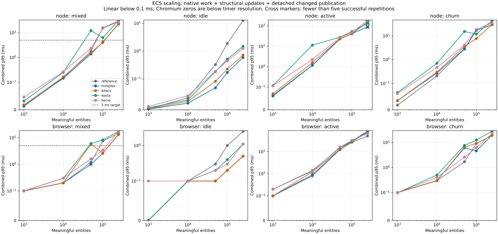
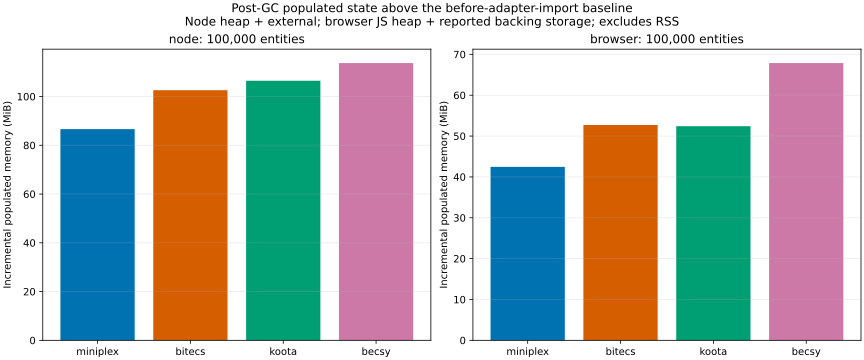

# ECS benchmark investigation

Run started 2026-10-28T13:05:29.738Z. Environment label: **reference-desktop**.

Reference hardware: AMD Ryzen 9 7900X3D 12-Core Processor ; 63.6 GiB RAM; win32 10.0.26300; Node 24.21.0.

Source revision: `6eaa13344d1f9640058050f86471d98c9888fccd`; benchmark/lock fingerprint: `4d9a7a96f573040d79348712f28d98b68c3f5255e722f61591560361b8dbf3ee`. The working-tree status in summary.json identifies uncommitted benchmark sources at run start.

## Target results

100,000 meaningful entities; mixed processors 20% active, 60% idle, 20% blocked. Values include native systems, structural updates, dirty tracking and deep detached changed-view publication. Target: p95 ≤5 ms and p99 ≤8 ms. Phase percentiles cannot be added to reconstruct a combined percentile.

| Environment | Candidate     | Completed repeats | p95 ms | p99 ms | Publication p95 ms | p95 range ms  |
| ----------- | ------------- | ----------------: | -----: | -----: | -----------------: | ------------- |
| browser     | becsy         |               5/5 |  3.400 |  4.100 |              2.800 | 3.200–4.500   |
| browser     | becsy-checked |               5/5 | 10.300 | 19.900 |              8.100 | 10.000–10.400 |
| browser     | bitecs        |               5/5 |  2.600 |  3.300 |              2.400 | 2.500–2.800   |
| browser     | bitecs-arrays |               5/5 |  2.600 |  3.000 |              2.400 | 2.600–2.700   |
| browser     | koota         |               5/5 |  8.300 | 13.600 |              6.500 | 8.000–8.900   |
| browser     | koota-update  |               5/5 |  8.700 | 14.000 |              6.600 | 8.400–8.700   |
| browser     | miniplex      |               5/5 |  2.600 |  3.100 |              2.400 | 2.400–2.800   |
| browser     | reference     |               5/5 |  7.500 | 12.300 |              6.600 | 7.400–7.900   |
| node        | becsy         |               5/5 | 15.119 | 21.257 |             14.248 | 14.770–15.406 |
| node        | becsy-checked |               5/5 | 13.381 | 19.423 |             11.211 | 13.145–13.829 |
| node        | bitecs        |               5/5 |  4.036 |  4.921 |              3.752 | 3.684–14.494  |
| node        | bitecs-arrays |               5/5 | 10.663 | 14.540 |             10.208 | 3.407–11.589  |
| node        | koota         |               5/5 |  6.264 |  7.917 |              4.350 | 5.976–6.334   |
| node        | koota-update  |               5/5 |  5.752 |  6.743 |              3.645 | 5.645–6.098   |
| node        | miniplex      |               5/5 |  4.210 |  5.392 |              3.973 | 4.145–4.633   |
| node        | reference     |               5/5 | 15.779 | 19.756 |             13.285 | 15.424–16.048 |

- **miniplex:** passes timing gate.
- **bitecs:** passes timing gate.
- **koota:** fails timing gate.
- **becsy:** fails timing gate.

Recommended candidate: **miniplex**, after correctness, complete evidence and both timing gates. Maintainability scores and evidence are recorded in summary.json.

## Evidence and limits

Completed job files: 1204; correctness results: 32; error/timeout records: 25; profile records: 8; paced browser records: 36.

The standalone benchmark imports no Angular/Babylon application or Editor assets. It qualifies synthetic simulation workloads on the recorded machine; RAF results are not full-game GPU/FPS guarantees. All raw timings and instrumented profiles are kept separately. Instrumented results do not rank timing performance.

Heap figures, external/ArrayBuffer figures and RSS have different meanings; ArrayBuffer bytes are included in Node external memory. Post-GC checkpoints and retained-object profiles must be considered together before attributing a leak. Becsy preallocates configured capacities; those retained allocations are part of its measured cost.

Canonical correctness compares all state, buffers, reservations, ownership and history against the plain TypeScript oracle and verifies 1,000 continued steps after rebuilding a fresh runtime. Native iteration order is not a stock-allocation priority.

## Reproduction

Run `yarn bench:ecs:check`, `yarn bench:ecs:smoke`, then `yarn bench:ecs:full --output tmp/ecs-bench/<run-id>`. The full suite uses fresh sequential worker processes and a production Vite harness. Resume with the same command/output and `--resume`; source and lock hashes must match. `yarn bench:ecs:report --input <run-directory> --destination <report-directory>` regenerates summaries.

See summary.json for all repetitions, errors, memory checkpoints, capture/rebuild costs, lifecycle cycles, browser versions and paced samples. Large CPU/heap profiles and per-tick samples remain in the ignored run directory and CI artifacts.

## Maintainability review

| Candidate | Score / 10 | Domain reuse | Types | Lifecycle | Capture/projection | Package risk |
| --------- | ---------: | -----------: | ----: | --------: | -----------------: | -----------: |
| miniplex  |          9 |            2 |     2 |         2 |                  2 |            1 |
| bitecs    |          6 |            2 |     1 |         1 |                  1 |            1 |
| koota     |          5 |            2 |     1 |         1 |                  1 |            0 |
| becsy     |          5 |            2 |     2 |         0 |                  1 |            0 |

Scores are evidence-based engineering assessments, not performance measurements. They decide only among qualifying candidates; higher is simpler. Full per-criterion rationale is included in summary.json.

## Errors and timeouts

- node/reference/trial/250000/active: 120-second measured-trial timeout
- node/miniplex/trial/250000/active: 120-second measured-trial timeout
- node/bitecs/trial/250000/active: 120-second measured-trial timeout
- node/koota/trial/250000/active: 120-second measured-trial timeout
- node/becsy/trial/250000/active: 120-second measured-trial timeout
- node/miniplex/trial/250000/active: 120-second measured-trial timeout
- node/bitecs/trial/250000/active: 120-second measured-trial timeout
- node/koota/trial/250000/active: 120-second measured-trial timeout
- node/becsy/trial/250000/active: 120-second measured-trial timeout
- node/reference/trial/250000/active: 120-second measured-trial timeout
- node/bitecs/trial/250000/active: 120-second measured-trial timeout
- node/koota/trial/250000/active: 120-second measured-trial timeout
- node/becsy/trial/250000/active: 120-second measured-trial timeout
- node/reference/trial/250000/active: 120-second measured-trial timeout
- node/miniplex/trial/250000/active: 120-second measured-trial timeout
- node/koota/trial/250000/active: 120-second measured-trial timeout
- node/becsy/trial/250000/active: 120-second measured-trial timeout
- node/reference/trial/250000/active: 120-second measured-trial timeout
- node/miniplex/trial/250000/active: 120-second measured-trial timeout
- node/bitecs/trial/250000/active: 120-second measured-trial timeout
- node/becsy/trial/250000/active: 120-second measured-trial timeout
- node/reference/trial/250000/active: 120-second measured-trial timeout
- node/miniplex/trial/250000/active: 120-second measured-trial timeout
- node/bitecs/trial/250000/active: 120-second measured-trial timeout
- node/koota/trial/250000/active: 120-second measured-trial timeout

## Scaling and memory charts

