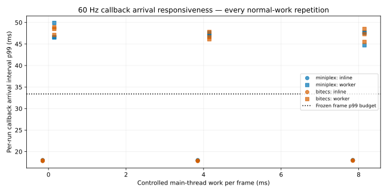
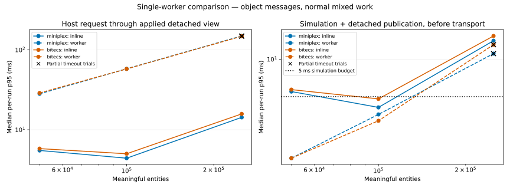

# Simulation worker investigation — 29 October 2026

**Retain Miniplex 2.0.0 as the ECS baseline, and revise the publication contract before production worker integration. Neither measured single-worker configuration qualifies.** Both candidates pass correctness and the simulation-plus-detached-copy budget. Sending rich changed records to the main thread makes receiving work and callback gaps exceed the browser budgets. bitECS has a stronger documented foundation for possible future shared numeric processing, but this study finds no current single-worker advantage sufficient to change the library choice.

The isolated laboratory is implemented under [tools/simulation-worker-bench](../../../../tools/simulation-worker-bench/README.md). Production simulation, Angular/Babylon runtime, authored scenes and art are unchanged. No multi-worker ECS, shared component memory, Atomics or parallel scheduler was implemented.

## Target result

The target is 100,000 meaningful entities: 60,000 processors, 20,000 inventory owners including the player, 10,000 deposits and 10,000 ground piles. Normal work keeps 12,000 processors active, with replenishment, transfers, reservations, held output, histories and charge. These are synthetic processing records, not delivered factory gameplay.

Values below are the **median of five independent per-run percentiles**, in milliseconds. Simulation/copy includes native systems, structural commits, dirty tracking and deep detached changed-record publication, **before messaging**. It is not total worker CPU cost. Object-message serialization and receipt are additional costs.

| Candidate      | Configuration | Simulation/copy p95 | Simulation/copy p99 | Observed receipt p95 | Observed receipt p99 | Host round trip p95 | Host round trip p99 |
| -------------- | ------------- | ------------------: | ------------------: | -------------------: | -------------------: | ------------------: | ------------------: |
| Miniplex 2.0.0 | Inline        |                 4.1 |                 4.6 |                  0.3 |                  0.4 |                 4.4 |                 4.9 |
| Miniplex 2.0.0 | One worker    |                 3.6 |                 3.8 |                 33.0 |                 35.4 |                58.0 |                62.7 |
| bitECS 0.4.0   | Inline        |                 4.8 |                 5.3 |                  0.2 |                  0.3 |                 5.0 |                 5.5 |
| bitECS 0.4.0   | One worker    |                 3.2 |                 3.7 |                 32.7 |                 36.5 |                57.8 |                62.7 |

| Worker qualification criterion                                    | Frozen budget            | Miniplex             | bitECS               |
| ----------------------------------------------------------------- | ------------------------ | -------------------- | -------------------- |
| Correctness and target state equivalence                          | All pass                 | Pass                 | Pass                 |
| Simulation + detached copy                                        | p95 ≤5 / p99 ≤8 ms       | Pass                 | Pass                 |
| Observed receiving work                                           | p95 ≤2 / p99 ≤4 ms       | Fail                 | Fail                 |
| Normal callback intervals, every pressure/repetition              | p95 ≤18.5 / p99 ≤33.4 ms | Fail                 | Fail                 |
| Sampled input to next presented acknowledgement, every repetition | p95 ≤100 / p99 ≤150 ms   | Fail                 | Fail                 |
| Overall                                                           | Every required gate      | **Does not qualify** | **Does not qualify** |

No budget or entity target was relaxed. Inline controls demonstrate the cost of the worker bridge under this publication contract; they are not an agreed automatic production fallback.

### Repetitions and spread

These are all five target worker repetitions, in execution order. Full p50/p95/p99/max, throughput, work counts, phase distributions and every inline repetition are in [primary/trials.csv](primary/trials.csv), [primary/trials.json](primary/trials.json) and [summary.json](summary.json).

| Candidate / metric           | Run 1 | Run 2 | Run 3 | Run 4 | Run 5 | Median |
| ---------------------------- | ----: | ----: | ----: | ----: | ----: | -----: |
| Miniplex simulation/copy p95 |   2.9 |   3.6 |   3.6 |   3.7 |   3.1 |    3.6 |
| Miniplex simulation/copy p99 |   3.4 |   3.9 |   3.8 |   3.9 |   3.5 |    3.8 |
| Miniplex receipt p95         |  34.1 |  32.4 |  32.6 |  33.0 |  33.9 |   33.0 |
| Miniplex round trip p95      |  57.0 |  58.2 |  57.7 |  58.0 |  59.3 |   58.0 |
| bitECS simulation/copy p95   |   2.9 |   3.1 |   3.6 |   3.7 |   3.2 |    3.2 |
| bitECS simulation/copy p99   |   3.4 |   3.7 |   4.0 |   4.0 |   3.6 |    3.7 |
| bitECS receipt p95           |  32.5 |  32.0 |  32.7 |  33.4 |  34.1 |   32.7 |
| bitECS round trip p95        |  57.1 |  54.5 |  57.8 |  58.5 |  59.3 |   57.8 |

Inline simulation/copy p95 spans 2.6–9.3 ms for Miniplex and 2.8–9.7 ms for bitECS. Their medians meet the compute budget, while individual repetitions exceed it. All repetitions remain published; none was discarded as noise.

## What dominates the cost

Native systems are inexpensive in the normal world: median per-run system p95 is 0.9 ms for Miniplex and 0.6 ms for bitECS. Detached-copy publication p95 is 2.7 and 2.6 ms respectively. Most measured receiving time occurs in `MessageEvent.data` access: p95 32.7/32.4 ms. The explicit cache-application p95 is only about 0.3 ms. This is consistent with lazy reconstruction of the cloned message graph; browser work before handler entry remains unattributed.

The worker's synchronous `postMessage` call also costs p95 **25.4 ms for Miniplex and 25.2 ms for bitECS**, with p99 27.0/27.8 ms. These costs are additional to simulation/copy. Individual post samples were summarized per run; their percentiles cannot be added to simulation or receipt percentiles to reconstruct a combined percentile. The measured host round trip already includes the complete request/reply path.

| Detached frame    | Records | UTF-8 JSON estimate |
| ----------------- | ------: | ------------------: |
| Initial full view | 100,000 |    39,630,193 bytes |
| First normal tick |  12,301 |     4,766,401 bytes |
| 0% dirty          |       0 |            80 bytes |
| 1% dirty          |   1,000 |       390,282 bytes |
| 10% dirty         |  10,000 |     3,928,092 bytes |
| 100% dirty        | 100,000 |    39,630,192 bytes |

All four configurations produce the same frame-size estimates. These are untimed JSON estimates, not actual structured-clone wire bytes or a steady-state size distribution. Complete changed records include nested data that does not change with every progress update. The first normal packet already represents about 4.55 MiB of JSON-equivalent data.

The transferred-JSON diagnostic lowers worker round-trip p95 to 37.0/37.3 ms, but packing takes about 21 ms p95 and decoding/application about 15 ms. It misses the compute/host budgets and is not an adoption recommendation. Five-step batches reach about 99 simulated ticks/second in unpaced diagnostics, with 63–66 ms p95 per **five-step request**, by publishing once per batch. That is not equivalent to one publication per tick or a demonstrated responsive interaction policy. [Exploratory diagnostics](exploratory/summary.json) retain both candidates' variants.

## Browser responsiveness and clocks

Frame qualification uses **actual callback arrival gaps**, measured with the host monotonic clock. Supplied RAF timeline timestamps can remain regular while JavaScript callbacks arrive late. An injected 45 ms stall is detected by the same recorder in every correctness job. [Methodology](methodology.md) documents the correction and measurement limits.

The table contains median per-run percentiles across three 30-second runs. Qualification checks **each run**, and every repetition is published in [paced/paced.csv](paced/paced.csv) and [summary.json](summary.json).

| Worker   | Host work per callback | Callback p95 | Callback p99 | Input-to-presentation p95 | Input-to-presentation p99 |
| -------- | ---------------------: | -----------: | -----------: | ------------------------: | ------------------------: |
| Miniplex |                   0 ms |         39.9 |         46.6 |                     100.6 |                     109.2 |
| Miniplex |                   4 ms |         40.2 |         47.2 |                     103.3 |                     115.5 |
| Miniplex |                   8 ms |         40.5 |         47.6 |                     111.4 |                     118.1 |
| bitECS   |                   0 ms |         40.5 |         48.5 |                      95.0 |                     108.1 |
| bitECS   |                   4 ms |         40.1 |         46.6 |                     106.8 |                     116.1 |
| bitECS   |                   8 ms |         40.2 |         47.3 |                      99.6 |                     109.5 |

All inline normal runs meet the frame budget: callback p95 ranges 17.5–17.7 ms, with p99 at or below 18.0 ms. Both workers fail the frame budget even without added host pressure. bitECS's median input result at 8 ms looks acceptable, but one repetition reaches 104.4 ms p95, so it fails the per-run requirement. Normal runs record only one Miniplex and three bitECS long tasks across the nine worker cases; the 50 ms long-task threshold misses many shorter stalls that still disrupt 60 Hz callbacks.

At 8 ms pressure the ordinary host-clock runs publish 520–552 completed ticks over roughly 30 seconds, versus the inline control's 599. Queue depth remains one, and excess elapsed time is discarded by the bounded five-step contract. The resulting slowdown is recorded rather than concealed by an unbounded queue.



Dedicated paired clock diagnostics use the same normal world and 8 ms pressure:

| Candidate | Clock  | Median observed completed ticks | Callback p95 | Input p95 | Input p99 |
| --------- | ------ | ------------------------------: | -----------: | --------: | --------: |
| Miniplex  | Host   |                             546 |         40.1 |     101.7 |     110.2 |
| Miniplex  | Worker |                             598 |         39.7 |     164.6 |     175.9 |
| bitECS    | Host   |                             550 |         40.0 |     103.3 |     110.8 |
| bitECS    | Worker |                             598 |         38.9 |     158.3 |     163.4 |

Worker clock ownership sustains near-20 Hz authority in this diagnostic, but the current polling/acknowledgement path increases input delay and does not repair frame gaps. It also needs a bounded removal-history/full-resynchronization policy for prolonged unpolled churn. Keep the host-credit design as the simpler starting contract after publication is fixed; revisit the worker-owned scheduler if profiles of the integrated renderer justify it. These tests do not qualify that alternative for arbitrary workloads or host stalls.

The 120 Hz runs are timer-emulated diagnostics, not physical-display qualification. Input probes measure applied-tick acknowledgement and a subsequent presentation callback, with unapplied/unpresented tails recorded. They do not establish physical input-to-photon delay or real movement/camera feel. Preserve interpolation first and defer prediction until later integration evidence warrants it.

## Scaling, startup and capture



All 120 primary trials were attempted. **100 completed 2,000 measured steps; 20 reached the 120-second measured-trial limit.** The timeouts are all five repetitions for each worker at 250,000 normal entities and 100,000 fully active entities. They are partial trials, not successful steady-state completions. Inline configurations complete those cases. Complete scale/workload results and maxima remain in the CSV/JSON.

| Worker case          | Miniplex round-trip p95 | bitECS round-trip p95 | Complete repetitions per candidate |
| -------------------- | ----------------------: | --------------------: | ---------------------------------: |
| Normal 50,000        |                    28.2 |                  28.9 |                                5/5 |
| Normal 100,000       |                    58.0 |                  57.8 |                                5/5 |
| Normal 250,000       |                   149.6 |                 148.3 |                       0/5, timeout |
| Mostly idle 100,000  |                     4.6 |                   4.7 |                                5/5 |
| Fully active 100,000 |                   301.3 |                 295.9 |                       0/5, timeout |
| Churn 100,000        |                    64.4 |                  63.9 |                                5/5 |

Five-run median fresh-world initialization, including initial detached view application, is 121/98 ms inline and 571/555 ms in a warmed worker for Miniplex/bitECS. Cold worker readiness is 580/546 ms. Median disposal is 35/7 ms inline and 42/5 ms in a worker. These are wall-clock lifecycle measurements; forced GC is not included. The common laboratory bundle contains both APIs, so this does not isolate bare-library import cost or predict an optimized worker-only host bundle.

Separate single-run ancillary measurements encode snapshots of about 39.63 MB. Worker capture takes 793/774 ms and rebuild plus initial view application 1,487/1,396 ms for Miniplex/bitECS. Encoding takes 56/56 ms and decoding 88/101 ms. These are diagnostic operations outside tick rankings and do not implement gameplay saving.

## Memory and retained objects

These separate instrumented runs use 10,000 churn ticks and 20 create/capture/rebuild/dispose cycles at 100,000 entities. Values are reported JS heap plus backing storage, summed across main and worker targets where applicable, in MiB. Native IPC buffers, browser RSS and unsampled peaks remain unavailable.

| Candidate | Configuration | Populated | After soak | Capture/rebuild held | World disposed | After termination/lifecycle |
| --------- | ------------- | --------: | ---------: | -------------------: | -------------: | --------------------------: |
| Miniplex  | Inline        |     71.23 |      70.84 |               129.54 |           1.60 |                        1.64 |
| Miniplex  | Worker        |     90.23 |      87.73 |               145.05 |           1.96 |                        1.38 |
| bitECS    | Inline        |     84.94 |      84.66 |               146.71 |           1.63 |                        1.67 |
| bitECS    | Worker        |    100.51 |      98.14 |               155.36 |           1.99 |                        1.37 |

The worker configurations retain separate authoritative and presentation graphs. Both main-thread caches are about 48.2 MiB after the soak; bitECS's additional retained cost is in its worker-side heap/stores. Inline authority and detached cache share one execution context. Capture/rebuild checkpoints show additional live copies; they are not claimed as true peak RAM.

[Heap evidence](heap-evidence.json) finds **zero concrete synthetic payloads in all ten inspected post-disposal snapshots**. Live positive controls contain 200,000 payloads inline and 100,000 in each worker. All 20 cycles end with zero live worker targets. Soak checkpoints are stable at this test length; this is evidence against persistent entity retention in the tested default protocol, not a universal leak-free guarantee.

Allocation sampling estimates about 60–61 GiB inline, versus about 177.6 GiB for the Miniplex worker configuration and 179.5 GiB for bitECS across both contexts. These are allocation volumes during an instrumented soak, not retained or peak RAM. [Profiles](profiles.json) preserve CPU self samples, separate allocation attribution, GC event distributions, checkpoints and lifecycle data. GC events overlap and include diagnostic forced collections; their durations are not summed as unique pauses.

## Library choice and future multithreading

| Candidate | Current advantages                                                                                                                                                                           | Current disadvantages                                                                                                                                                                                                              |
| --------- | -------------------------------------------------------------------------------------------------------------------------------------------------------------------------------------------- | ---------------------------------------------------------------------------------------------------------------------------------------------------------------------------------------------------------------------------------- |
| Miniplex  | Typed ordinary records, cached queries and direct reuse of domain functions; simpler mutation/capture integration; lower measured retained memory. Runs correctly inside a private worker.   | Explicit nested dirty tracking and predicate reindexing; rich object publication still allocates; slower measured disposal; sparse release cadence and transitive `eventery` CommonJS warning in the Angular probe.                |
| bitECS    | Direct numeric stores, native queries, no runtime dependencies, faster measured disposal, and a more direct future shared-numeric/query-buffer path. Runs correctly inside a private worker. | Capacity growth, cleanup, recycled handles and indexed-store assertions remain application code; capture/projection translates separate stores; higher retained memory here; the same rich message graph dominates receiving work. |

The five equally weighted maintainability criteria remain 0–2 each:

| Candidate | Domain reuse | Type safety | Lifecycle/mutation | Capture/projection | Package/integration | Total |
| --------- | -----------: | ----------: | -----------------: | -----------------: | ------------------: | ----: |
| Miniplex  |            2 |           2 |                  2 |                  2 |                   1 |  9/10 |
| bitECS    |            2 |           1 |                  1 |                  1 |                   1 |  6/10 |

[Criterion evidence](maintainability.json) explains every score. Since neither worker qualifies, these scores are advisory for the next investigation, not a way to override failed gates. Miniplex remains the prior ECS selection and preferred baseline. Future readiness is reported separately and receives no speculative scoring bonus.

The [future-threading assessment](future-threading.md) finds bitECS better prepared for shared numeric helper jobs, including application-owned shared component arrays and `asBuffer` queries. The locked query-buffer implementation can fall back to ordinary ArrayBuffer and replaces backing storage on growth. Rich payloads, stable-ID mapping, structural coordination, deterministic stock spending, consistent publication, capture and cancellation remain project responsibilities under either library. Neither supplies an automatic parallel system scheduler. No parallel speedup or break-even point was measured.

## Implementation handoff

Keep the agreed single simulation worker, sequential systems, one clock, pause/no-offline-catch-up contract and interpolation-first presentation as the intended architecture. The current message contract is a blocker to integrating it at the agreed scale.

1. Define the presentation fields and update semantics actually needed by the renderer/UI. Keep complete authoritative captures separate from routine views. Investigate field/component deltas and bounded interest-based publication while retaining 100,000 meaningful simulated entities and the same budgets.
2. Compare ordinary messages with compact transferred numeric/presentation buffers for both candidates under that same revised contract. Whole-record JSON transfer is not sufficient evidence of a fix. Include packing, decoding, cache application, stale/removal handling and command acknowledgements.
3. Repeat target qualification, then implement the asynchronous session port and real movement/camera playtest. Retain worker authority over collision and position. Prediction cannot resolve a blocked main thread and remains a later evidence-driven experiment.

[Compatibility and production handoff](compatibility.md) identifies the affected contracts/files, synchronous tick-hook differences, migration order, regression checks and rollback constraints. No production migration or automatic inline failover is implemented. Additional simulation workers, shared-memory ECS and parallel systems remain out of scope until simulation-side profiles justify a separate investigation.

## Evidence, corrections and reproduction

Qualification joins **120 primary trials and four payload probes from B** with **124 paced trials from C**, plus their eight correctness jobs: 256 jobs, zero harness failures and 20 explicit stress timeouts. All complete target captures share the same hash and 1,047,363 completed operations after the first separate tick plus 2,000 measured ticks. [Independent arithmetic](primary/completed-work-checks.json) verifies every primary trial, including partial timeouts; [state equivalence](primary/state-equivalence.json) verifies all comparable complete groups.

Two measurement corrections are retained transparently. A's warm-up worker was replaced before timing; B retains its warmed execution context. B's supplied RAF timestamps concealed callback delays; C measures actual callback arrival and preserves RAF timeline/lateness separately. A timing and B paced samples are archived and excluded from qualification. The [methodology](methodology.md) explains these boundaries, and [summary.json](summary.json) verifies unchanged primary timing code, domain/adapters/protocol, packages, budgets, hardware and environment labels between B and C.

| Cohort | Purpose                                                       | Source commit                              |                 Completed jobs | Recorded execution time |
| ------ | ------------------------------------------------------------- | ------------------------------------------ | -----------------------------: | ----------------------: |
| A      | Exploratory data; retained CPU/memory/ancillary diagnostics   | `bb7b1a29aab46a6b4d4a134530890e9dc8225a93` | 145/262, intentionally stopped |           about 155 min |
| B      | Corrected complete primary matrix; legacy paced stage stopped | `398e9f3f9bf08001abc390f2be93e8a53833de6b` |                        168/252 |           about 141 min |
| C      | Corrected complete paced matrix                               | `1b5e7d88af7791d39e72af5ee4d791a3a53c1602` |                        128/128 |                  91 min |

All 56 frozen source-file hashes matched at the end of each cohort: [A](exploratory/source-verification.json), [B](primary/source-verification.json), [C](paced/source-verification.json). Their environment manifests and raw artifact hashes are in those same directories. Large raw samples, CPU/allocation profiles, GC traces and heap snapshots remain ignored under `tmp/simulation-worker-bench/reference-2026-10-29/`, `reference-2026-10-29-corrected-timing/` and `reference-2026-10-29-callback-pacing/`. The superseded B timeline CSV is explicitly named [legacy-paced.csv](primary/legacy-paced.csv).

Reference desktop: Ryzen 9 7900X3D, 24 logical CPUs, 63.6 GiB RAM, Windows x64 build 10.0.26300. Node 24.21.0 / V8 13.6.233.17-node.53; Playwright 1.64.1 / Chromium 156.0.8078.4 / browser V8 15.6.75; Yarn 4.18.1. Browser results govern this investigation; Node runs tooling and pure checks, with no Node performance qualification gate.

A clean current-source run performs the corrected protocol in one cohort:

```text
yarn install --immutable
yarn playwright install chromium --only-shell
yarn bench:worker:check
yarn bench:worker:smoke --paced --profiles
yarn bench:worker:browser --output tmp/simulation-worker-bench/<new-run>
yarn bench:worker:report --input tmp/simulation-worker-bench/<new-run>
```

Use the pinned plotting requirements from `tools/ecs-bench/plot-requirements.txt`. A full reference run takes roughly four hours on this desktop; instrumentation and machine conditions affect duration. The laboratory README gives exact staged reproduction and report-joining commands.

[Repository validation](validation.json) records locked installation, lint and tooling tests, the existing ECS checks/smoke, all 284 application tests, worker CI smoke, production build, asset validation and development export/reload recovery. The production audit finds **no candidate or investigation code among 3,950 production inputs**. [Angular packaging](packaging.json) verifies both workers through the real production builder under `/lab/` and strict same-origin CSP, with matching state hashes, no browser errors and zero axe violations. Existing peer-dependency warnings and the isolated Miniplex CommonJS warning remain recorded. Documentation/diagram and final diff checks complete the validation record.

Normal CI includes correctness/small worker smoke; the full suite is available as a [manual workflow](../../../../.github/workflows/simulation-worker-bench.yml) with uploaded artifacts. No hosted performance workflow was dispatched, and hosted timings must remain separate from reference-desktop selection.

Only the ECS comparison, synthetic workload evidence and this investigation are complete. Production ECS ownership, worker integration, the remaining Milestone 3 Step 0 foundation and gameplay work remain open.
