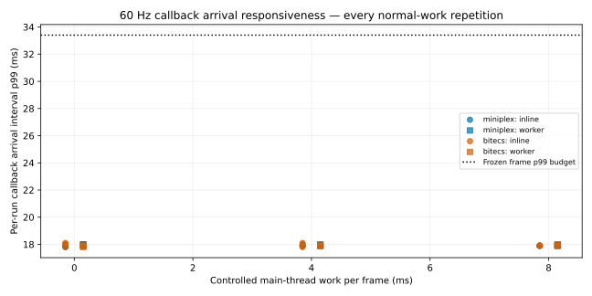
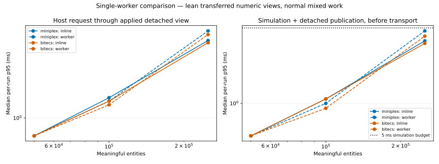

# Lean simulation-worker publication — 30 October 2026

**Retain Miniplex 2.0.0 and proceed with the lean single-worker contract as the production integration direction. Both Miniplex and bitECS now qualify in the standalone browser laboratory.** The rich-record transport blocker is resolved for this explicitly smaller presentation contract. Production worker/ECS integration, real scene qualification and multi-worker ECS remain unimplemented.

The new contract sends fixed numeric presentation rows in transferred buffers, with bounded on-demand inventory/selection details. It preserves the complete authoritative fixture, double precision, native systems, command ordering and full capture/rebuild. It changes what presentation routinely receives. The [29 October rich-record report](../2026-10-29/README.md) remains historical evidence; its samples are not pooled with this cohort.

## Qualification at 100,000 entities

Values are the **median of five independent per-run percentiles**, in milliseconds, for the normal world with 12,000 active processors. Each run contains 2,000 measured fixed steps after the original disposable-world warm-up. Publication includes constructing numeric rows and subscribed detached details; subsequent native posting/receipt is measured separately.

| Candidate | Execution | Simulation/publication p95 | p99 | Observed receipt p95 | p99 | Host round trip p95 | p99 |
| --- | --- | ---: | ---: | ---: | ---: | ---: | ---: |
| Miniplex | Inline | 1.1 | 1.7 | 0.4 | 0.5 | 1.5 | 2.1 |
| Miniplex | Worker | **1.0** | **1.5** | **0.4** | **0.5** | **1.4** | **2.0** |
| bitECS | Inline | 1.1 | 1.6 | 0.4 | 0.5 | 1.4 | 2.1 |
| bitECS | Worker | **0.9** | **1.3** | **0.4** | **0.5** | **1.3** | **1.8** |

| Required gate | Unchanged budget | Miniplex worker | bitECS worker |
| --- | --- | --- | --- |
| Correctness, full-state equivalence and restored continuation | All pass | Pass | Pass |
| Simulation plus publication | p95 ≤5 / p99 ≤8 ms | Pass | Pass |
| Observed receiving work | p95 ≤2 / p99 ≤4 ms | Pass | Pass |
| Normal callback gaps, every pressure/repetition | p95 ≤18.5 / p99 ≤33.4 ms | Pass | Pass |
| Sampled input to presentation, every pressure/repetition | p95 ≤100 / p99 ≤150 ms | Pass | Pass |
| Overall | Every required gate | **Qualifies** | **Qualifies** |

All 20 normal target captures have the same normalized state hash, `bcf235c63a93cc84cbb71674c9787db303e403074bb631df3662e2dbd38f9ff6`, matching the prior rich cohort. Each completes 1,047,363 synthetic operations after its separate first tick and 2,000 measured steps. Dirty-record counts are asserted every single-step trial. Full captures retain all inventories, ownership links, buffers, reservations, held output, charge and resource counters; reducing presentation does not remove simulation work.

All five target worker repetitions are published below. Complete metrics, maxima, distributions and inline repetitions are in [summary.json](summary.json), [summary.csv](summary.csv) and [facts.json](facts.json); raw samples remain in the ignored run directory.

| Candidate / metric | Run 1 | Run 2 | Run 3 | Run 4 | Run 5 | Median |
| --- | ---: | ---: | ---: | ---: | ---: | ---: |
| Miniplex compute/publication p95 | 1.0 | 0.9 | 1.0 | 0.9 | 1.0 | 1.0 |
| Miniplex compute/publication p99 | 1.5 | 1.5 | 1.4 | 1.5 | 1.5 | 1.5 |
| Miniplex receipt p95 | 0.4 | 0.4 | 0.4 | 0.3 | 0.4 | 0.4 |
| Miniplex round trip p95 | 1.4 | 1.3 | 1.4 | 1.3 | 1.5 | 1.4 |
| bitECS compute/publication p95 | 0.9 | 0.9 | 1.0 | 0.9 | 0.9 | 0.9 |
| bitECS compute/publication p99 | 1.1 | 1.2 | 1.3 | 1.3 | 1.3 | 1.3 |
| bitECS receipt p95 | 0.3 | 0.4 | 0.4 | 0.4 | 0.4 | 0.4 |
| bitECS round trip p95 | 1.2 | 1.3 | 1.4 | 1.3 | 1.3 | 1.3 |

## What changed and why it helps

The publisher visits the existing dirty set directly, avoiding an intermediate rich detached graph. Each row contains ordinal/generation identity, kind, position, status, work, charge, quantity, reservations, held output and publication tick in **12 Float64 fields: 96 bytes**. Removals use numeric identity pairs. Newly allocated presentation buffers are transferred; no authoritative component store is transferred or shared. The host applies them to its own typed cache. Generation/revision guards, base versions, duplicate handling and explicit full resynchronization remain.

Nested inventory, item/buffer, recipe and ownership details are available through a completed-boundary subscription request. Up to 16 unique IDs may be watched; qualification watches the player inventory and one processor. Dirty watched entities publish fresh detached details on the next frame. Replaced identities invalidate details and stale subscriptions cannot resolve to recycled entities. Unwatched details must be fetched before displaying them. The cap bounds simultaneous inspectors, not authoritative inventory owners. A different actual UI/subscription load requires qualification.

This uses fixed rows rather than field-level diffs. There is no culling, compression, buffer pool, SharedArrayBuffer, Atomics, numeric quantization or parallel ECS implementation. The fixture-specific identity encoding must be adapted to actual production game-owned IDs. Both libraries use the same publisher and cache.

| Publication | Entity rows | Exact buffer bytes | JSON estimate of envelope/details |
| --- | ---: | ---: | ---: |
| Initial full view | 100,000 | 9,600,000 | 1,052 |
| First normal tick | 12,301 | 1,180,896 | 1,051 |
| 0% dirty | 0 | 0 | 112 |
| 1% dirty | 1,000 | 96,000 | 1,050 |
| 10% dirty | 10,000 | 960,000 | 1,051 |
| 100% dirty | 100,000 | 9,600,000 | 1,052 |

All configurations produce the same payload measurements. Primary normal ticks average 1,180,895.04 buffer bytes and two detail records. The old first-tick rich view was about 4.55 MiB as JSON, versus about 1.13 MiB of numeric buffers plus roughly 1 KiB of envelope/details here. These are different measurement types; actual browser message overhead is unavailable. The key improvement is avoiding reconstruction of thousands of nested object graphs, beyond merely reducing their estimated byte count.

Native worker posting falls from roughly 25 ms p95 to about **0.1 ms**, near timer resolution. Observed receipt falls from about 33 ms to 0.4 ms. Normal worker system p95 is about 0.3 ms and publication about 0.7 ms for both candidates. Phase percentiles cannot be added to reconstruct a combined percentile; the table above measures the combined duration directly.

## Responsiveness and inline comparison

The table gives median per-run percentiles over three 30-second runs. Qualification checks **every run**, including every pressure. All 36 normal runs maintain 599 completed ticks and record zero long tasks. Queue depth remains one. End-of-window pending probes remain published in the raw samples and [facts](facts.json); they are not silently counted as presented.

| Worker | Host work/callback | Callback p95 | p99 | Input-to-presentation p95 | p99 |
| --- | ---: | ---: | ---: | ---: | ---: |
| Miniplex | 0 ms | 17.6 | 18.0 | 50.4 | 50.9 |
| Miniplex | 4 ms | 17.6 | 17.9 | 50.5 | 51.4 |
| Miniplex | 8 ms | 17.6 | 17.9 | 50.6 | 51.2 |
| bitECS | 0 ms | 17.6 | 17.9 | 50.7 | 51.2 |
| bitECS | 4 ms | 17.6 | 17.9 | 50.7 | 51.2 |
| bitECS | 8 ms | 17.6 | 17.9 | 50.5 | 51.3 |

The worst normal worker per-run callback p95 is 17.7 ms and p99 18.0 ms; worst sampled input p95 is 51.1 ms and p99 67.5 ms. Both workers now resemble their qualifying inline controls rather than the rich bridge's roughly 40 ms p95 callback gaps. Separate idle/fully-active worker diagnostics at 8 ms pressure also maintain 599 ticks in every run, with callback p95 17.6 ms. They do not replace paired active inline tests or a real scene comparison.



The worker is **not demonstrated to improve total throughput over inline**. Median unpaced normal throughput is about 1,053 ticks/s inline versus 940 in a Miniplex worker; bitECS is about 1,051 versus 959. Both comfortably sustain the required paced 20 Hz. The reason to retain the architecture is concurrent rendering/input and isolated simulation ownership, with messaging overhead now small. Actual integrated Babylon responsiveness still needs testing.

The attempted 120 Hz timer diagnostics observe about 1,939–1,944 callbacks in 30 seconds, roughly 65 Hz. They do not demonstrate 120 Hz execution or physical display qualification. Preserve 60 Hz as the required target. Sampled input-to-presentation is an acknowledgement/callback proxy, not physical input-to-photon delay. Interpolation remains first; local prediction remains deferred.

## Stress, capture and lifecycle

All **120/120 primary trials complete 2,000 steps**, with zero timeouts. The previous rich workers timed out at 250,000 normal and 100,000 fully active entities. New stress limits remain explicit:

| Worker case | Miniplex compute p95/p99 | bitECS compute p95/p99 | Miniplex round trip p95 | bitECS round trip p95 |
| --- | ---: | ---: | ---: | ---: |
| Normal 50,000 | 0.5 / 0.7 | 0.5 / 0.6 | 0.7 | 0.7 |
| Normal 100,000 | 1.0 / 1.5 | 0.9 / 1.3 | 1.4 | 1.3 |
| Normal 250,000 | 4.7 / 5.5 | 4.2 / 4.9 | 5.7 | 5.3 |
| Mostly idle 100,000 | 0.2 / 0.2 | 0.2 / 0.3 | 0.3 | 0.3 |
| Fully active 100,000 | **7.9 / 8.6** | **6.1 / 6.9** | 9.3 | 7.7 |
| Churn 100,000 | 3.5 / 5.3 | 2.9 / 3.9 | 4.5 | 4.9 |

The fully active workload exceeds the normal target's 5 ms p95 compute budget for both candidates; Miniplex also exceeds its 8 ms p99. The agreed qualification workload remains 20% active processors. Do not extend its pass to every activity ratio or target device. No budget was relaxed.



Five-run median warmed-worker initialization is 112.7/79.8 ms and disposal 32.0/4.1 ms for Miniplex/bitECS. Separate single-run captures remain rich: about 39.63 MB of JSON, 825/834 ms worker capture round trips, 57.5/56.3 ms encoding, 89.4/85.3 ms decoding, and 941.5/901.3 ms rebuild plus initial-view application. Lean routine publication does not make full capture an inexpensive interactive operation and does not implement gameplay saving. The common laboratory host bundle still includes both APIs; startup does not isolate bare-library import cost or an optimized production host bundle.

## Memory and retention

Separate instrumented diagnostics retain the full 10,000-tick churn soak and 20 create/capture/rebuild/dispose cycles for every configuration. Values sum reported JS heap plus backing storage across page/worker contexts, in MiB. They exclude browser RSS/native IPC buffers and are not peak RAM.

| Candidate | Execution | Populated | After soak | Rebuilt, capture held | Rebuilt, capture released | World disposed | After termination/cycles |
| --- | --- | ---: | ---: | ---: | ---: | ---: | ---: |
| Miniplex | Inline | 60.09 | 49.81 | 108.61 | 61.81 | 1.65 | 1.68 |
| Miniplex | Worker | 60.51 | **50.32** | 109.01 | 62.20 | 2.16 | 1.53 |
| bitECS | Inline | 70.43 | 60.23 | 122.14 | 71.90 | 1.67 | 1.73 |
| bitECS | Worker | 71.02 | **60.73** | 119.14 | 72.33 | 2.19 | 1.53 |

Compared with rich worker post-soak totals of 87.73/98.14 MiB, the lean workers retain about **37.4 MiB less** each. The extra execution context adds about 0.5 MiB relative to each lean inline control in this diagnostic. The populated checkpoint holds an initial full packet as well as the cache; steady checkpoints release packet references. Rebuilt worlds have higher live retained totals after capture release; detailed attribution of that live representation difference was not measured. It is not cumulative lifecycle growth: every disposed cycle returns to its small baseline.

[Heap evidence](heap-evidence.json) finds zero concrete synthetic payloads in all **ten** post-disposal snapshots. All six live controls are consistent with the contract: inline/worker authority contains 100,000 payloads, worker main contexts contain none after churn invalidates the two watched identities, and main caches have a 9,600,000-byte backing node. That backing node disappears after disposal; disposed snapshots have no nodes over 1 MiB. All 20 cycles per configuration leave zero worker targets. Soak retained totals change by less than 0.1 MiB between tick 500 and 10,000. This is finite evidence against persistent retention in the tested protocol, not a universal leak-free guarantee.

Sampled allocation volume is about 16.2 GiB inline versus 16.8 GiB across contexts for Miniplex, and 12.6 versus 13.2 GiB for bitECS. Rich workers sampled about 177.6/179.5 GiB. Sampling is an allocation estimate rather than retained/peak memory or an exact count of all native buffer traffic. [CPU/allocation/GC evidence](profiles.json) preserves both-context attribution. Profiling and forced diagnostic collections never contribute to timing rankings.

## Recommendation and integration boundary

Miniplex remains preferred among the now qualifying configurations. The [five-criterion assessment](../2026-10-29/maintainability.json) remains **9/10 for Miniplex, 6/10 for bitECS**: native adapter code, schemas, domain reuse, indexed-store assertions, lifecycle/capacity obligations and package risks are unchanged. Numeric publication/subscription infrastructure is common to both and earns neither a special advantage. Miniplex retains simpler typed ordinary records and capture/mutation integration, with lower retained memory. bitECS is slightly faster in several stress cases and disposal, and its future shared-numeric path remains more direct. That speculative path does not outweigh current maintainability or justify multi-worker implementation now.

Retain host frame-driven credits, one authoritative worker/world, interpolation and explicit pause/failure/disposal. The [updated handoff](handoff.md) adds actual ID encoding, asynchronous inspection subscriptions, typed-cache consumers and integrated scene qualification to the prior migration order. The laboratory cap/field list is not a finalized production UI contract. Production simulation, Angular/Babylon runtime and authored assets are unchanged. Remaining Milestone 3 foundation/gameplay checkboxes remain open.

## Reproduction and run cost

Use Node **24.21.0**, pinned Yarn **4.18.1**, Miniplex **2.0.0**, bitECS **0.4.0**, Playwright **1.64.1** and its Chromium **156.0.8078.4 / V8 15.6.75**, seed 1729. Reference desktop: Ryzen 9 7900X3D, 24 logical CPUs, about 63.6 GiB RAM, Windows 10.0.26300 x64. Exact packages, Node/V8, launch flags, source hashes and raw samples are retained in `tmp/simulation-worker-bench/2026-10-30-lean-qualification-01/`.

```text
yarn install --immutable
yarn bench:worker:check --presentation lean
yarn bench:worker:smoke --presentation lean --paced --profiles
yarn bench:worker:browser --presentation lean --phase lean --output tmp/simulation-worker-bench/<run>
yarn bench:worker:report --input tmp/simulation-worker-bench/<run> --destination docs/reports/simulation-worker/<date>
```

The focused qualification takes **54 minutes 25 seconds** for 188 jobs, excluding development calibration, offline evidence analysis and repository checks. It preserves the primary scales, five repetitions, original warm-up, 2,000 steps, all normal pacing gates and memory duration. It saves time by omitting superseded JSON/batch/alternate-clock trials and narrowing idle/active pacing to worker diagnostics at 8 ms. No benchmark/build/test runs concurrently with a ranking trial. This focused mode is also available in the manual workflow; hosted timings remain separate. Normal CI adds lean smoke/pacing alongside rich smoke. No hosted workflow was dispatched.

[Source verification](source-verification.json) confirms all **58** measured source/package/lock files still match the recorded fingerprint `62ad22e6f3311e71e83b727b73a9b66c99801bf89ad3f65e74d91b361a8b2b16`. The manifest records the base revision and dirty snapshot; this report's accompanying source is the measured snapshot. Development calibration and the two initial sandbox/cache/loopback setup failures are excluded from qualification. See [methodology](methodology.md) for the complete matrix, correctness changes, timing definitions and limits.

## Verification and saved evidence

All 16 repository validation steps pass: immutable installation, lint and lint tests, scene export tests, world/simulation tests, all ECS checks/smoke workloads, 284 application tests, rich and lean worker smoke, production build/input audit, built assets, development reload/export recovery, Angular packaging and documentation checks. Worker checks include strict TypeScript and eight pure protocol/presentation tests. An additional [independent wire-schema check](schema-checks.json), run after measurement in fresh Node processes, asserts literal column order, all four kinds, asymmetric fractional values/coordinates, identity and next-tick details against all three native/reference publishers without reusing the encoder to construct expectations. Reproduce it with `node --experimental-transform-types docs/reports/simulation-worker/2026-10-30/schema-check.mjs`. The lean smoke also exercises both host-credit and worker-clock pacing on small worlds. The [Angular probe](packaging.json) verifies all four candidate/presentation combinations under the production builder, deployed `/lab/` base and same-origin CSP, with zero browser errors and zero axe violations. The normal production audit checks 3,950 inputs with no candidate or investigation code. These successes do not replace real-game worker integration tests.

Reproduction artifacts:

- [Exact environment, flags, manifest and completion](environment.json), [raw artifact hashes](raw-artifacts.json), [validation results](validation-checks.json).
- [All correctness configurations](correctness.json), [independent completed-operation checks](completed-work-checks.json), [cross-configuration state equivalence](state-equivalence.json).
- [All per-run primary statistics](trials.json), [primary CSV](trials.csv), [paced CSV](paced.csv), [aggregate summary](summary.json), [derived narrative facts](facts.json).
- [Both-context CPU/allocation/GC summaries](profiles.json), [retained-object/backing-storage evidence](heap-evidence.json), and [production handoff](handoff.md).

The saved profiles, heap snapshots, traces and raw tick samples remain ignored in the run directory. To regenerate the compact evidence, run `publish.mjs`, `profile-evidence.mjs`, `heap-evidence.py` and `verify-source.mjs` from the adjacent 29 October report directory with this run/destination, then this directory's `analyze.mjs`. They analyze saved evidence only and must run after measurement. The plotting script produces the matching SVG/PNG figures. No production source, artwork, authored scene or runtime files were changed by the laboratory or its validation.
